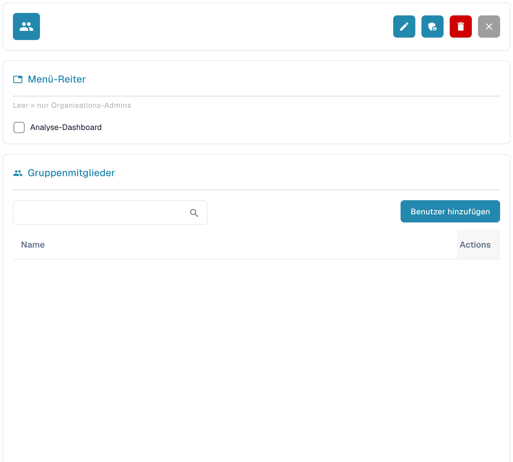

# Gruppen und Berechtigungen


DocBits Groups & Permissions Tutorial: Set User Roles, Access Rights & Secure Your Workspace


<figure><figcaption>
Details einer ausgewählten Gruppe in der deutschen Oberfläche. Namen und Beschreibungen sind ausgeblendet.
</figcaption></figure>

Mit Gruppen und Berechtigungen steuern Sie, welche Benutzer auf bestimmte Dokumenttypen zugreifen und welche Aktionen sie ausführen dürfen.

## Gruppen und Berechtigungen aktivieren/deaktivieren

Verwenden Sie den Schalter oben auf der Seite, um das System für Gruppen und Berechtigungen ein- oder auszuschalten. Wenn es deaktiviert ist, verwendet das System ein einfacheres Zugriffsmodell ohne gruppenbasierte Einschränkungen.

## Gruppenliste

Links sehen Sie die konfigurierten Gruppen. Verwenden Sie **Gruppe suchen**, um eine Gruppe nach ihrem Namen zu finden. Mit **+ Neu** öffnen Sie das Formular für eine neue Gruppe. Wenn Sie eine Gruppe auswählen, erscheinen rechts ihre Details, die Gruppenmitglieder und die verfügbaren Aktionen.

## Gruppenberechtigungen konfigurieren

Wählen Sie eine Gruppe links aus und öffnen Sie in ihren Details die Zugriffskontrolle über das Schildsymbol. Dort können Sie den Zugriff pro Dokumenttyp konfigurieren:

| Berechtigung | Beschreibung |
|------------|-------------|
| **View** | Berechtigung, Dokumente dieses Typs zu sehen. |
| **Update** | Berechtigung, Dokumente dieses Typs zu ändern. |
| **Delete** | Berechtigung, Dokumente dieses Typs zu entfernen. |
| **First Approval** | Berechtigung, die erste Genehmigung durchzuführen. |
| **Second Approval** | Berechtigung, eine zweite Genehmigungsstufe durchzuführen (falls zutreffend). |

Jede Zeile der Berechtigungstabelle steht für einen Dokumenttyp (z. B. Rechnung, Gutschrift, Lieferschein). Aktivieren oder deaktivieren Sie die Kontrollkästchen, um der Gruppe Berechtigungen zu erteilen oder zu entziehen.

## Eine neue Gruppe erstellen

1. Klicken Sie in der Gruppenliste auf **+ Neu**.
2. Geben Sie einen **Gruppennamen** und optional eine **Beschreibung** ein.
3. Konfigurieren Sie die Berechtigungen für jeden Dokumenttyp.
4. Weisen Sie der Gruppe Benutzer zu.
5. Klicken Sie auf **Speichern**, um die Änderungen zu übernehmen.
