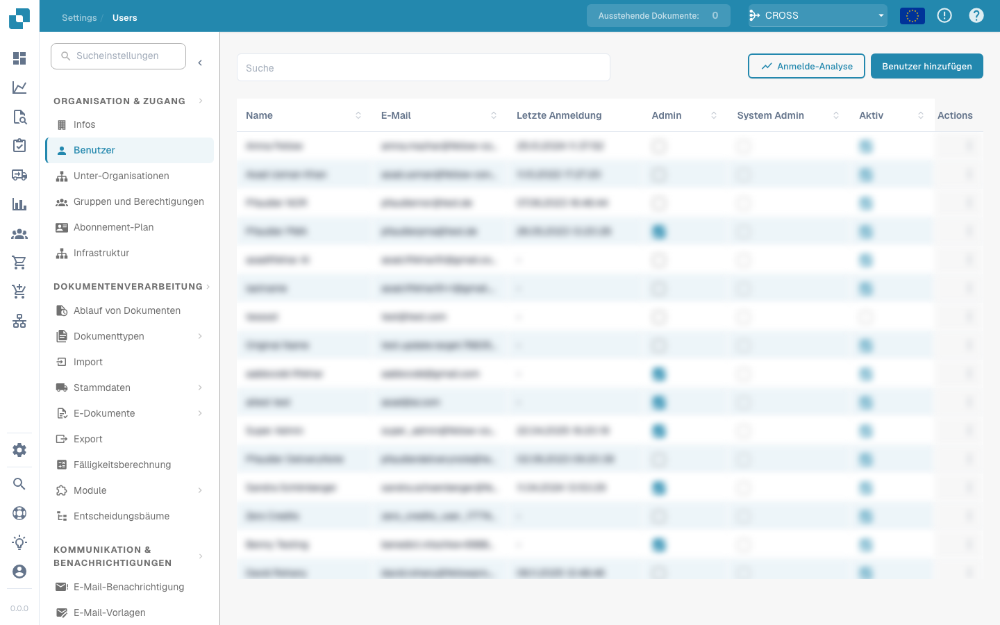

# Gruppen und Berechtigungen


DocBits Groups & Permissions Tutorial: Set User Roles, Access Rights & Secure Your Workspace


<figure><figcaption></figcaption></figure>

**Komponenten des Abschnitts Gruppen und Berechtigungen**

**Gruppen und Berechtigungen aktivieren/deaktivieren:** Ein Schalter, der es dem Systemadministrator ermöglicht, die Nutzung von Gruppen und Berechtigungen über die Plattform zu aktivieren oder zu deaktivieren. Wenn dieser deaktiviert ist, kann das System standardmäßig auf ein weniger granulareres Zugriffssteuerungsmodell zurückgreifen.

**Gruppenliste:** Zeigt die Liste der verfügbaren Benutzergruppen innerhalb der Organisation. Jede Gruppe kann mit spezifischen Berechtigungen konfiguriert werden. Administratoren können neue Gruppen erstellen, indem sie auf die Schaltfläche „+ Neu“ klicken.

**Berechtigungstabelle:**

* Wird angezeigt, sobald eine Gruppe ausgewählt oder eine neue Gruppe konfiguriert wird.
* Listet alle vom System erkannten Dokumenttypen auf (z. B. RECHNUNG, GUTSCHRIFT, LIEFERSCHEIN).
* Für jeden Dokumenttyp gibt es Kontrollkästchen für verschiedene Berechtigungen:
  * **Ansehen:** Berechtigung, das Dokument zu sehen.
  * **Aktualisieren:** Berechtigung, das Dokument zu ändern.
  * **Löschen:** Berechtigung, das Dokument aus dem System zu entfernen.
  * **Erste Genehmigung:** Berechtigung, die erste Genehmigung des Dokuments durchzuführen.
  * **Zweite Genehmigung:** Berechtigung, eine sekundäre Genehmigung (falls zutreffend) durchzuführen.

<figure><figcaption></figcaption></figure>
