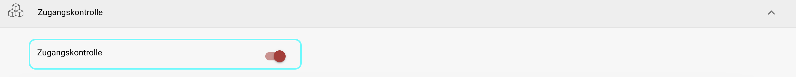
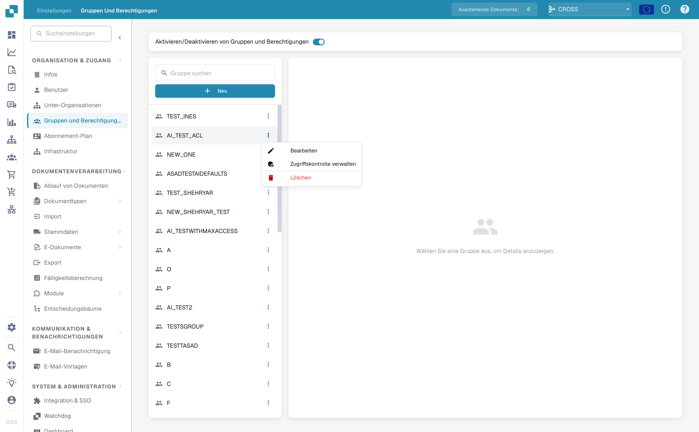
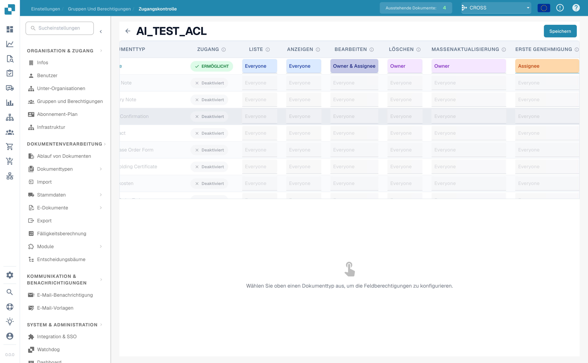
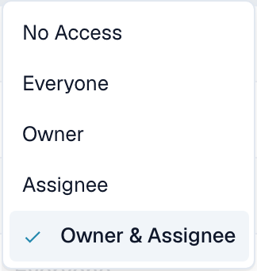
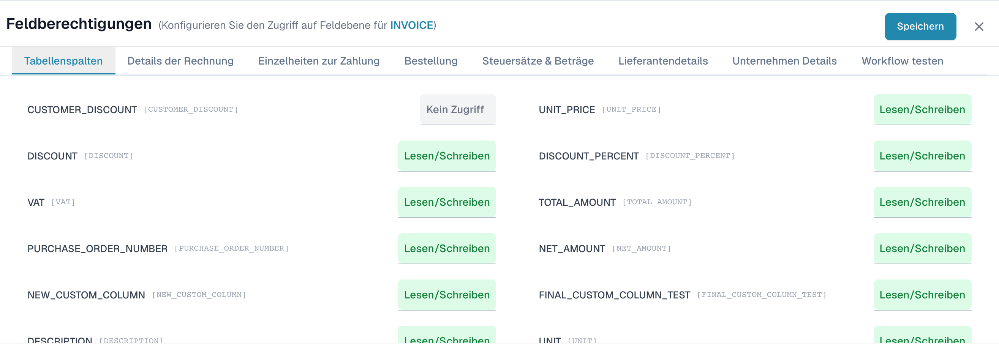

# Zugangskontrolle

## Übersicht

Die Zugriffskontrolle legt für eine einzelne **Gruppe** (Rolle) genau fest, was deren Mitglieder tun dürfen — sowohl auf **Dokumenttyp-Ebene** (welche Dokumenttypen sie sehen und welche Aktionen sie ausführen dürfen) als auch auf **Feldebene** (welche einzelnen Felder sie lesen oder bearbeiten dürfen).

Berechtigungen werden immer **pro Gruppe** ausgewertet. Ein Benutzer erbt die Berechtigungen jeder Gruppe, der er angehört.


Die Zugriffskontrolle greift nur, wenn das System **Gruppen & Berechtigungen** eingeschaltet ist (siehe [Berechtigungen aktivieren](activating-permissions.md)). **Administratoren umgehen die Zugriffskontrolle immer** und können unabhängig von den Einstellungen auf dieser Seite alles sehen und tun.


Jede Gruppe kann konfiguriert werden für:

* **Dokumentzugriff** — ob die Gruppe einen Dokumenttyp überhaupt nutzen darf.
* **Aktionsberechtigungen** — welche Aktionen (auflisten, anzeigen, bearbeiten, löschen, massenaktualisieren, genehmigen) die Gruppe ausführen darf und _für welche Dokumente_.
* **Feldberechtigungen** — ob jedes einzelne Feld eines Dokumenttyps bearbeitbar, schreibgeschützt oder ausgeblendet ist.

## Aktivierung

1. Navigieren Sie zu **Einstellungen**.
2. Wählen Sie **Dokumentenverarbeitung**.
3. Wählen Sie **Module.**
4. Aktivieren Sie die **Zugriffskontrolle**, indem Sie den Schieberegler aktivieren.

<figure><figcaption></figcaption></figure>

## Zugriffskontrolle einer Gruppe öffnen

1. Navigieren Sie zu **Einstellungen**.
2. Gehen Sie zu **Globale Einstellungen**.
3. Wählen Sie **Gruppen, Benutzer und Berechtigungen**.
4. Wählen Sie **Gruppen und Berechtigungen**.
5. Um die Berechtigungen einer Gruppe (z. B. PROCUREMENT\_DIRECTOR) zu verwalten, klicken Sie auf die drei Punkte auf der rechten Seite.
6. Wählen Sie **Zugriffskontrolle verwalten**.

<figure><figcaption>
Öffnen Sie auf der Seite „Gruppen und Berechtigungen" das <strong>⋮</strong>-Menü einer Gruppe und wählen Sie <strong>Zugriffskontrolle verwalten</strong>.
</figcaption></figure>

## Wie eine Berechtigung ausgewertet wird

Wenn ein Benutzer etwas mit einem Dokument tun möchte, prüft DocBits der Reihe nach:

1. **Ist das System Gruppen & Berechtigungen eingeschaltet und der Benutzer kein Administrator?** Wenn aus oder der Benutzer ist Administrator → voller Zugriff.
2. **Ist der Dokumenttyp für eine der Gruppen des Benutzers aktiviert?** Wenn deaktiviert → der Benutzer kann diesen Dokumenttyp nicht sehen oder nutzen.
3. **Welcher Zugriffsbereich ist für die Aktion gesetzt?** (z. B. _Bearbeiten = Owner_). Der Bereich wird mit der Beziehung des Benutzers zu _diesem konkreten Dokument_ abgeglichen — ist er Eigentümer, Zugewiesener, beides oder keines?
4. **Welche Feldberechtigung gilt?** Selbst wenn ein Benutzer ein Dokument öffnen darf, können einzelne Felder weiterhin ausgeblendet oder gesperrt sein.

## Dokumenttyp-Berechtigungen

Jede Zeile der Matrix ist ein Dokumenttyp (Invoice, Credit Note, Purchase Order, …).

Die erste Spalte ist ein Schalter **Aktiviert / Deaktiviert**. Deaktivieren Sie ihn, kann die Gruppe diesen Dokumenttyp gar nicht nutzen — er verschwindet aus ihrem Dashboard. Aktivieren Sie ihn, werden die sieben Aktionsspalten bearbeitbar.

| Aktion                   | Bestimmt, ob die Gruppe …                           |
| ------------------------ | --------------------------------------------------- |
| **Liste**                | den Dokumenttyp in der Dashboard-Liste sehen darf.  |
| **Anzeigen**             | ein Dokument öffnen und seine Details ansehen darf. |
| **Bearbeiten**           | Feldwerte eines Dokuments ändern darf.              |
| **Löschen**              | ein Dokument löschen darf.                          |
| **Massenaktualisierung** | mehrere Dokumente auf einmal aktualisieren darf.    |
| **Erste Genehmigung**    | die Genehmigung der ersten Stufe erteilen darf.     |
| **Zweite Genehmigung**   | die Genehmigung der zweiten Stufe erteilen darf.    |

### Zugriffsbereiche

Jede Aktionsspalte ist ein Dropdown. Der gewählte Wert beantwortet die Frage _„für welche Dokumente darf die Gruppe das tun?"_. Die Bereichsnamen erscheinen in der Oberfläche auf Englisch:

| Bereich              | Wer ist erlaubt                                                          | Wirkung auf ein Dokument                                                                                |
| -------------------- | ------------------------------------------------------------------------ | ------------------------------------------------------------------------------------------------------- |
| **No Access**        | Niemand in der Gruppe.                                                   | Die Aktion ist für alle in der Gruppe gesperrt — die Schaltfläche ist ausgeblendet oder deaktiviert.    |
| **Everyone**         | Jedes Mitglied der Gruppe.                                               | Jedes Gruppenmitglied kann die Aktion bei **jedem** Dokument dieses Typs ausführen.                     |
| **Owner**            | Nur der Benutzer, der das Dokument **erstellt / hochgeladen** hat.       | Die Aktion funktioniert nur bei Dokumenten, die der Benutzer selbst hochgeladen hat.                    |
| **Assignee**         | Nur der Benutzer (oder die Gruppe), dem das Dokument **zugewiesen** ist. | Die Aktion funktioniert nur bei Dokumenten, die dem Benutzer oder einer seiner Gruppen zugewiesen sind. |
| **Owner & Assignee** | Der Eigentümer **oder** der Zugewiesene.                                 | Die Aktion funktioniert, wenn der Benutzer _entweder_ der Hochladende _oder_ der Zugewiesene ist.       |


**Owner** und **Assignee** hängen von der _Beziehung zwischen dem Benutzer und jedem einzelnen Dokument_ ab. Zwei Mitglieder derselben Gruppe können daher beim selben Beleg unterschiedliche Rechte haben — siehe das durchgespielte Beispiel unten.


<figure><figcaption>
Die Dokumenttyp-Berechtigungsmatrix. Hier ist der Typ <strong>Invoice</strong> aktiviert und seine Aktionen sind auf verschiedene Zugriffsbereiche gesetzt; die übrigen Typen sind deaktiviert.
</figcaption></figure>

<figure><figcaption>
Jede Aktionsspalte bietet dieselben fünf Zugriffsbereiche.
</figcaption></figure>

### Genehmigung erfordert auch Bearbeiten

Das Genehmigen eines Dokuments löst im Hintergrund **zwei Aktionen** aus: DocBits **speichert** zuerst das Dokument und setzt es dann auf den genehmigten Status. Der Speicherschritt benötigt die Berechtigung **Bearbeiten** — die beiden Berechtigungen sind also verknüpft.

Ein Benutzer, der nur **Erste Genehmigung** oder **Zweite Genehmigung** erhält — aber _nicht_ **Bearbeiten** —, läuft beim Speicherschritt in einen Berechtigungsfehler und kann das Dokument nicht genehmigen.


Wann immer Sie **Erste Genehmigung** oder **Zweite Genehmigung** vergeben, vergeben Sie auch **Bearbeiten** (und **Anzeigen**) für denselben Dokumenttyp. Eine Genehmigungsberechtigung allein reicht nicht aus.


## Feldberechtigungen

Klicken Sie auf eine Dokumenttyp-Zeile, um darunter das Panel **Feldberechtigungen** zu öffnen. Felder sind in Reiter gegliedert (z. B. _Tabellenspalten_, _Details der Rechnung_, _Einzelheiten zur Zahlung_, _Steuersätze & Beträge_). Jedes Feld hat seine eigene Zugriffsstufe:

| Stufe               | Wirkung auf das Feld                                                                                  |
| ------------------- | ----------------------------------------------------------------------------------------------------- |
| **Lesen/Schreiben** | Das Feld ist sichtbar **und** bearbeitbar.                                                            |
| **Nur Lesen**       | Das Feld ist sichtbar, kann aber **nicht bearbeitet** werden (ausgegraut).                            |
| **Genehmigung**     | Das Feld kann bearbeitet werden, die Änderung durchläuft aber zuerst einen **Genehmigungs-Workflow**. |
| **Kein Zugriff**    | Das Feld ist **vollständig ausgeblendet** — der Benutzer sieht es nie.                                |


Feldregeln gelten für **alle** Mitglieder der Gruppe gleichermaßen — sie hängen nicht von Eigentümer/Zugewiesenem ab. Nutzen Sie sie, um sensible Felder (z. B. einen Rabatt oder einen Gesamtbetrag) für eine ganze Gruppe auszublenden oder zu sperren.


<figure><figcaption>
Das Panel „Feldberechtigungen" für den Typ Invoice. <code>CUSTOMER_DISCOUNT</code> ist ausgeblendet (Kein Zugriff), während die übrigen Felder auf Lesen/Schreiben stehen.
</figcaption></figure>

## Durchgespieltes Beispiel: Was die Zugriffskontrolle bei einem echten Beleg bewirkt

Angenommen, Sie erstellen eine Gruppe **AP\_CLERK** für Ihre Kreditorenbuchhalter und konfigurieren den Dokumenttyp **Invoice** wie folgt:

**Dokumenttyp-Berechtigungen für Invoice**

| Aktion               | Bereich          |
| -------------------- | ---------------- |
| Aktiviert            | ✅ An             |
| Liste                | Everyone         |
| Anzeigen             | Everyone         |
| Bearbeiten           | Owner & Assignee |
| Löschen              | No Access        |
| Massenaktualisierung | No Access        |
| Erste Genehmigung    | Assignee         |
| Zweite Genehmigung   | No Access        |

**Feldberechtigungen für Invoice**

| Feld                    | Stufe           |
| ----------------------- | --------------- |
| `TOTAL_AMOUNT`          | Nur Lesen       |
| `CUSTOMER_DISCOUNT`     | Kein Zugriff    |
| _(alle anderen Felder)_ | Lesen/Schreiben |

Verfolgen Sie nun ein konkretes Dokument — den Beleg **INV-4711**, den **Maria hochgeladen** hat und der **Maria zugewiesen** ist. Sowohl Maria als auch ihr Kollege Tom sind in der Gruppe **AP\_CLERK**.

**Maria (Eigentümerin&#x20;**_**und**_**&#x20;Zugewiesene von INV-4711):**

* ✅ Sieht INV-4711 in der Dashboard-Liste _(Liste = Everyone)_.
* ✅ Öffnet ihn _(Anzeigen = Everyone)_.
* ✅ Bearbeitet Lieferantennamen und Positionen _(Bearbeiten = Owner & Assignee — sie ist die Eigentümerin)_.
* 🔒 Sieht `TOTAL_AMOUNT`, das Feld ist aber ausgegraut und nicht änderbar _(Nur Lesen)_.
* 🚫 Sieht das Feld `CUSTOMER_DISCOUNT` gar nicht _(Kein Zugriff)_.
* 🚫 Die Schaltfläche **Löschen** ist ausgeblendet _(Löschen = No Access — niemand in der Gruppe darf löschen)_.
* ✅ Kann die **erste Genehmigung** erteilen _(Erste Genehmigung = Assignee — sie ist die Zugewiesene)_.

**Tom (gleiche Gruppe, hat INV-4711 aber&#x20;**_**nicht**_**&#x20;hochgeladen und er ist ihm&#x20;**_**nicht**_**&#x20;zugewiesen):**

* ✅ Sieht ihn in der Liste und ✅ öffnet ihn _(Liste & Anzeigen = Everyone)_.
* 🚫 Kann nichts bearbeiten — das Dokument öffnet **schreibgeschützt** _(Bearbeiten = Owner & Assignee — Tom ist keines von beiden)_.
* 🔒 / 🚫 Sieht genau dieselbe Feldsichtbarkeit wie Maria: `TOTAL_AMOUNT` gesperrt, `CUSTOMER_DISCOUNT` ausgeblendet _(Feldregeln gelten für die ganze Gruppe)_.
* 🚫 Kann die erste Genehmigung nicht erteilen _(Erste Genehmigung = Assignee — nicht Tom)_.
* 🚫 Kann nicht löschen _(No Access)_.

**Was dieses Beispiel zeigt**

* **Everyone** öffnet ein Dokument für alle Gruppenmitglieder; **Owner / Assignee** schränkt eine Aktion auf die Personen ein, die mit dem konkreten Dokument verbunden sind.
* **No Access** entfernt eine Aktion (Löschen) oder blendet ein Feld (`CUSTOMER_DISCOUNT`) für die gesamte Gruppe aus.
* **Nur Lesen** hält ein Feld sichtbar zur Referenz (`TOTAL_AMOUNT`), verhindert aber Änderungen.
* Zwei Personen in **derselben Gruppe** können beim **selben Beleg unterschiedliche Rechte** haben — allein deshalb, wer ihn hochgeladen hat und wem er zugewiesen ist.
