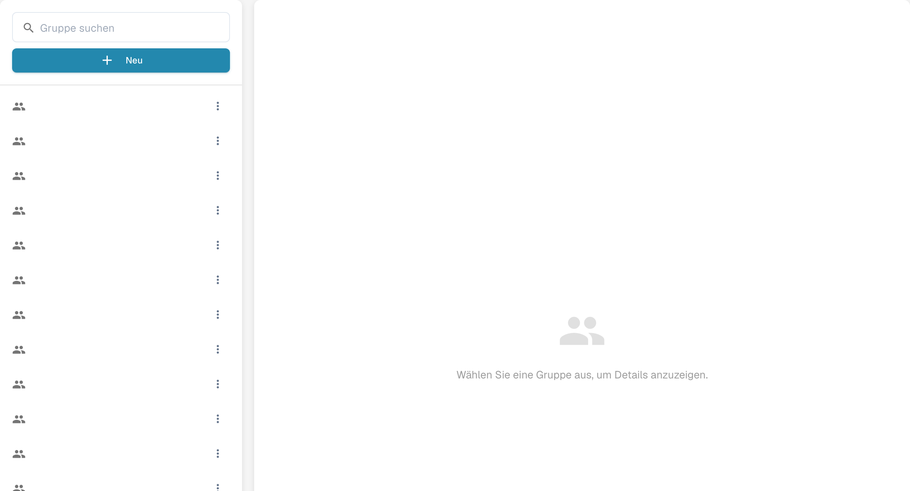
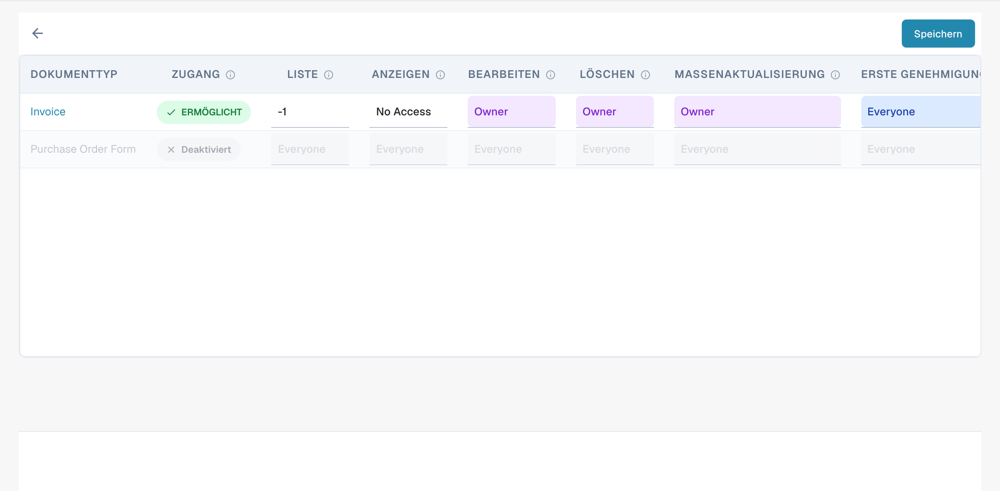
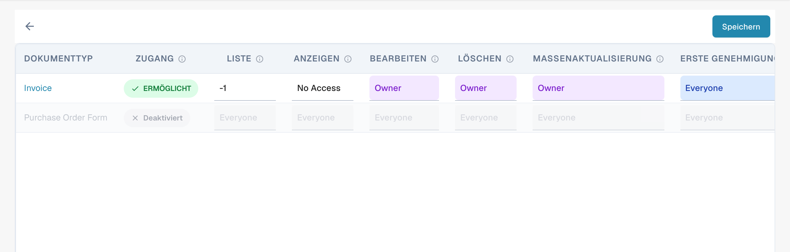
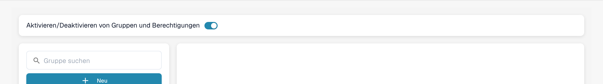

# Berechtigungen aktivieren


DocBits-Anleitung zu Gruppen und Berechtigungen: Benutzerrollen und Zugriffsrechte festlegen und den Arbeitsbereich absichern


Das Aktivieren oder Deaktivieren des Berechtigungssystems über den Schalter hat verschiedene Auswirkungen auf die Funktionalität in DocBits.

## **Aktivieren des Berechtigungssystems:**

<figure><figcaption>
Deutsche Gruppenauswahl. Gruppennamen sind ausgeblendet; wählen Sie eine Gruppe, um ihre Zugriffskontrolle zu öffnen.
</figcaption></figure>

* Wenn das Berechtigungssystem aktiviert ist, werden die Zugriffsberechtigungen für Benutzer und Gruppen angewendet.
* Benutzern wird nur Zugriff auf die Ressourcen gewährt, auf die sie basierend auf den zugewiesenen Berechtigungen ausdrücklich zugreifen dürfen.
* Administratoren können die Berechtigungen für einzelne Benutzer und Gruppen verwalten und sicherstellen, dass nur autorisierte Personen die Daten anzeigen oder bearbeiten können.

<figure><figcaption>
Zugriffskontrolle einer Gruppe mit deutschen Spaltenüberschriften. Die Produktwerte Owner, Everyone und No Access bleiben englisch.
</figcaption></figure>

## Zugriff auf zugewiesene Dokumente

<figure><figcaption>
Aktuelle Zugriffskontrolle pro Dokumenttyp. Die Auswahl für Anzeigen und Bearbeiten bestimmt den Zugriffsumfang; die Produktwerte sind teilweise englisch.
</figcaption></figure>

Die aktuelle Zugriffsmatrix bietet Berechtigungen pro Dokumenttyp und Aktion. Die Auswahlwerte **Verantwortlich**, **Everyone** und **Kein Zugriff** werden vom Produkt derzeit auf Englisch angezeigt. In älteren Oberflächen steuert der Schalter **Nur zugewiesene Dokumente** die Sichtbarkeit anhand der Gruppenzuordnung; die folgende Beschreibung dieses Schalters gilt für diese älteren Oberflächen. Ist er eingeschaltet, können Benutzer nur Dokumente sehen, die ihnen oder einer Gruppe, der sie angehören, ausdrücklich zugewiesen sind. Ist er ausgeschaltet, können Benutzer mit der entsprechenden Ansichtsberechtigung alle Dokumente sehen, unabhängig von der Zuweisung.

#### Funktionsweise des bisherigen Schalters

* **Ausgeschaltet (Standard)**:
  * Wenn der Schalter ausgeschaltet ist, können Benutzer, die Mitglied einer Gruppe sind, alle Dokumente sehen, sofern sie die entsprechende Ansichtsberechtigung haben. Die Zuweisung von Dokumenten wirkt sich nicht auf die Sichtbarkeit aus.
* **Eingeschaltet**:
  * Wenn der Schalter eingeschaltet ist, können Benutzer nur Dokumente sehen, die ihnen oder einer Gruppe, der sie angehören, ausdrücklich zugewiesen sind. Dadurch wird die Sichtbarkeit von Dokumenten anhand der Gruppenzuordnung strenger eingeschränkt.

#### Beispielszenario

1. **Standard (ausgeschaltet)**:
   * Ein Benutzer der Gruppe „Sales“ kann alle Dokumente im System sehen, für die er eine Berechtigung hat, auch wenn sie ihm nicht zugewiesen sind.
2. **Eingeschaltet**:
   * Ein Benutzer der Gruppe „Sales“ kann nur Dokumente sehen, die ihm oder der Gruppe „Sales“ zugewiesen sind. Der Zugriff auf Dokumente außerhalb seiner Zuweisungen ist damit eingeschränkt.

## Deaktivieren des Berechtigungssystems:

<figure><figcaption>
Deutscher Schalter zum Aktivieren oder Deaktivieren von Gruppen und Berechtigungen. Im Beispiel ist er eingeschaltet.
</figcaption></figure>

* Wenn das Berechtigungssystem deaktiviert ist, werden alle Zugriffsberechtigungen entfernt und Benutzer haben in der Regel uneingeschränkten Zugriff auf alle Ressourcen.
* Dies kann nützlich sein, wenn eine offene Zusammenarbeit vorübergehend ohne die Einschränkungen der Zugriffskontrolle erforderlich ist.
* Es besteht jedoch ein erhöhtes Risiko von Datenlecks oder unbefugtem Zugriff, da Benutzer möglicherweise auf sensible Informationen zugreifen können, zu denen sie nicht berechtigt sind.

Das Aktivieren oder Deaktivieren des Berechtigungssystems ist eine wichtige Entscheidung, die auf den Sicherheitsanforderungen und der Arbeitsweise der Organisation basiert. In Umgebungen, in denen Datenschutz und Zugriffskontrolle entscheidend sind, ist es üblich, das Berechtigungssystem aktiviert zu lassen, um die Datenintegrität und Vertraulichkeit zu gewährleisten. In anderen Fällen kann es vorübergehend notwendig sein, das Berechtigungssystem zu deaktivieren, um die Zusammenarbeit zu erleichtern, sollte jedoch mit Vorsicht verwendet werden, um potenzielle Sicherheitsrisiken zu minimieren.
