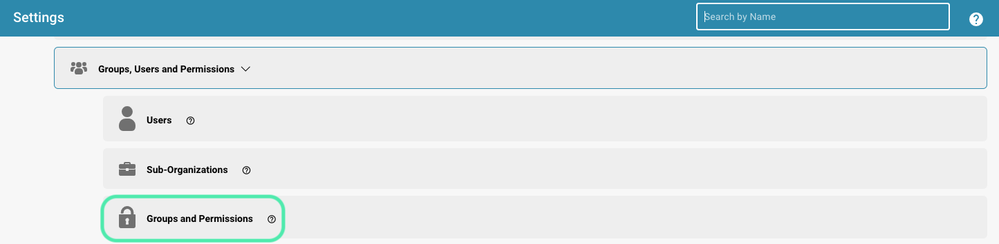
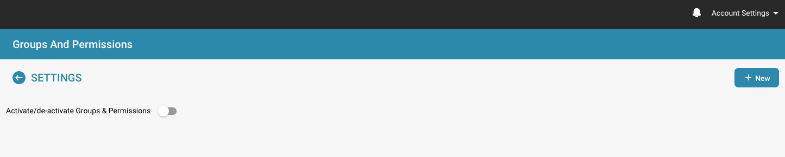

# Gruppen hinzufügen/bearbeiten


DocBits Groups & Permissions Tutorial: Set User Roles, Access Rights & Secure Your Workspace


## Um eine neue Gruppe hinzuzufügen oder die Berechtigungen einer bestehenden Gruppe zu ändern, gehen Sie wie folgt vor:

* **Zu den Gruppeneinstellungen navigieren:** Melden Sie sich bei Ihrem Administratorkonto an und öffnen Sie im Admin-Bereich die Gruppeneinstellungen.

<figure><figcaption></figcaption></figure>

Dieses Fenster wird geöffnet:

<figure><figcaption></figcaption></figure>

* **Auf die Schaltfläche + New klicken:** Wenn Sie eine neue Gruppe hinzufügen möchten, klicken Sie auf die Schaltfläche + New, um den Vorgang zum Hinzufügen einer neuen Gruppe zu starten.

<figure><figcaption></figcaption></figure>

* **Das Formular ausfüllen:** Geben Sie den Gruppennamen und eine Beschreibung der Gruppe an.
* **Die Angaben speichern:** Sobald Sie Gruppe und Beschreibung ausgefüllt haben, klicken Sie auf die Schaltfläche „Save“.

<figure><figcaption></figcaption></figure>

## Gruppen bearbeiten:

* **Gruppen bearbeiten:** Um Gruppen zu bearbeiten, klicken Sie auf „edit“. Hier können Sie den Gruppennamen ändern.

<figure><figcaption></figcaption></figure>

<figure><figcaption></figcaption></figure>

* **Groups & permissions aktivieren:** Damit die Gruppe sichtbar ist, muss „Groups & permissions“ aktiviert sein.

<figure><figcaption></figcaption></figure>

* **Ergebnisse prüfen:** Prüfen Sie nach dem Speichern die Ergebnisse, um sicherzustellen, dass die Gruppe erfolgreich hinzugefügt, bearbeitet oder aktualisiert wurde.
