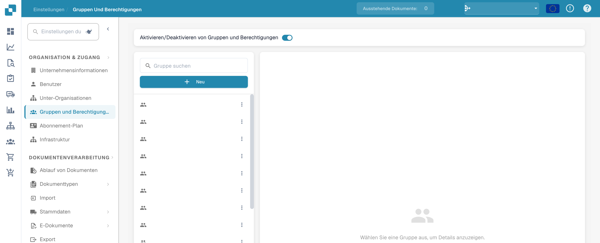
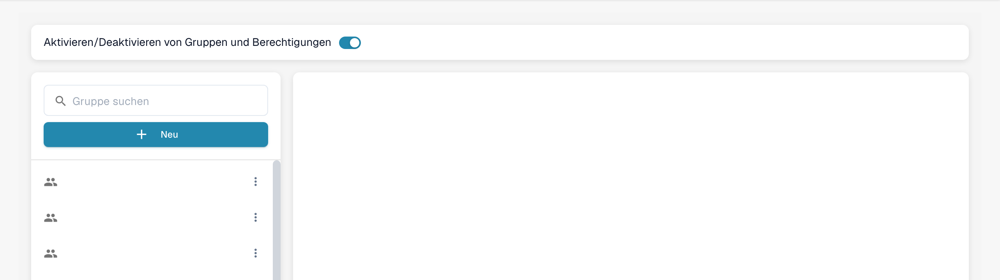
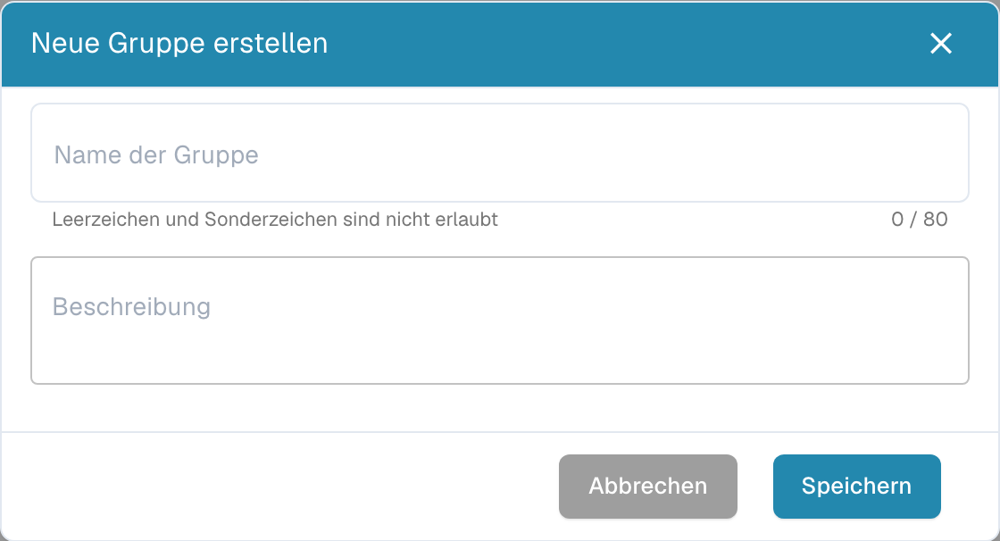
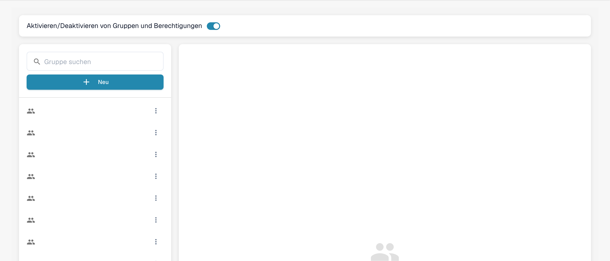

# Gruppen hinzufügen/bearbeiten


DocBits Groups & Permissions Tutorial: Set User Roles, Access Rights & Secure Your Workspace


## Um eine neue Gruppe hinzuzufügen oder die Berechtigungen einer bestehenden Gruppe zu ändern, gehen Sie wie folgt vor:

* **Zu den Gruppeneinstellungen navigieren:** Melden Sie sich bei Ihrem Administratorkonto an und öffnen Sie im Admin-Bereich die Gruppeneinstellungen.

<figure><figcaption>
Deutsche Gruppeneinstellungen. Gruppennamen sind ausgeblendet.
</figcaption></figure>

Dieses Fenster wird geöffnet:

<figure><figcaption>
Gruppensuche und Schaltfläche „Neu“ in der deutschen Oberfläche.
</figcaption></figure>

* **Auf die Schaltfläche + Neu klicken:** Wenn Sie eine neue Gruppe hinzufügen möchten, klicken Sie auf die Schaltfläche + Neu, um den Vorgang zum Hinzufügen einer neuen Gruppe zu starten.

<figure><figcaption>
Deutsches Formular Neue Gruppe erstellen mit Gruppenname und Beschreibung.
</figcaption></figure>

* **Das Formular ausfüllen:** Geben Sie den Gruppennamen und eine Beschreibung der Gruppe an.
* **Die Angaben speichern:** Sobald Sie Gruppe und Beschreibung ausgefüllt haben, klicken Sie auf die Schaltfläche „Speichern“.

<figure><figcaption>
Gruppenübersicht nach dem Schließen des Formulars. Gruppennamen sind ausgeblendet; die Aufnahme belegt keine neu gespeicherte Gruppe.
</figcaption></figure>

## Gruppen bearbeiten:

* **Gruppen bearbeiten:** Um Gruppen zu bearbeiten, wählen Sie die Gruppe aus und klicken Sie auf das Stiftsymbol. Hier können Sie den Gruppennamen ändern.

<figure><figcaption></figcaption></figure>

<figure><figcaption></figcaption></figure>

* **Gruppen und Berechtigungen aktivieren:** Verwenden Sie den Schalter „Aktivieren/Deaktivieren von Gruppen und Berechtigungen“ oben auf der Seite.

<figure><figcaption></figcaption></figure>

* **Ergebnisse prüfen:** Prüfen Sie nach dem Speichern die Ergebnisse, um sicherzustellen, dass die Gruppe erfolgreich hinzugefügt, bearbeitet oder aktualisiert wurde.
