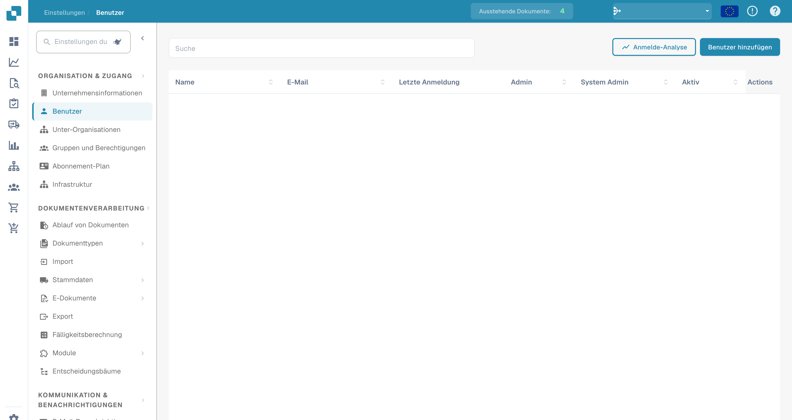

# Benutzer



<figure><figcaption>
Deutsche Benutzerverwaltung. Namen, E-Mail-Adressen und weitere Personenwerte sind ausgeblendet.
</figcaption></figure>

Auf der Seite „Benutzer“ können Administratoren alle Benutzerkonten in Ihrer DocBits-Organisation verwalten. Hier können Sie neue Benutzer hinzufügen, Rollen zuweisen und den Zugriff steuern.

## Benutzerliste

Die Benutzertabelle zeigt die folgenden Spalten an:

| Spalte | Beschreibung |
|--------|-------------|
| **Name** | Der vollständige Name des Benutzers. |
| **E-Mail** | Die E-Mail-Adresse des Benutzers, die als Anmeldekennung verwendet wird. |
| **Letzte Anmeldung** | Datum und Uhrzeit der letzten Anmeldung des Benutzers. |
| **Administrator** | Kontrollkästchen, das angibt, ob der Benutzer über Administratorrechte verfügt. Admins haben Zugriff auf alle Einstellungen und können andere Benutzer verwalten. |
| **System-Administrator** | Kontrollkästchen, das den einzigen System Admin der Organisation kennzeichnet – das Konto, das DocBits für automatische Aktionen im Hintergrund nutzt (etwa für automatische Importe und Exporte). Ein System Admin verfügt zusätzlich immer über Admin-Rechte. Den Unterschied zwischen Admin und System Admin finden Sie unter [Admin-Privilegien](admin-privileges.md#admin-vs-system-admin). |
| **Aktiv** | Kontrollkästchen, das anzeigt, ob das Benutzerkonto derzeit aktiv ist. Inaktive Benutzer können sich nicht anmelden. |
| **Aktionen** | Menü mit Optionen wie dem Bearbeiten von Benutzerdaten, dem Zurücksetzen von Passwörtern oder dem Deaktivieren des Kontos. |

Verwenden Sie die **Suchleiste** am oberen Rand, um Benutzer schnell anhand ihres Namens oder ihrer ID zu finden.

## Login-Analyse

Klicken Sie auf **Anmelde-Analyse**, um Daten zur Anmeldeaktivität in Ihrer gesamten Organisation einzusehen, einschließlich Häufigkeit und Mustern der Anmeldungen. Eine vollständige Aufschlüsselung finden Sie unter [Anmelde-Analyse](login-analytics.md).

## Einen neuen Benutzer hinzufügen

1. Klicken Sie oben rechts auf die Schaltfläche **Benutzer hinzufügen**.
2. Füllen Sie die erforderlichen Angaben aus:
   * **Benutzername**: Ein eindeutiger Name für den Benutzer.
   * **Vorname** und **Nachname**: Der vollständige Name des Benutzers.
   * **E-Mail**: Wird für die Anmeldung und für Benachrichtigungen verwendet.
   * **Passwort**: Muss den Sicherheitsrichtlinien Ihrer Organisation entsprechen.
   * **User Role**: Weisen Sie die passende Rolle zu (Standard User, Admin oder System Admin).
3. Klicken Sie auf **Speichern**, um das Benutzerkonto anzulegen. Der neue Benutzer erhält eine E-Mail-Benachrichtigung mit seinen Anmeldedaten und einem Link, um sein erstes Passwort auf der Seite **Passwort festlegen** zu setzen. Siehe [Erste Schritte und Anmeldung](../../../../../end-user-and-partner-section/end-user-section/getting-access-and-signing-in.md#erstes-passwort-für-vom-administrator-angelegte-konten).

> **Hinweis:** Die Rolle **System-Administrator** kann nur beim Anlegen eines Benutzers gewählt werden – sie kann später weder hinzugefügt noch entfernt werden. Jede Organisation kann nur einen System Admin haben, und mit der Auswahl werden automatisch auch Admin-Rechte vergeben. Wann Sie diese Rolle verwenden sollten, erfahren Sie unter [Admin-Privilegien](admin-privileges.md#admin-vs-system-admin).
