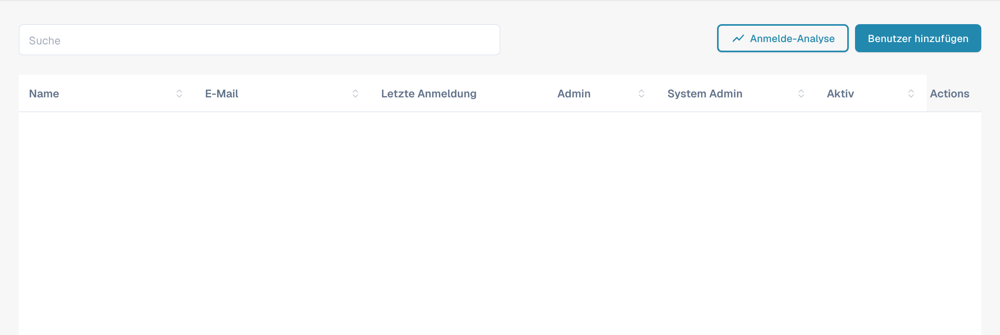
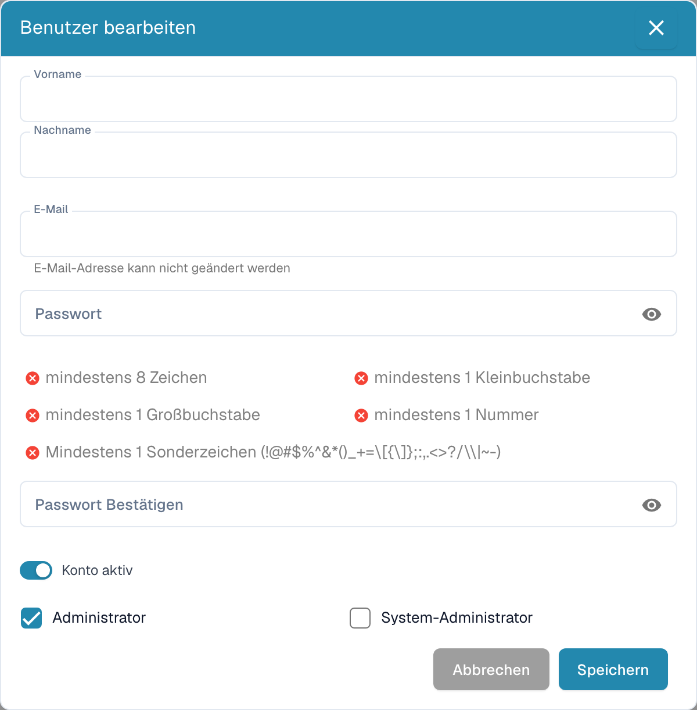

# Benutzerdetails bearbeiten

<figure><figcaption>
Deutsche Benutzerübersicht mit Suche und Benutzer hinzufügen. Personenbezogene Tabellenwerte sind ausgeblendet.
</figcaption></figure>

* **Als Administrator anmelden:** Melden Sie sich mit Ihren Administratorrechten an.
* **Auf die Benutzerverwaltung zugreifen:** Navigieren Sie zu den Benutzereinstellungen, in denen Sie bestehende Benutzer bearbeiten können.
* **Benutzer auswählen:** Suchen Sie den Benutzer, dessen Details Sie ändern möchten, und wählen Sie ihn aus. Das geht durch Klicken auf den Benutzernamen oder auf eine Schaltfläche „Bearbeiten“ neben dem Benutzer.

<figure><figcaption></figcaption></figure>

*   **Benutzerdetails bearbeiten:** Es erscheint ein Formular mit den aktuellen Details des Benutzers. Bearbeiten Sie die erforderlichen Felder entsprechend den gewünschten Änderungen. Typische Details, die bearbeitet werden, sind:

    * Vor- und Nachname
    * E-Mail-Adresse
    * Benutzerrolle oder Berechtigungsstufe

    <figure><figcaption>
Benutzer bearbeiten mit Vorname, Nachname, Passwort und Kontostatus. Bestehende Eingabewerte sind ausgeblendet.
</figcaption></figure>
* **Änderungen speichern:** Prüfen Sie Ihre Änderungen und klicken Sie auf **Speichern**, um die neuen Benutzerdetails zu speichern.

<figure><figcaption></figcaption></figure>

* **Auswirkungen von Rollenänderungen prüfen:** Wenn Sie die Benutzerrolle des Benutzers geändert haben, prüfen Sie die Auswirkungen dieser Änderung auf die Sicherheits-Zugriffsebenen. Stellen Sie sicher, dass der Benutzer nach der Rollenänderung die Berechtigungen hat, die er benötigt, um seine Aufgaben weiterhin wahrzunehmen.
* **Benachrichtigung senden (optional):** Sie können dem Benutzer eine Benachrichtigung senden, um ihn über die vorgenommenen Änderungen zu informieren.

Nach Abschluss dieser Schritte sind die Benutzerdetails erfolgreich aktualisiert, und der Benutzer verfügt über die neuen Informationen und Berechtigungen entsprechend den vorgenommenen Änderungen.

## Benutzer entfernen:

* **Benutzer auswählen:** Suchen Sie den Benutzer, dessen Zugriff Sie entfernen möchten, und wählen Sie ihn aus. Das geht durch Klicken auf den Benutzernamen oder auf eine Schaltfläche „Bearbeiten“ neben dem Benutzer.

<figure><figcaption></figcaption></figure>

* **Zugriff entfernen:** Klicken Sie auf „delete“, um den Benutzer zu entfernen.

<figure><figcaption></figcaption></figure>

* **Bestätigung:** Sie werden aufgefordert, das Entfernen des Benutzers zu bestätigen.

<figure><figcaption></figcaption></figure>

* **Optionale Benachrichtigung:** Sie können dem Benutzer optional eine Benachrichtigung senden, um ihn über das Entfernen seines Zugriffs zu informieren.
* **Aufgaben und Dokumente prüfen:** Prüfen Sie vor dem Entfernen des Benutzers, welche Aufgaben oder Dokumente ihm zugewiesen sind. Übertragen Sie die Verantwortung für diese Aufgaben oder Dokumente auf einen anderen Benutzer, damit nichts verloren geht oder unerledigt bleibt.
* **Änderungen speichern:** Bestätigen Sie das Entfernen des Benutzers und speichern Sie die Änderungen.

Wenn Sie diese Schritte befolgen, stellen Sie sicher, dass der Zugriff des Benutzers sicher entfernt wird und alle relevanten Aufgaben und Dokumente ordnungsgemäß verwaltet werden.
