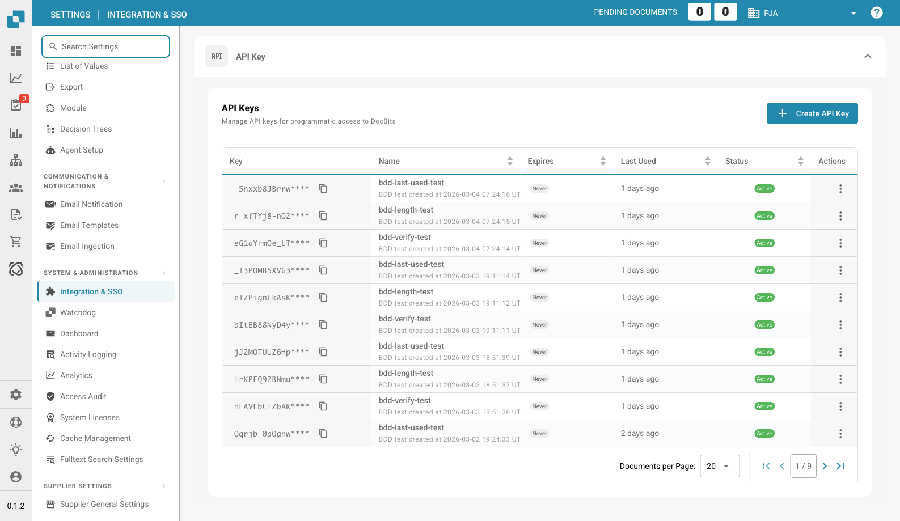

# Integration & SSO

<figure><figcaption>
Seite Integration & SSO
</figcaption></figure>

Auf der Seite Integration & SSO verwalten Sie API-Schlüssel für den programmatischen Zugriff, Organisations-IDs und die Konfiguration von Single Sign-On (SSO).

## API Key

Verwalten Sie API-Schlüssel, die für den programmatischen Zugriff auf DocBits verwendet werden.

| Spalte | Beschreibung |
|--------|-------------|
| **Key** | Der maskierte Wert des API-Schlüssels. Klicken Sie auf das Kopiersymbol, um den vollständigen Schlüssel zu kopieren. |
| **Name** | Ein aussagekräftiger Name für den Schlüssel. |
| **Expires** | Ablaufdatum (oder „Never“). |
| **Last Used** | Wann der Schlüssel zuletzt verwendet wurde. |
| **Status** | Active oder Inactive. |
| **Actions** | Drei-Punkte-Menü zum Widerrufen oder Löschen. |

Klicken Sie auf **+ Create API Key**, um einen neuen Schlüssel zu erzeugen.

## ID

Zeigt die Kennungen Ihrer Organisation:

| Feld | Beschreibung |
|-------|-------------|
| **Org ID** | Die eindeutige Kennung Ihrer Organisation. |
| **Sub Org ID** | Die ID der aktuell ausgewählten Unterorganisation. |

## SSO Service Provider Settings

DocBits-SSO-Konfigurationswerte, die Sie beim Einrichten Ihres Identity Providers benötigen:

| Feld | Beschreibung |
|-------|-------------|
| **Entity ID** | Die SAML-Metadaten-URL für DocBits. |
| **SLO URL** | URL für Single Logout. |
| **SSO URL** | URL des Assertion Consumer Service. |

Außerdem können Sie für Ihre IdP-Konfiguration **Download Certificate** und **Download Metadata** verwenden.

## Identity Service Provider Settings

Konfigurieren Sie Ihren externen Identity Provider (IdP):

| Feld | Beschreibung |
|-------|-------------|
| **Tenant ID** | Die Mandantenkennung Ihres IdP. |
| **Upload file** | Laden Sie die Metadaten-XML-Datei Ihres IdP hoch. |

Klicken Sie auf **Configure**, um Ihre IdP-Einstellungen zu speichern.

* **Höhere Effizienz:** Die Integration mit anderen Tools und Diensten kann Arbeitsabläufe straffen und die Effizienz steigern. Beispielsweise können Dokumente automatisch zwischen Docbits und einem CRM-System ausgetauscht werden, was manuelle Eingaben reduziert und die Produktivität erhöht
* **Datenkonsistenz:** Die Integration ermöglicht den nahtlosen Datenaustausch zwischen verschiedenen Systemen und verbessert so Konsistenz und Genauigkeit der Daten. Das vermeidet Inkonsistenzen oder doppelte Dateneingaben, die zu Fehlern führen könnten.
* **Aktualisierungen in Echtzeit**: Die Integration ermöglicht Aktualisierungen in Echtzeit zwischen verschiedenen Plattformen, sodass Benutzer stets die neuesten Informationen haben. Das ist besonders wichtig für kritische Geschäftsprozesse, die Informationen in Echtzeit erfordern.
* **Automatisierung von Aufgaben:** Die Integration ermöglicht es, Routineaufgaben zu automatisieren und so Zeit und Ressourcen zu sparen. Beispielsweise können Benachrichtigungen automatisch ausgelöst werden, wenn in einem anderen System ein bestimmtes Ereignis eintritt, ohne dass ein manueller Eingriff nötig ist.
* **Verbesserte Benutzererfahrung:** Eine gut konfigurierte Integration sorgt für eine nahtlose Benutzererfahrung, da Benutzer nicht zwischen verschiedenen Systemen wechseln müssen, um auf relevante Informationen zuzugreifen. Das steigert die Zufriedenheit der Benutzer und trägt zur Effizienz bei.

Um die Integrationseinstellungen richtig zu konfigurieren, ist es wichtig, die Anforderungen der Organisation zu verstehen und sicherzustellen, dass die Integration nahtlos in bestehende Arbeitsabläufe und Prozesse eingebunden ist. Das erfordert eine sorgfältige Planung, Konfiguration und Überwachung der Integration, damit sie reibungslos funktioniert und den gewünschten Nutzen bringt.
