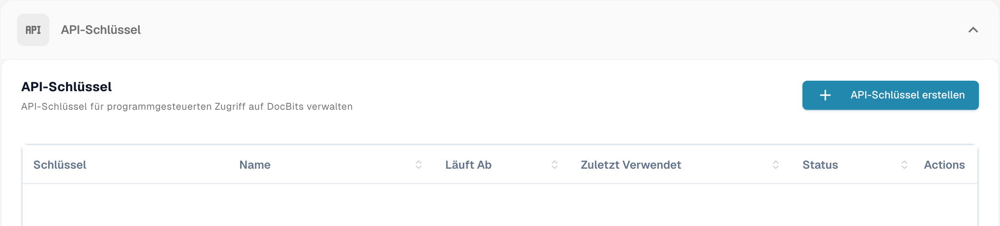
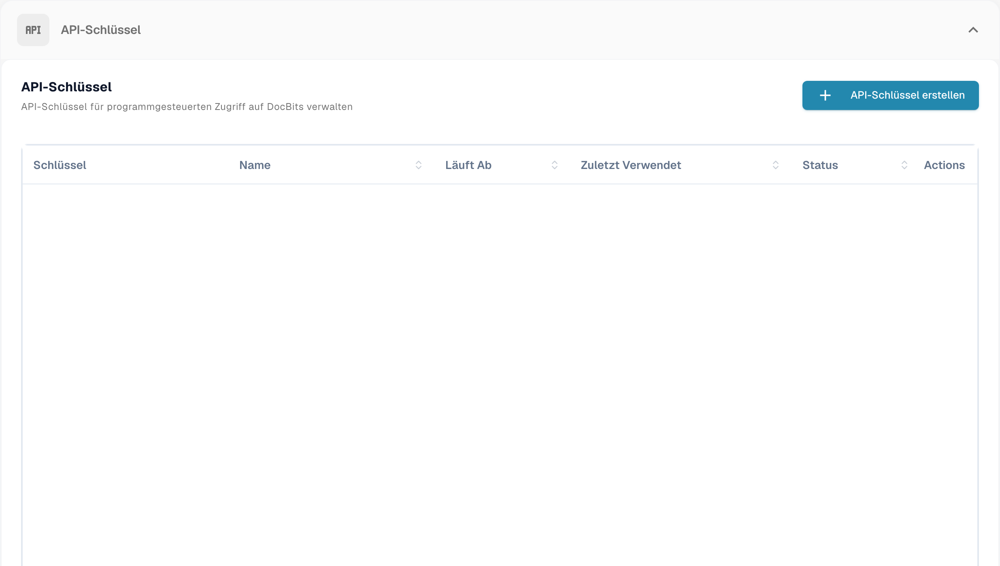
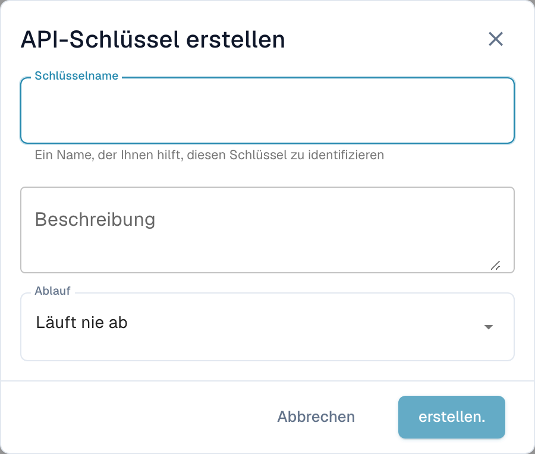

# API-Schlüssel verwalten

Ein API Key erlaubt es einem anderen System — Ihrem ERP, einem Skript oder einer Partneranwendung — mit DocBits zu sprechen, ohne dass sich ein Benutzer anmeldet. Ihre Organisation kann so viele Keys halten, wie Sie benötigen, und jeder wird für sich verwaltet: Geben Sie ihm einen eigenen Namen, entscheiden Sie, ob er abläuft, und widerrufen Sie ihn einzeln, falls er jemals offengelegt wird.

Weil jede Integration ihren eigenen Key haben kann, können Sie einen abschalten, ohne einen der anderen zu stören.

## Die API-Key-Verwaltung öffnen

Gehen Sie zu **Einstellungen** und wählen Sie **Integration & SSO** unter **System & Verwaltung**.

Der Abschnitt **API-Schlüssel** oben auf der Seite listet jeden Key auf, den Ihre Organisation besitzt.

## Die Liste verstehen

| Spalte | Was sie Ihnen sagt |
| --- | --- |
| **Schlüssel** | Die ersten Zeichen des Keys, gefolgt von `****`. Der Rest wird nach dem Erstellen nie wieder angezeigt — siehe [Einen API Key erstellen](#einen-api-key-erstellen). |
| **Name** | Der Name, den Sie dem Key gegeben haben, mit seiner Beschreibung darunter. |
| **Läuft Ab** | Das Datum, an dem der Key aufhört zu funktionieren, oder **Never**, wenn Sie keines gesetzt haben. |
| **Zuletzt Verwendet** | Wann zuletzt eine Anfrage mit diesem Key eingegangen ist. **Never used** bedeutet, dass ihn noch kein System verwendet hat — nützlich, um Keys zu erkennen, die Sie gefahrlos entfernen können. |
| **Status** | **Active** bedeutet, dass der Key funktioniert. Ein widerrufener Key ist dauerhaft abgeschaltet. |
| **Actions** | Das Drei-Punkte-Menü, über das Sie den Key widerrufen können. |

Wenn Sie mehr Keys haben, als auf eine Seite passen, verwenden Sie die Blätterelemente unten in der Liste.


**Zuletzt Verwendet** ist der schnellste Weg, Keys zu finden, die niemand mehr braucht. Ein Key, der nie verwendet wurde oder seit Monaten nicht mehr, ist ein guter Kandidat zum Widerrufen.


## Einen API Key erstellen

1. Klicken Sie oben rechts im Abschnitt API-Schlüssel auf **+ API-Schlüssel erstellen**.
2. Füllen Sie den Dialog aus:

| Feld | Was Sie eintragen |
| --- | --- |
| **Schlüsselname** | Erforderlich. Benennen Sie ihn nach dem System, das ihn verwenden wird — `M3 Production`, `Invoice Import Script` — damit Sie später erkennen, zu welcher Integration ein Key gehört. |
| **Beschreibung** | Optional. Platz für eine Notiz, wofür der Key da ist oder wer ihn eingerichtet hat. |
| **Ablauf** | Wählen Sie ein Ablaufdatum oder belassen Sie es auf **Läuft nie ab**. Ein Ablaufdatum ist die sicherere Wahl: Der Key verabschiedet sich von selbst, falls die Integration einmal vergessen wird. |

3. Klicken Sie auf **erstellen.**. DocBits zeigt Ihnen den neuen Key:

4. Kopieren Sie den Key über das Kopiersymbol und fügen Sie ihn direkt in das System ein, das ihn verwenden wird, oder in Ihren Passwortmanager.
5. Haken Sie **I have copied and saved this key** an und klicken Sie auf **Done**.


**Der vollständige Key wird nur ein einziges Mal angezeigt.** DocBits speichert einen Einweg-Hash des Schlüssels und ein kurzes Präfix zur Identifizierung. Weder Ihre Administratoren noch der DocBits-Support können den ursprünglichen vollständigen Schlüssel aus diesem Hash abrufen. Wenn Sie ihn verlieren, widerrufen Sie ihn und erstellen Sie einen neuen.


Behandeln Sie den Key wie ein Passwort. Wer ihn hat, kann mit den Dokumenten und Daten Ihrer Organisation arbeiten.

Siehe [Sichere Speicherung von Zugangsdaten](../../../../security/secure-storage-of-credentials.md).
