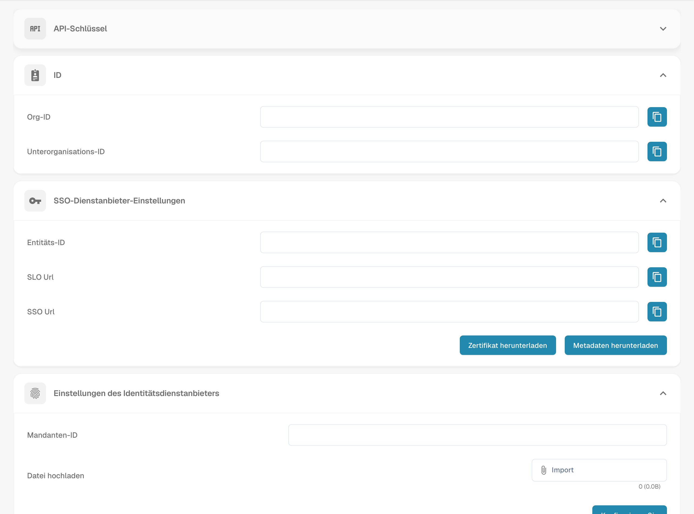

# V2: Infor OS Portal SSO

Verwenden Sie diese Anleitung, wenn Ihre Organisation DocBits aus dem **Infor OS Portal V2** startet. Erforderlich ist ein Administrator sowohl für Infor als auch für DocBits. Lassen Sie beim Testen von SSO eine bestehende DocBits-Administratorsitzung geöffnet. Die Menü- und Feldnamen in Infor hängen vom Release des Tenants ab; bestätigen Sie sie mit Ihrem Infor-Administrator.

## 1. Die SAML-Werte von DocBits abrufen

Öffnen Sie in der richtigen DocBits-Organisation **Settings → Integration & SSO → SSO Service Provider Settings**. Kopieren Sie **Entity ID**, **SSO Url** und **SLO Url**. Verwenden Sie **Download Certificate**, wenn das Formular für den Service Provider in Infor das Signaturzertifikat verlangt. **Download Metadata** ist die XML-Datei des DocBits-*Service Providers*; sie ist nicht die Metadaten des Infor Identity Providers, die in Schritt 3 verwendet werden. Die URLs im Sandbox-Bild gehören nur zu dieser Testorganisation.

## 2. DocBits in Infor als Service Provider hinzufügen

Öffnen Sie im Infor OS Portal **OS → Security → Security Administration → Service Provider**, falls dies der Weg in Ihrem Tenant ist. Fügen Sie einen SAML Service Provider hinzu und verwenden Sie die folgende Zuordnung:

| Infor-Feld | DocBits-Wert |
| --- | --- |
| Entity ID | Entity ID |
| SSO Endpoint | SSO Url, der Assertion-Consumer-Endpunkt |
| SLO Endpoint | SLO Url, der Logout-Endpunkt |
| Signing Certificate | Download Certificate, falls erforderlich |
| Name ID Format / Mapping | E-Mail-Adresse, nachdem Sie geprüft haben, dass sie mit dem DocBits-Benutzer übereinstimmt |

Die frühere Anleitung wies Benutzer an, die **SLO Url** in den **SSO Endpoint** einzutragen. Das ist falsch: Jede URL gehört in das entsprechende Feld. Speichern Sie den Service Provider. Die [Anleitung von Infor zum Service Provider](https://docs.infor.com/inforos/latest/en-us/useradminlib_cloud/inforos_security/jho1449385888462.html) erklärt die Navigation und die erforderliche Rolle; die [SAML-Feldanleitung](https://docs.infor.com/inforos/2026.09/en-us/useradminlib_cloud/mineeag/min1772650388038.html) erklärt die Rollen der Endpunkte.

## 3. Die Metadaten des Identity Providers von Infor importieren

Öffnen Sie den gespeicherten Service Provider in Infor und wählen Sie **View → Export SAML Metadata** für den Infor Identity Provider. Öffnen Sie zurück in DocBits **Settings → Integration & SSO → Identity Service Provider Settings**. Geben Sie die **Tenant ID** von Infor ein, wählen Sie unter **Upload file** die Infor-XML-Datei und klicken Sie dann auf **Configure**. Bestätigen Sie Tenant-ID und Metadaten mit Ihrem Infor-Administrator. Laden Sie hier nicht die XML-Datei des DocBits-Service-Providers aus Schritt 1 hoch.

## 4. Eine DocBits-Kachel im Infor OS Portal hinzufügen

Öffnen Sie im Infor OS Portal **Portal → Applications → Add Application**. Registrieren Sie DocBits für Ihren Tenant als Nicht-Infor-Anwendung, geben Sie einen Anzeigenamen, ein Symbol und eine eindeutige Logical ID an und setzen Sie die **Anwendungs-URL** auf Ihre normale DocBits-Anmelde- oder Start-URL. Die Anwendungs-URL des Portals öffnet die Benutzeroberfläche; sie ist **nicht** der SAML-SSO-/ACS-Endpunkt aus Schritt 2. Folgen Sie für das aktuelle Formular, die Navigationsoptionen und Berechtigungen der [Anleitung von Infor zu Nicht-Infor-Anwendungen](https://docs.infor.com/inforos/latest/en-us/useradminlib_cloud/inforospag/lsm1436532874794.html). Geben Sie dem Testbenutzer Zugriff auf die Portal-Anwendung.

## 5. Mit einem Benutzer verifizieren

Melden Sie sich in einer separaten Browsersitzung ab, öffnen Sie die DocBits-Kachel in Infor und bestätigen Sie, dass die E-Mail-Adresse des zugewiesenen Benutzers dem richtigen DocBits-Konto und der richtigen Organisation zugeordnet wird. Prüfen Sie auch die Abmeldung. Schlägt eines von beiden fehl, vergleichen Sie Infor-Metadaten, SSO-/SLO-URLs, Zertifikat, Name ID und die URL der Portal-Kachel gemeinsam mit den beiden Administratoren. Behalten Sie die ursprüngliche Administratorsitzung, bis der Test abgeschlossen ist.

**Umfang der Verifizierung:** Der oben gezeigte DocBits-Bildschirm wurde in der englischen Sandbox-Testorganisation aufgenommen. Es stand kein Infor-Tenant zur Verfügung, daher wurden die Menüs des Infor-Portals, der Metadatenimport, das Erstellen der Kachel und das Live-SSO für diese Aktualisierung nicht getestet. Alte extern gehostete Infor-Bilder, darunter private E-Mail-Anhänge, wurden entfernt; nutzen Sie für diese Oberfläche die verlinkte Infor-Dokumentation und den Administrator Ihres Tenants.
