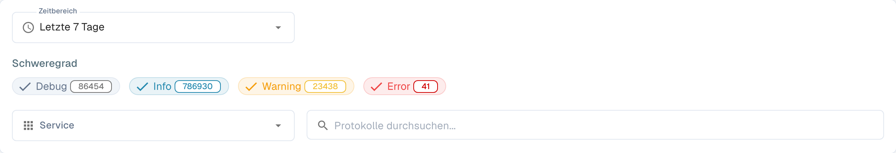

# Aktivitätsprotokollierung

<figure><figcaption>
Deutsche Filter der Protokollansicht. Die technischen Schweregrade Debug, Info, Warning und Error bleiben unverändert.
</figcaption></figure>

Die Aktivitätsprotokollierung bietet eine Echtzeitsicht auf Systemereignisse über alle DocBits-Dienste hinweg. Verwenden Sie es, um die Verarbeitungsaktivität zu überwachen, Fehler zu beheben und das Systemverhalten zu prüfen.

## Analytics Banner

Oben auf der Seite verlinkt ein Banner auf das **Analytics Dashboard** mit Diagrammen, Kennzahlen und Echtzeit-Monitoring.

## Filter

| Filter | Beschreibung |
|--------|-------------|
| **Zeitbereich** | Wählen Sie ein Zeitfenster (z. B. Heute, Letzte 7 Tage, Letzte 30 Tage). |
| **Schweregrad** | Schalten Sie Schweregrade ein oder aus: **Debug**, **Info**, **Warning**, **Error**. Jeder Chip zeigt die aktuelle Anzahl. |
| **Service** | Filtern Sie Protokolle nach Dienst (z. B. api, auth, api-service). |
| **Protokolle durchsuchen** | Freitextsuche in den Protokollmeldungen. |

## Protokolltabelle

| Spalte | Beschreibung |
|--------|-------------|
| **Zeitstempel** | Datum und Uhrzeit des Ereignisses. Sortierbar. |
| **Schweregrad** | Farbig codiertes Badge: Info (blau), Warning (gelb), Error (rot), Debug (grau). |
| **Service** | Der Dienst oder das Modul, das das Protokoll erzeugt hat (z. B. api, auth, api-service). |
| **Nachricht** | Die vollständige Protokollmeldung mit Ereignisdetails. |

Die Ergebnisse sind seitenweise aufgeteilt — navigieren Sie mit den Steuerelementen am unteren Rand durch die Seiten.

## Aktionen in der Fußzeile

| Aktion | Beschreibung |
|--------|-------------|
| **Auto-refresh** | Schalter, um die Protokollansicht in regelmäßigen Abständen automatisch zu aktualisieren. |
| **Refresh Now** | Die Protokolldaten manuell aktualisieren. |
| **Export JSON** | Die aktuell gefilterten Protokolle als JSON-Datei exportieren. |
| **Download Logs** | Die vollständigen Protokolldaten herunterladen. |
