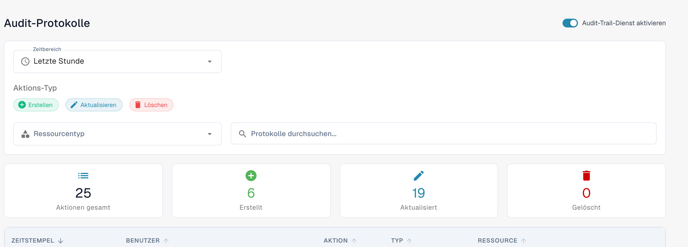
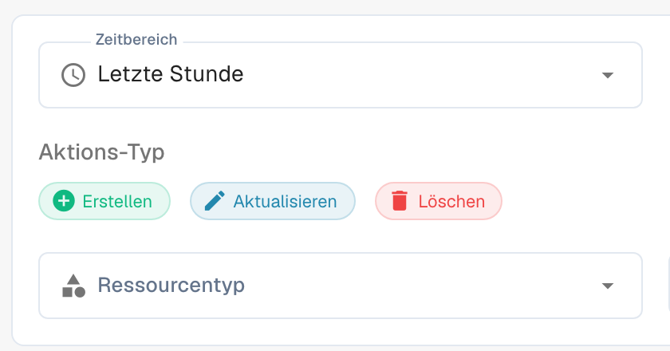

# Zugriffsprotokoll

Das Zugriffsprotokoll zeichnet auf, wer eine Ressource erstellt, geändert oder gelöscht hat und wann das geschehen ist. Öffnen Sie die Audit-Protokolle in den Einstellungen.

<figure><figcaption>
Aktuelle deutsche Ansicht der Audit-Protokolle mit Zeitbereich, Aktionsfilter und Übersichtskarten. Im gezeigten Beispiel ist der Audit-Trail-Dienst bereits aktiviert; dies ist keine Aussage über die Standardeinstellung.
</figcaption></figure>

## Protokollierung ein- oder ausschalten

Der Schalter **Audit-Trail-Dienst aktivieren** ändert die Organisationseinstellung. Aktivieren Sie den Dienst für eine Organisation nur dann, wenn Sie Audit-Ereignisse sammeln möchten. Wenn der Dienst ausgeschaltet ist, stehen keine neu gesammelten Ereignisse zur Verfügung. Die Aufnahme oben zeigt einen bereits aktivierten Dienst; für die Aufnahme wurde die Einstellung nicht verändert.

## Ein Ereignis finden

<figure><figcaption>
Detail der deutschen Filter für Zeitbereich, Aktions-Typ und Ressourcentyp. Der Ausschnitt stammt unverändert aus der aktuellen Gesamtansicht.
</figcaption></figure>

| Steuerelement | Funktion |
|---|---|
| **Zeitbereich** | Beschränkt die Liste auf einen Zeitraum, etwa **Letzte Stunde**. |
| **Aktions-Typ** | Filtert nach **Erstellen**, **Aktualisieren** und **Löschen**. |
| **Ressourcentyp** | Beschränkt die Ergebnisse auf einen Ressourcentyp. |
| **Protokolle durchsuchen...** | Durchsucht die Protokolleinträge nach Text. |

Die Übersichtskarten fassen die Treffer für die gewählten Filter zusammen: **Aktionen gesamt**, **Erstellt**, **Aktualisiert** und **Gelöscht**. Die Tabelle zeigt **ZEITSTEMPEL**, **BENUTZER**, **AKTION**, **TYP** und **RESSOURCE**. Öffnen Sie die Detailansicht einer Zeile, um die aufgezeichnete Änderung im Vorher-Nachher-Vergleich zu prüfen. Wenn keine Ereignisse erscheinen, prüfen Sie zuerst, ob der Dienst eingeschaltet ist, und erweitern Sie den Zeitraum, bevor Sie die übrigen Filter ändern.

Die manuelle Aktualisierung lädt passende Einträge einmal nach; die automatische Aktualisierung hält die geöffnete Liste aktuell. Über den Export können Sie Protokolldaten als JSON-Datei herunterladen. Die Seitengröße bestimmt, wie viele Einträge pro Seite angezeigt werden.

Bei deaktivierter Protokollierung kann ein Hinweisdialog die erfassten Aktionen und den Nutzen des Dienstes erklären. Schließen Sie diesen Hinweis, bleibt der Dienst deaktiviert. Die Aktivierungsaktion im Hinweis oder auf der Seite ändert die Organisationseinstellung. Erfasste Ereignisse können Benutzeraktivität, IP-Adressen, Zeitstempel und Änderungen im Vorher-Nachher-Vergleich enthalten. Ein leeres Protokoll ist kein Nachweis, dass der Dienst erfolgreich aktiviert wurde.
