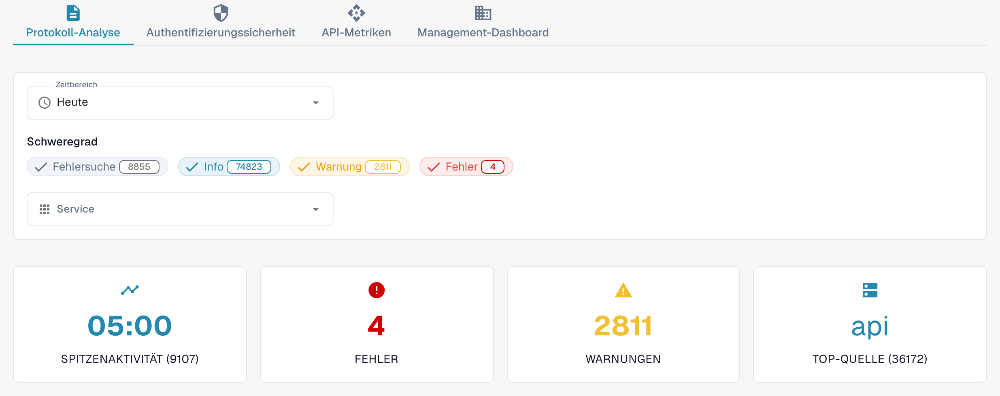

# Analytik

Öffnen Sie als Organisationsadministrator **Einstellungen → Aktivitätsprotokollierung → Analytik**. Die Seite bündelt Protokollaktivität, Authentifizierungsereignisse, API-Nutzung und eine Übersicht für die Leitung. Beginnen Sie mit **Protokoll-Analyse**. Über **Ereignisprotokolle anzeigen** öffnen Sie die Ereignisliste, um einen einzelnen Eintrag zu untersuchen.

<figure><figcaption>
Aktuelle deutsche Dev-Ansicht. Die Zahlen stammen aus der Testumgebung und weichen in Ihrer Organisation ab.
</figcaption></figure>

## Reiter

| Reiter | Beschreibung |
|--------|--------------|
| **Protokoll-Analyse** | Verteilung der Protokollschweregrade, Zeitverlauf und Aufschlüsselung nach Dienst. |
| **Authentifizierungssicherheit** | Authentifizierungsereignisse, Anmeldeversuche und Sicherheitskennzahlen. |
| **API-Metriken** | API-Anfragevolumen, Antwortzeiten und Fehlerraten. |
| **Management-Dashboard** | Übergeordnete Übersicht für Organisationsadministratoren; die Verfügbarkeit hängt von Ihrer Rolle ab. |

Die Reiter besitzen eigene Zeitraumeinstellungen. Prüfen Sie den ausgewählten Zeitraum nach einem Reiterwechsel erneut.

## Protokollfilter

| Filter | Beschreibung |
|--------|--------------|
| **Zeitbereich** | Wählen Sie **Letzte Stunde**, **Heute**, **Letzte 7 Tage**, **Letzte 30 Tage** oder **Benutzerdefiniert**. Bei der benutzerdefinierten Auswahl erscheinen Felder für Start- und Enddatum mit Uhrzeit. |
| **Schweregrad** | Klicken Sie auf **Fehlersuche** (Debug), **Info**, **Warnung** oder **Fehler**, um die jeweilige Stufe ein- oder auszuschließen. Eine Zahl am Filter zeigt die aktuelle Anzahl. |
| **Service** | Wählen Sie einen oder mehrere Dienste, deren Ereignisse Sie untersuchen möchten. |

## Zusammenfassungskarten

Unter den Protokollfiltern erscheinen vier Zusammenfassungskarten:

| Karte | Beschreibung |
|-------|--------------|
| **Spitzenaktivität** | Zeitpunkt mit dem höchsten Protokollvolumen und die zugehörige Anzahl. |
| **Fehler** | Anzahl der Fehler im ausgewählten Zeitraum. |
| **Warnungen** | Anzahl der Warnungen im ausgewählten Zeitraum. |
| **Top-Quelle** | Dienst mit den meisten Protokollen und deren Anzahl. |

## Real User Monitoring (RUM)

Wenn Browser-Telemetrie verfügbar ist, zeigt der RUM-Bereich Leistungskennzahlen des Frontends. Die verfügbaren Daten hängen von Umgebung und Zeitraum ab. Ein leeres Diagramm, ein Hinweis auf fehlende Daten oder ein Ladeplatzhalter ist kein Messergebnis.

## Protokolldiagramme und Downloads

Wählen Sie in **Protokoll-Analyse** eine der drei Diagrammansichten:

| Ansicht | Beschreibung |
|---------|--------------|
| **Schweregrad** | Kreisdiagramm zur Verteilung der Protokollstufen. |
| **Verlauf** | Liniendiagramm zum Protokollvolumen im Zeitverlauf. |
| **Service** | Balkendiagramm mit der Aufschlüsselung nach Dienst. |

Öffnen Sie im **Verlauf**-Diagramm das Menü oben rechts und wählen Sie **Download SVG**, **Download PNG** oder **Download CSV**. Diese Optionen beziehen sich auf das angezeigte Diagramm; andere Diagramme bieten möglicherweise keine entsprechende Werkzeugleiste.

Wenn ein Diagramm keine verfügbaren Daten meldet, versuchen Sie einen größeren **Zeitbereich** oder weniger **Schweregrad**-Filter.

## JS-Fehler mit Stack-Traces

Wenn diese Karte verfügbar ist, kennzeichnet ihr Umgebungshinweis den Geltungsbereich der Fehler, beispielsweise **Nur dev**. Die Karte listet aktuelle Browser-Ausnahmen auf, begrenzt auf 24 Stunden. **Alles als JSON kopieren** kopiert die aktuell in dieser Karte geladenen Einträge, nicht das vollständige Ereignisprotokoll. Ohne Einträge ist die Schaltfläche deaktiviert.

Klicken Sie bei einem vorhandenen Eintrag auf die Meldung, um den Stacktrace aufzuklappen. Über die Zeilenaktionen kopieren Sie diesen Eintrag als JSON oder seinen Stacktrace. Ein Trace-Link erscheint nur, wenn der Eintrag eine Trace-ID besitzt.
