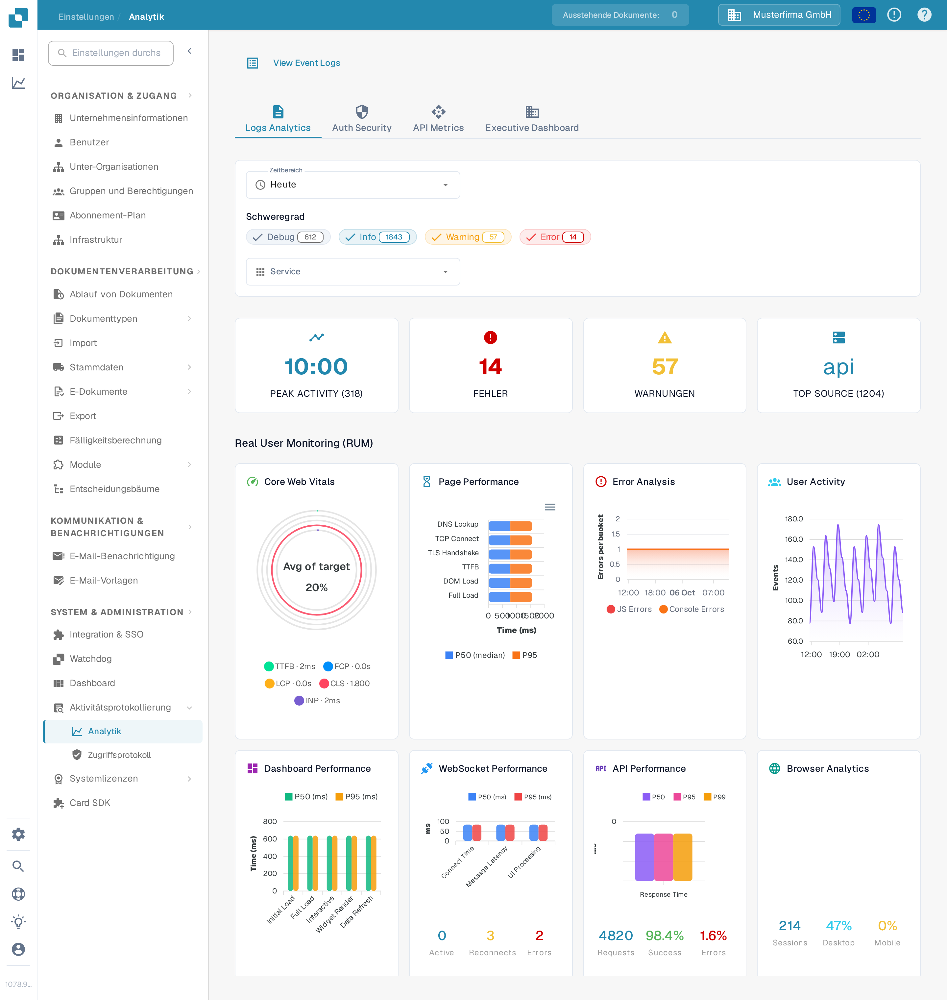

# Analytik

<figure><figcaption>
Über die Reiter und Filter grenzen Sie die Kennzahlen ein, die Sie auswerten möchten.
</figcaption></figure>

Die Analytik-Seite hilft Ihnen, Protokollmuster, Authentifizierungsereignisse, API-Nutzung und eine Führungskräfteübersicht zu untersuchen. Beginnen Sie mit **Logs Analytics**. Wählen Sie **View Event Logs**, um die zugrunde liegende Ereignisliste zu öffnen, wenn Sie einen einzelnen Eintrag untersuchen möchten.

## Reiter

| Reiter | Beschreibung |
|--------|--------------|
| **Logs Analytics** | Verteilung der Protokollschweregrade, Zeitverlauf-Diagramme und Aufschlüsselung nach Dienst. |
| **Auth Security** | Authentifizierungsereignisse, Anmeldeversuche und sicherheitsbezogene Kennzahlen. |
| **API Metrics** | API-Anfragevolumen, Antwortzeiten und Fehlerraten. |
| **Executive Dashboard** | Übergeordnete Übersicht für Organisationsadministratoren; andere Rollen sehen diesen Reiter möglicherweise nicht. |

## Filter

| Filter | Beschreibung |
|--------|--------------|
| **Zeitbereich** | Wählen Sie ein Zeitfenster (z. B. Heute, Letzte 7 Tage) für die angezeigten Kennzahlen. |
| **Schweregrad** | Klicken Sie auf Debug, Info, Warning oder Error, um den jeweiligen Level einzuschließen oder auszuschließen. Eine Zahl am Chip zeigt seine aktuelle Anzahl. |
| **Service** | Wählen Sie den Dienst, dessen Ereignisse Sie untersuchen möchten. |

## Zusammenfassungskarten

Vier Zusammenfassungskarten erscheinen unterhalb der Filter:

| Karte | Beschreibung |
|-------|--------------|
| **Peak Activity** | Tageszeit mit dem höchsten Protokollvolumen und dessen Gesamtanzahl. |
| **Errors** | Gesamtanzahl der Fehler im gewählten Zeitraum. |
| **Warnings** | Gesamtanzahl der Warnungen im gewählten Zeitraum. |
| **Top Source** | Der Dienst mit den meisten Protokollen und deren Anzahl. |

## Real User Monitoring (RUM)

Unterhalb der Zusammenfassungskarten zeigen RUM-Kennzahlen Frontend-Leistungsdaten, die aus echten Browser-Sitzungen echter Benutzer gesammelt werden.

## Analytics-Diagramme

Wählen Sie in **Logs Analytics** eine der drei Diagramm-Schaltflächen, um festzulegen, wie dieselben gefilterten Protokolle angezeigt werden:

| Ansicht | Beschreibung |
|---------|--------------|
| **Severity** | Kreisdiagramm mit der Verteilung der Protokolllevel (Debug, Info, Warning, Error). |
| **Timeline** | Liniendiagramm mit dem Protokollvolumen im Zeitverlauf. |
| **Service** | Balkendiagramm mit der Aufschlüsselung der Protokolle nach Dienst. |

Meldet ein Diagramm, dass keine Daten verfügbar sind, versuchen Sie einen größeren **Zeitbereich** oder weniger **Schweregrad**-Filter. Die Zahlen im Screenshot gehören zur synthetischen Sandbox-Organisation und weichen in Ihrer Organisation ab.
