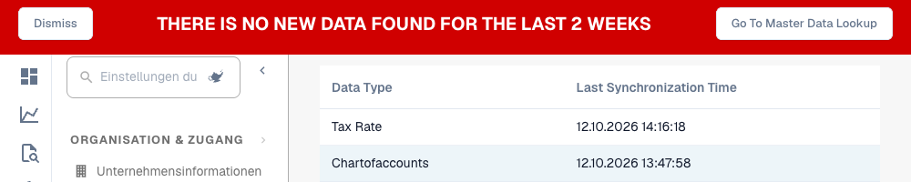

# Datensynchronisation prüfen

Diese Übersicht hilft, wenn ein Lieferant, eine Bestellung oder andere erwartete Stammdaten fehlen. Sie zeigt je Datentyp den erfassten Synchronisationszeitpunkt der aktuellen Organisation, nicht den Inhalt jedes importierten Datensatzes.

<figure><figcaption>
Erfasste Synchronisationszeiten für zwei Datentypen und die Warnung vor mehr als zwei Wochen alten Daten. Der Ausschnitt belegt keine vollständigen Importdaten. Die Spaltenüberschriften werden derzeit auf Englisch angezeigt. Auch die Warnung und ihre Schaltflächen werden derzeit auf Englisch angezeigt.
</figcaption></figure>

## Schritt für Schritt

1. Prüfen Sie Organisation, relevante Unterorganisation und ERP-Quellmandant.
2. Öffnen Sie **Einstellungen → Aktivitätsprotokoll → Datensynchronisation**. In älteren Ansichten liegt die Funktion unter den Protokolleinstellungen.
3. Suchen Sie den Datentyp in **Data Type** und lesen Sie **Last Synchronization Time** im eingestellten Datumsformat. Die neuesten Einträge stehen oben.
4. Vergleichen Sie den Zeitpunkt mit der erwarteten Quelländerung. Ein aktueller Lieferantenimport sagt nichts über die Aktualität einer Bestellung aus.
5. Suchen Sie die tatsächlich fehlende Kennung in der Stammdaten- oder Bestellansicht. Vergleichen Sie Mandant, Lieferanten-/Bestellnummer und Positionskennungen.
6. Prüfen Sie bei fehlenden oder alten Werten Importkanal und Protokolle: Quellnachricht, Zielorganisation, Mapping und Antwort. Beheben Sie dort die Ursache; diese Übersicht besitzt keinen Start- oder Wiederholen-Knopf.
7. Laden Sie nach dem korrigierten Import Übersicht und betroffenen Lookup oder Beleg neu. Prüfen Sie Zeitpunkt und tatsächliche Werte.

## Anzeigen richtig einordnen

| Beobachtung | Nächste Prüfung |
| --- | --- |
| Keine Zeilen | Organisation, Importkonfiguration und bisher erfasste Synchronisationen. Leer bedeutet nicht erfolgreich. |
| Ein Datentyp ist alt | Diesen Datenfluss unabhängig von anderen Zeilen verfolgen. |
| Warnung vor alten Daten | Die aktuelle Warnung kann bei leerer Liste oder ausschließlich mehr als zwei Wochen alten Einträgen erscheinen. Ihr Prozess kann deutlich aktuellere Daten benötigen. |
| Aktueller Zeitpunkt, Datensatz fehlt | Quellumfang, Kennungen, Nachrichteninhalt, Mapping und Antwort prüfen. Der Zeitpunkt belegt keine Vollständigkeit. |

Halten Sie für den Support Umgebung, Organisation, Datentyp, Kennung, erwarteten Änderungszeitpunkt und genaue Fehler-/Trace-ID mit passenden bereinigten Nachweisen fest.

Siehe [Stammdatenimport](../../../infor-integration-and-configuration/importing-customer-master-data/README.md), [Aktivitätsprotokoll](README.md) und [Stammdaten-Lookup](../document-processing/master-data-lookup.md).
