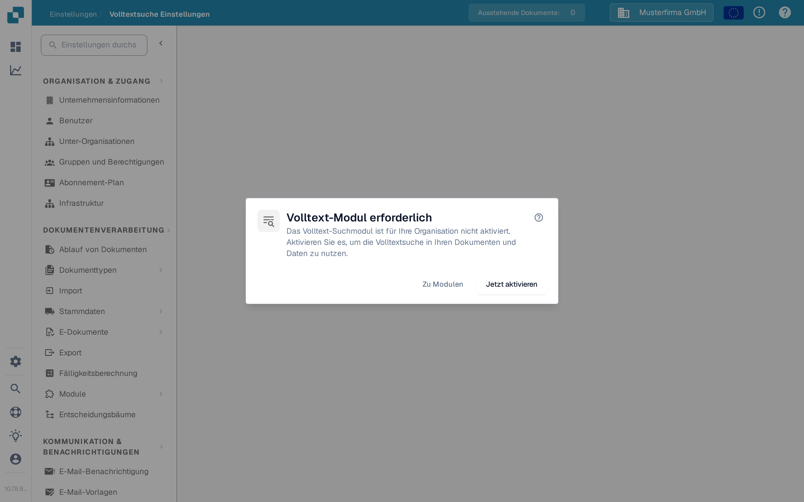

# Volltextsuche-Einstellungen

<figure><figcaption>
Ist die Volltextsuche deaktiviert, erklärt dieser Dialog die nächsten Schritte.
</figcaption></figure>

Die Volltextsuche-Einstellungen legen fest, was DocBits indexiert und wie diese Inhalte für die Suche über Dokumente, ERP-Stammdaten und Vorlagen hinweg verfügbar werden. Die Einstellungsseite zeigt ein Anforderungs-Dialogfenster, bis das **Volltextsuche-Modul** aktiviert ist — die benutzerseitige Abfragesprache finden Sie unter [Volltextsuche](../document-processing/module/fulltext-search.md).

## Voraussetzungen

Das Volltextsuche-Modul muss unter **Einstellungen → Module → Dashboards & Analytics → Volltextsuche** aktiviert sein. Ist das Modul nicht aktiviert, bietet der Dialog drei Aktionen:

* **Hilfe (?)** — Öffnet die Volltextsuche-Dokumentation in einem neuen Tab, bevor Sie eine Einstellung ändern.
* **Zu Modulen** — Öffnet die Modul-Einstellungen unter Dashboards & Analytics, um die Konfiguration zu prüfen.
* **Jetzt aktivieren** — Öffnet den Abonnement-Dialog. Prüfen und bestätigen Sie diesen Dialog, bevor das Modul aktiviert wird; ein Klick auf diese Schaltfläche allein aktiviert das Modul noch nicht.

Die Einstellungsseite selbst wird verfügbar, sobald das Modul aktiv ist.

## Aufbau der Seite

Die Einstellungsseite ist in drei Reiter unterteilt, von denen jeder einen anderen Inhaltstyp abdeckt, den die Volltextsuche indexieren kann.

### Reiter „Dokumente“

Der Reiter Dokumente umfasst alles rund um die Indexierung verarbeiteter Dokumente:

* **Indexierungs-Statistik** — Summen für indexierte und ausstehende Dokumente, bei Bedarf manuell aktualisierbar.
* **Vektor-Einstellungen** — drei organisationsweite Schalter, die festlegen, ob die Vektor-Indexierung parallel zum Textindex für Dokumente läuft. Die Vektor-Indexierung versorgt den `vector:`-Suchmodus und die Funktion „Ähnliche finden“.
* **Reindexierungs-Aktionen** — starten Sie eine vollständige oder inkrementelle Neuindexierung. Während die Neuindexierung läuft, sehen Sie den aktuellen Fortschritt (Dokumente pro Minute, voraussichtliche Restzeit), den Status des Streams und den letzten Fehler (falls vorhanden).
* **Synchronisierungs-Diagnose** — bei Bedarf abrufbare Diagnose für Fälle, in denen der Index nicht mit dem zugrunde liegenden Dokumentenspeicher übereinzustimmen scheint.

Die Neuindexierung ist nicht zerstörerisch — die bestehende Suche funktioniert weiter, während der neue Index aufgebaut wird.

### Reiter „ERP“

Der Reiter ERP steuert die Indexierung der ERP-Stammdaten — Lieferanten, Kunden, Artikel und ähnliche Entitäten. Jede Entität hat eigene Schalter:

* **Indexierung** — die Entität wird textlich indexiert und ist im Dashboard durchsuchbar.
* **Vektor** — die Entität wird vektoriell indexiert und kann über semantische Abfragen gefunden werden.

Über die Aktion **Alle umschalten** am Anfang der Liste lässt sich derselbe Ein/Aus-Zustand für alle Entitäten gleichzeitig anwenden. Die Indexierung startet im Hintergrund; eine Anzeige pro Zeile zeigt an, wenn sie läuft.

### Reiter „Vorlagen“

Der Reiter Vorlagen listet die Vorlagen-Versionen, die dem Volltextindex bekannt sind. Mit dieser Ansicht bestätigen Sie nach einem erneuten Deployment, dass die von Ihnen genutzten Vorlagen-Versionen im Index vorhanden sind.

## Was indexiert wird

Sobald aktiviert und konfiguriert, ermöglicht die Volltextsuche:

* Die Suche über den gesamten Inhalt von Dokumenten (nicht nur die Metadatenfelder).
* Das Auffinden von Dokumenten anhand von Text in den hochgeladenen Dateien.
* Erweiterte Suchoperatoren für präzise Abfragen.
* Den direkten Zugriff auf Suchergebnisse vom Dashboard aus.
* Semantische Suche (`vector:`-Präfix), wenn die Vektor-Indexierung für den jeweiligen Inhaltstyp aktiv ist.

Die vollständige Referenz der Abfragesprache — einschließlich Bereichsabfragen, intelligenter Filter und KI-Suchmodus — finden Sie auf der Modul-Seite [Volltextsuche](../document-processing/module/fulltext-search.md).
