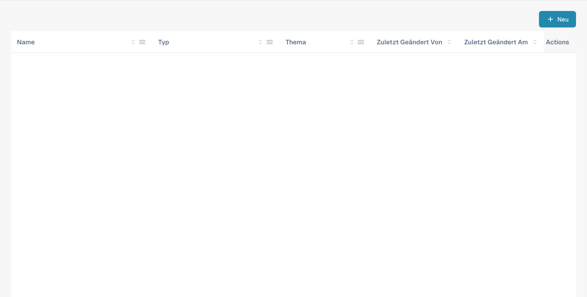

# E-Mail-Vorlagen bearbeiten

<figure><figcaption><p>Deutsche Vorlagenübersicht. Vorlagennamen, Betreffzeilen und Benutzerangaben sind ausgeblendet.</p></figcaption></figure>

### Überblick

Mit der Funktion E-Mail-Vorlagen können Administratoren E-Mail-Kommunikation erstellen und anpassen, die automatisch an Lieferanten gesendet wird. Eines der Schlüsselelemente dieser Vorlagen ist der `{{magic_link}}`, der einen dynamischen, auf jeden Empfänger zugeschnittenen Link bereitstellt.

#### Was ist `{{magic_link}}`?

Der `{{magic_link}}` ist ein Platzhalter, der beim Versand der E-Mail dynamisch durch eine eindeutige URL ersetzt wird. Diese URL leitet den Empfänger in der Regel dazu, eine Aktion abzuschließen, etwa eine Registrierung, eine Genehmigung oder den Zugriff auf einen bestimmten Bereich des Lieferantenportals.

### E-Mail-Vorlagen bearbeiten

<figure><figcaption></figcaption></figure>

#### Auf den E-Mail-Vorlagen-Editor zugreifen

1. **Zu den E-Mail-Vorlagen navigieren**:
   * Gehen Sie im Hauptmenü zum Abschnitt **E-Mail-Vorlagen**.
2. **Eine Vorlage zur Bearbeitung auswählen**:
   * Wählen Sie die E-Mail-Vorlage, die Sie bearbeiten möchten, indem Sie auf den Vorlagennamen klicken (z. B. „Supplier Invitation Email“).
3. **Die Vorlage bearbeiten**:
   * Mit dem Editor können Sie sowohl den HTML-Code als auch das visuelle Design der E-Mail ändern.
   * Über die bereitgestellten Registerkarten können Sie zwischen visueller Bearbeitung und Code-Bearbeitung wechseln.

<figure><figcaption></figcaption></figure>

#### `{{magic_link}}` als Link definieren

Damit `{{magic_link}}` in der E-Mail als anklickbarer Link erscheint, muss er im HTML-Code der Vorlage korrekt formatiert sein. Gehen Sie dazu wie folgt vor:

1. **Den Link-Abschnitt im HTML-Code finden**:
   * Suchen Sie im Code-Editor den Abschnitt, in dem der Magic Link erscheinen soll. Er befindet sich in der Regel in einem `<a>`-Tag (Anker).
2.  **Den Platzhalter `{{magic_link}}` einfügen**:

    * Ersetzen Sie das Attribut `href` des Anker-Tags durch `{{magic_link}}`.
    * Achten Sie darauf, dass der Link passend zur E-Mail-Vorlage gestaltet ist. Hier ein Beispiel:

    ```html
    <a href="{{magic_link}}" target="_blank" style="
        background-color: #B7184B;
        border-radius: 25px;
        font-family: 'Montserrat', Arial, sans-serif;
        font-size: 14px;
        font-weight: bold;
        padding: 12px 25px;
        color: #FFFFFF;
        text-decoration: none;
        display: inline-block;
        cursor: pointer;">
        Complete Registration
    </a>
    ```

### 3. Den Linktext anpassen:

• Ändern Sie den Text zwischen dem öffnenden \<a> und dem schließenden \</a>-Tag so, dass er die Aktion widerspiegelt, die der Benutzer ausführen soll, zum Beispiel „Registrierung abschließen“ oder „Auf Ihr Konto zugreifen“.

4\. Die Vorlage speichern und testen:

• Klicken Sie nach den Änderungen auf die Schaltfläche Save.

• Mit der Schaltfläche Send Test können Sie eine Test-E-Mail senden, um sicherzustellen, dass der Link wie erwartet funktioniert.

## Best Practices für die Verwendung von \{{magic\_link\}}

• Platzierung des Links: Platzieren Sie den \{{magic\_link\}} gut sichtbar in der E-Mail, damit er für die Empfänger leicht zugänglich ist.

• Eindeutiger Call-to-Action: Der Text im Link sollte eine klare Handlungsaufforderung sein, etwa „Registrierung abschließen“ oder „E-Mail-Adresse bestätigen“.

• Gestaltung: Achten Sie darauf, dass der Link zur übrigen E-Mail-Vorlage passend gestaltet ist und optisch hervorsticht.

• Testen: Senden Sie nach der Bearbeitung der Vorlage immer eine Test-E-Mail, um zu prüfen, dass der \{{magic\_link\}} korrekt aufgelöst wird und die Gestaltung passt.

## Fazit

Wenn Sie den \{{magic\_link\}} in Ihren E-Mail-Vorlagen korrekt definieren, stellen Sie sicher, dass Empfänger eine personalisierte und handlungsorientierte E-Mail erhalten, die sie zur passenden Aufgabe in Ihrem Lieferantenportal führt. Das verbessert die Benutzererfahrung und sorgt für ein reibungsloses Onboarding und reibungslose Kommunikationsprozesse.

\


Diese Dokumentation bietet Administratoren eine Schritt-für-Schritt-Anleitung, wie sie den \{{magic\_link\}} in E-Mail-Vorlagen definieren und verwenden, damit die E-Mails sowohl funktionsfähig als auch optisch ansprechend sind.
