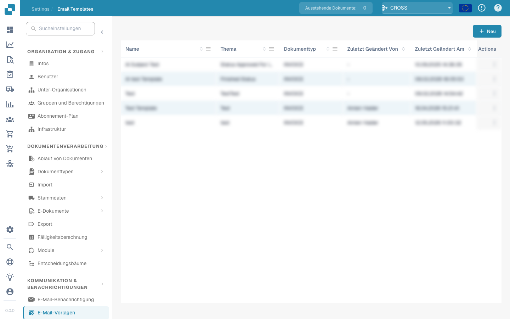
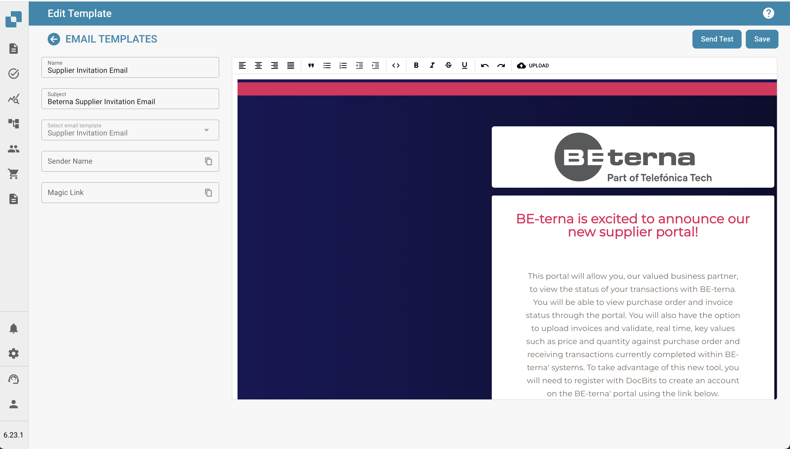

# Email Vorlagen editieren

**Übersicht**\
Die Funktion **E-Mail-Vorlagen** ermöglicht es Administratoren, E-Mail-Kommunikation zu erstellen und anzupassen, die automatisch an Lieferanten gesendet wird. Eines der Schlüsselelemente, das in diesen Vorlagen verwendet wird, ist der **\{{magic\_link\}}**, der einen dynamischen Link enthält, der für jeden Empfänger individuell angepasst wird.

<figure><figcaption></figcaption></figure>

**Was ist \{{magic\_link\}}?**\
Der **\{{magic\_link\}}** ist ein Platzhalter, der beim Versenden der E-Mail automatisch durch eine eindeutige URL ersetzt wird. Diese URL leitet den Empfänger in der Regel dazu, eine Aktion abzuschließen, wie z. B. eine Registrierung, Genehmigung oder den Zugriff auf einen bestimmten Bereich des Lieferantenportals.

**Bearbeiten von E-Mail-Vorlagen**

<figure><figcaption></figcaption></figure>

**Zugriff auf den E-Mail-Template-Editor**

1. **Navigieren Sie zu den E-Mail-Templates:**\
   Gehen Sie im Hauptmenü zum Abschnitt "E-Mail-Templates".
2. **Wählen Sie eine Vorlage zur Bearbeitung aus:**\
   Wählen Sie die E-Mail-Vorlage, die Sie bearbeiten möchten, indem Sie auf den Vorlagennamen klicken (z. B. "Lieferanteneinladung").
3. **Bearbeiten Sie die Vorlage:**\
   Der Editor ermöglicht es Ihnen, sowohl den HTML-Code als auch das visuelle Design der E-Mail zu bearbeiten.\
   Sie können über die bereitgestellten Registerkarten zwischen der visuellen Bearbeitung und dem Code-Editor wechseln.

<figure><figcaption></figcaption></figure>

***

**Definition von \{{magic\_link\}} als Link**

Um \{{magic\_link\}} als klickbaren Link in der E-Mail zu definieren, muss dieser korrekt im HTML-Code der Vorlage formatiert werden. Gehen Sie folgendermaßen vor:

1. **Finden Sie den Link-Abschnitt im HTML-Code:**\
   Im Code-Editor suchen Sie den Abschnitt, in dem der Magic-Link erscheinen soll. Dieser befindet sich in der Regel in einem \<a> (Anchor)-Tag.
2. **Fügen Sie den \{{magic\_link\}}-Platzhalter ein:**\
   Ersetzen Sie das **href**-Attribut des Anchor-Tags durch \{{magic\_link\}}.\
   Stellen Sie sicher, dass der Link im Stil der E-Mail-Vorlage korrekt formatiert ist. Hier ist ein Beispiel:

```html
<a href="{{magic_link}}" target="_blank" style="
    background-color: #B7184B;
    border-radius: 25px;
    font-family: 'Montserrat', Arial, sans-serif;
    font-size: 14px;
    font-weight: bold;
    padding: 12px 25px;
    color: #FFFFFF;
    text-decoration: none;
    display: inline-block;
    cursor: pointer;">
    Registrierung abschließen
</a>
```

3. **Passen Sie den Linktext an:**\
   Ändern Sie den Text zwischen den öffnenden und schließenden \<a>-Tags, um die gewünschte Aktion des Benutzers widerzuspiegeln, z. B. „Registrierung abschließen“ oder „Auf Ihr Konto zugreifen“.
4. **Speichern und testen Sie die Vorlage:**\
   • Klicken Sie nach den Änderungen auf die Schaltfläche "Speichern".\
   • Sie können die Schaltfläche "Test senden" verwenden, um eine Test-E-Mail zu senden und sicherzustellen, dass der Link wie gewünscht funktioniert.

***

**Best Practices für die Verwendung von \{{magic\_link\}}**

* **Platzierung des Links:** Platzieren Sie den \{{magic\_link\}} gut sichtbar in der E-Mail, damit er für die Empfänger leicht zugänglich ist.
* **Eindeutiger Call-to-Action:** Der Text im Link sollte eine klare Aufforderung zur Handlung sein, wie z. B. „Registrierung abschließen“ oder „E-Mail bestätigen“.
* **Stil:** Achten Sie darauf, dass der Link stilistisch mit der restlichen E-Mail übereinstimmt und sich optisch abhebt.
* **Testen:** Senden Sie nach jeder Bearbeitung eine Test-E-Mail, um zu prüfen, ob der \{{magic\_link\}} korrekt aufgelöst wird und die Formatierung stimmt.

***

**Fazit**

Durch die korrekte Definition des \{{magic\_link\}} in Ihren E-Mail-Vorlagen stellen Sie sicher, dass die Empfänger personalisierte und handlungsorientierte E-Mails erhalten, die sie zur entsprechenden Aufgabe im Lieferantenportal führen. Dies verbessert das Benutzererlebnis und gewährleistet einen reibungslosen Onboarding- und Kommunikationsprozess.

Diese Dokumentation bietet Administratoren eine Schritt-für-Schritt-Anleitung, wie der \{{magic\_link\}} in E-Mail-Vorlagen definiert und verwendet wird, um sicherzustellen, dass die E-Mails sowohl funktional als auch optisch ansprechend sind.
