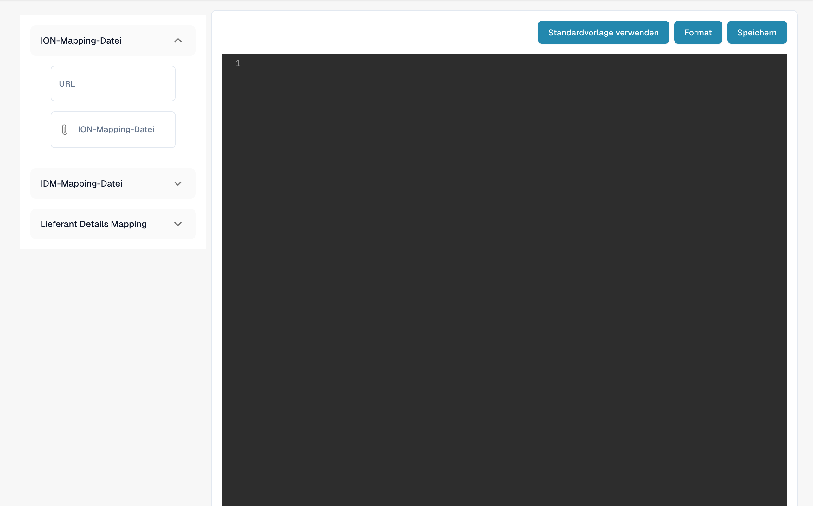

# Exportkonfiguration für das Lieferantenportal

<figure><figcaption><p>Deutsche Exportkonfiguration mit ION- und IDM-Mapping. Der Editor ist in diesem Beispiel leer; es wurde keine Konfiguration gespeichert.</p></figcaption></figure>

## Übersicht

Die Exportkonfigurationsdatei ist ein zentraler Bestandteil des Lieferantenportals. Sie definiert, wie Daten zwischen dem Lieferantenportal und dem ERP-System zugeordnet werden. Diese Konfiguration stellt sicher, dass Daten korrekt zwischen den Systemen übertragen und synchronisiert werden, und ermöglicht so einen reibungslosen und effizienten Betrieb.

## Struktur der Konfigurationsdatei

Die Exportkonfigurationsdatei ist als JSON-Objekt aufgebaut, das mehrere Zuordnungen enthält. Jede Zuordnung gehört zu einem bestimmten Programm im ERP-System und definiert die auszuführenden Aktionen, die zuzuordnenden Felder und die anzuwendenden Bedingungen.

## Wichtige Komponenten

### 1. Program

* **Definition**: Gibt das ERP-Programm an, auf das sich die Zuordnung bezieht.
* **Beispiel**: `"program": "CRS620MI"`

### 2. Actions

* **Definition**: Definiert die Aktionen, die ausgeführt werden können, etwa das Hinzufügen oder Aktualisieren von Datensätzen.
*   **Beispiel**:

    ```json
    "actions": {
        "add": "AddSupplier",
        "update": "UpdSupplier"
    }
    ```

### 3. Mapping

• Definition: Gibt die Zuordnung zwischen Feldern im ERP-System und Feldern im Lieferantenportal an.

• Komponenten:

• erp\_field\_name: Der Feldname im ERP-System.

• value\_field\_name: Der entsprechende Feldname im Lieferantenportal.

• value: Ein statischer Wert, der verwendet wird, wenn im Lieferantenportal kein entsprechendes Feld vorhanden ist.

• if\_conditions: Optionale Bedingungen, die den Wert anhand bestimmter Kriterien festlegen.

• Beispiel:

```json
{
    "erp_field_name": "SUNO",
    "value_field_name": "supplier_number"
}
```

### 4. Bedingte Logik (if\_conditions)

• Definition: Gibt Bedingungen an, die erfüllt sein müssen, damit ein bestimmter Wert verwendet wird.

• Komponenten:

• field\_name: Der Feldname im Lieferantenportal, der ausgewertet wird.

• field\_value: Der Wert, der die Bedingung auslöst.

• then\_value: Der Wert, der verwendet wird, wenn die Bedingung erfüllt ist.

• Beispiel:

```json
{
    "erp_field_name": "SUTY",
    "value": "0",
    "if_conditions": [{
        "field_name": "supplier_group",
        "field_value": "FRT",
        "then_value": "5"
    }]
}
```

### 5. Schleifen (loop\_on)

• Definition: Definiert die Abschnitte, in denen die Konfiguration eine Liste von Elementen durchlaufen soll, z. B. Adress- oder Referenzdetails.

• Beispiel:

```json
"loop_on": "address_details"
```

### 6. Berechnete Felder (value\_field\_calculated)

• Definition: Gibt Felder an, die zur Laufzeit berechnet werden sollen, z. B. die Ermittlung des aktuellen Datums.

• Beispiel:

```json
{
    "erp_field_name": "STDT",
    "value_field_calculated": "now()"
}
```

### 7. Feldzuordnungen mit Listen (mapping\_field\_name und mapping\_list)

• Definition: Ordnet bestimmte Werte aus dem Lieferantenportal anhand einer vordefinierten Liste den entsprechenden Werten im ERP-System zu.

• Komponenten:

• mapping\_field\_name: Das Feld, das die Zuordnung bestimmt.

• mapping\_list: Ein Wörterbuch, das Werte aus dem Lieferantenportal in Werte des ERP-Systems übersetzt.

• Beispiel:

```json
{
    "erp_field_name": "RFID",
    "mapping_field_name": "reference_type",
    "mapping_list": {
        "10": "PURCHASING",
        "15": "DLVRY PHN#",
        "20": "COA",
        "25": "QA",
        "30": "FINANCE",
        "35": "SALES"
    }
}
```

## Aufschlüsselung der Beispielkonfiguration

### Lieferant anlegen und aktualisieren (CRS620MI)

• Programm: CRS620MI

• Aktionen:

• Lieferant anlegen: AddSupplier

• Lieferant aktualisieren: UpdSupplier

• Zugeordnete Felder:

• SUNO → supplier\_number

• SUNM → name

• CSCD → supplier\_country

• TINO → tax\_id

• Weitere Felder enthalten statische Werte und bedingte Zuordnungen.

### Adressdetails (CRS620MI)

• Schleife über: _**address\_details**_

• Aktionen:

• Adresse anlegen: AddAddress

• Adresse aktualisieren: AddAddress

• Zugeordnete Felder:

• SUNO → supplier\_number

• ADR1 → address

• TOWN → city

• Weitere Felder enthalten berechnete Felder wie now() für das aktuelle Datum.

### Referenzdetails (CRS620MI)

• Schleife über: _**reference\_details**_

• Aktionen:

• Lieferantenreferenz anlegen: AddSupplierRef

• Lieferantenreferenz aktualisieren: AddSupplierRef

• Zugeordnete Felder:

• SUNO → supplier\_number

• RFTY → reference\_type

• RFID wird über eine Liste zugeordnet, um Typen wie „PURCHASING“, „QA“ und „FINANCE“ zu übersetzen.

## Die Exportkonfiguration verwenden

### 1. Konfigurationsdatei hochladen

#### 1. Zur Exportkonfiguration navigieren:

• Rufen Sie im Hauptmenü den Bereich Exportkonfiguration auf.

#### 2. Konfigurationsdatei hochladen:

• Klicken Sie auf den Bereich ION-Mapping File oder IDM Mapping File, um die jeweilige Konfigurationsdatei hochzuladen.

#### 3. Konfiguration speichern:

• Klicken Sie nach dem Hochladen auf die Schaltfläche Save, um die Konfiguration zu übernehmen.

### 2. Standardvorlagen verwenden

• Klicken Sie auf die Schaltfläche Use Default Template, wenn Sie zur vom System bereitgestellten Standardvorlage zurückkehren möchten.

### 3. JSON formatieren

• Verwenden Sie die Schaltfläche Format, um den JSON-Code für eine bessere Lesbarkeit automatisch zu formatieren.

## Fazit

Diese Konfigurationsdatei ist entscheidend dafür, dass die Daten zwischen dem Lieferantenportal und dem ERP-System korrekt zugeordnet und synchronisiert werden. Wenn Administratoren die Struktur und die wichtigsten Komponenten verstehen, können sie den Exportprozess effektiv verwalten und an ihre spezifischen Geschäftsanforderungen anpassen.

## Vollständiges Beispiel&#x20;

```json
[{
    "program": "CRS620MI",
    "actions": {
        "add": "AddSupplier",
        "update": "UpdSupplier"
    },
    "mapping": [{
        "erp_field_name": "SUNO",
        "value_field_name": "supplier_number"
    }, {
        "erp_field_name": "SUNM",
        "value_field_name": "name"
    }, {
        "erp_field_name": "SUTY",
        "value": "0",
        "if_conditions": [{
            "field_name": "supplier_group",
            "field_value": "FRT",
            "then_value": "5"
        }]
    }, {
        "erp_field_name": "CSCD",
        "value_field_name": "supplier_country"
    }, {
        "erp_field_name": "DTFM",
        "value_field_name": "date_format"
    }, {
        "erp_field_name": "ORTY",
        "value": "F20"
    }, {
        "erp_field_name": "DT4T",
        "value": "1"
    }, {
        "erp_field_name": "DTCD",
        "value": "2"
    }, {
        "erp_field_name": "CUCD",
        "value_field_name": "currency"
    }, {
        "erp_field_name": "TINO",
        "value_field_name": "tax_id"
    }, {
        "erp_field_name": "PHNO",
        "value_field_name": "supplier_phone"
    }, {
        "erp_field_name": "CRTP",
        "value": "1"
    }, {
        "erp_field_name": "ATPR",
        "value": "1"
    }, {
        "erp_field_name": "SUCL",
        "value_field_name": "supplier_group"
    }, {
        "erp_field_name": "LNCD",
        "value_field_name": "language"
    }, {
        "erp_field_name": "CONO",
        "value": "781_DDD"
    }, {
        "erp_field_name": "TEDL",
        "value": "FOB"
    }, {
        "erp_field_name": "TEPY",
        "value_field_name": "payment_term"
    }, {
        "erp_field_name": "TEPA",
        "value": "001"
    }, {
        "erp_field_name": "PYME",
        "value": "CRP"
    }]
}, {
    "program": "CRS620MI",
    "loop_on": "address_details",
    "actions": {
        "add": "AddAddress",
        "update": "AddAddress"
    },
    "mapping": [{
        "erp_field_name": "SUNO",
        "main_value_field": "supplier_number"
    }, {
        "erp_field_name": "ADTE",
        "value_field_name": "address_type"
    }, {
        "erp_field_name": "ADID",
        "value_field_name": "address_type",
        "if_conditions": [{
            "field_name": "address_type",
            "field_value": "10",
            "then_value": ""
        }]
    }, {
        "erp_field_name": "STDT",
        "value_field_calculated": "now()"
    }, {
        "erp_field_name": "ADR1",
        "value_field_name": "address"
    }, {
        "erp_field_name": "TOWN",
        "value_field_name": "city"
    }, {
        "erp_field_name": "ECAR",
        "value_field_name": "state"
    }, {
        "erp_field_name": "PONO",
        "value_field_name": "postal_code"
    }, {
        "erp_field_name": "CSCD",
        "value_field_name": "supplier_country"
    }]
}, {
    "program": "CRS620MI",
    "loop_on": "reference_details",
    "actions": {
        "add": "AddSupplierRef",
        "update": "AddSupplierRef"
    },
    "mapping": [{
        "erp_field_name": "SUNO",
        "main_value_field": "supplier_number"
    }, {
        "erp_field_name": "RFTY",
        "value_field_name": "reference_type"
    }, {
        "erp_field_name": "RFID",
        "mapping_field_name": "reference_type",
        "mapping_list": {
            "10": "PURCHASING",
            "15": "DLVRY PHN#",
            "20": "COA",
            "25": "QA",
            "30": "FINANCE",
            "35": "SALES"
        }
    }, {
        "erp_field_name": "YRE1",
        "value_field_name": "reference_name"
    }, {
        "erp_field_name": "PHNO",
        "value_field_name": "telephone_no"
    }, {
        "erp_field_name": "EMAL",
        "value_field_name": "email_address"
    }]
}]
```
