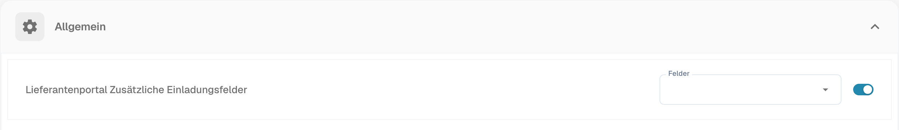

# Allgemeine Lieferanteneinstellungen

<figure><figcaption>
Deutscher Abschnitt „Allgemein“ mit zusätzlichen Einladungsfeldern für das Lieferantenportal. Konfigurierte Feldwerte sind ausgeblendet.
</figcaption></figure>

### Übersicht

Die Oberfläche **Allgemeine Lieferanteneinstellungen** bietet Administratoren die wichtigsten Werkzeuge, um das Lieferantenportal anzupassen. Zu den Kernfunktionen gehören das Hochladen eines Firmenlogos sowie die Definition der Richtlinien- und Datenschutzerklärung. Diese Einstellungen sind entscheidend, um ein einheitliches Markenbild zu wahren und rechtliche Anforderungen einzuhalten.

### Logo hochladen

#### Zweck

Mit der Funktion **Logo hochladen** können Administratoren das Lieferantenportal anpassen, indem sie das Logo ihres Unternehmens hochladen. Das stärkt die Markenwahrnehmung und sorgt für ein einheitliches visuelles Erscheinungsbild für Benutzer, die auf das Portal zugreifen.

#### Schritte zum Hochladen eines Logos

1. **Allgemeine Lieferanteneinstellungen öffnen**:
   * Navigieren Sie im Hauptmenü zum Bereich **Allgemeine Lieferanteneinstellungen**.
2. **Bereich „Upload Logo“ suchen**:
   * Scrollen Sie auf der Einstellungsseite nach unten zum Bereich **Logo hochladen**.
3. **Neues Logo hochladen**:
   * Klicken Sie auf den Bereich **Logo hochladen**, um den Dialog zur Dateiauswahl zu öffnen.
   * Wählen Sie die Bilddatei aus, die Sie hochladen möchten. Unterstützt werden in der Regel die Formate `.png`, `.jpg` oder `.jpeg`.
   * Das hochgeladene Logo wird im Vorschaubereich angezeigt.
4. **Hochgeladenes Logo speichern**:
   * Klicken Sie nach dem Hochladen des Logos auf die Schaltfläche **Speichern**, um die Änderungen zu übernehmen.
   * Das neue Logo wird nun im gesamten Lieferantenportal angezeigt.

#### Bewährte Vorgehensweisen

* **Logo-Abmessungen**: Stellen Sie sicher, dass die Abmessungen des Logos sowohl für die Desktop- als auch für die mobile Ansicht optimiert sind. Das System bietet möglicherweise Richtlinien oder eine automatische Größenanpassung.
* **Dateigröße**: Verwenden Sie eine komprimierte Bilddatei, um die Ladezeiten zu verkürzen und die Benutzerfreundlichkeit zu verbessern.
* **Markenkonsistenz**: Verwenden Sie auf allen Plattformen dasselbe Logo, um eine einheitliche Markenidentität zu wahren.

### Richtlinien- und Datenschutzerklärung

#### Zweck

Im Bereich **Politik und Erklärung zum Datenschutz** können Administratoren die rechtlichen Dokumente hochladen oder festlegen, die die Nutzung des Lieferantenportals regeln. Diese Dokumente sind für die Einhaltung gesetzlicher und regulatorischer Anforderungen unverzichtbar und enthalten die Nutzungsbedingungen, Datenschutzrichtlinien und weitere wesentliche Informationen für Benutzer.

#### Schritte zum Hochladen der Richtlinien- und Datenschutzerklärung

1. **Allgemeine Lieferanteneinstellungen öffnen**:
   * Navigieren Sie im Hauptmenü zum Bereich **Allgemeine Lieferanteneinstellungen**.
2. **Bereich „Policy and Privacy Statement“ suchen**:
   * Scrollen Sie nach unten zum Bereich **Politik und Erklärung zum Datenschutz**.
3. **Dokumente hochladen oder aktualisieren**:
   * Klicken Sie auf die Schaltfläche **Dokument hochladen**, um die relevanten Dateien auszuwählen.
   * Wählen Sie die Dokumentdatei aus Ihrem lokalen Speicher aus. Unterstützt werden in der Regel die Formate `.pdf`, `.docx` oder `.txt`.
   * Hochgeladene Dokumente werden in diesem Bereich zur Überprüfung aufgelistet.
4. **Änderungen speichern**:
   * Klicken Sie nach dem Hochladen oder Aktualisieren der Dokumente auf die Schaltfläche **Speichern**, damit die neuen Richtlinien übernommen werden.

#### Bewährte Vorgehensweisen

* **Regelmäßige Aktualisierung**: Prüfen und aktualisieren Sie die Richtlinien- und Datenschutzerklärung regelmäßig, damit sie den aktuellen gesetzlichen Anforderungen und Unternehmensrichtlinien entspricht.
* **Klarheit und Zugänglichkeit**: Stellen Sie sicher, dass die hochgeladenen Dokumente klar, präzise und für alle Benutzer zugänglich sind. Erwägen Sie Übersetzungen, wenn Ihr Lieferantenstamm international ist.
* **Rechtliche Prüfung**: Lassen Sie alle Dokumente vor dem Hochladen von einer Rechtsberatung prüfen, um die Einhaltung der einschlägigen Gesetze und Vorschriften sicherzustellen.
