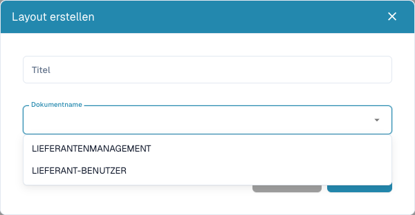

# Lieferantenformulare konfigurieren

<figure><figcaption>
Zuerst die externe oder interne Zielgruppe des neuen Layouts wählen. Es wurde nichts gespeichert.
</figcaption></figure>

Lieferantenlayouts bestimmen Formulare für Lieferanten und interne Mitarbeiter. Sie verändern weder das gedruckte Rechnungsbild noch das Extraktionstraining. Sie benötigen Administratorrechte und abgestimmte Informationsanforderungen je Zielgruppe.

## Zielgruppe wählen

1. Öffnen Sie **Einstellungen → Lieferanteneinstellungen → Lieferantenlayout**.
2. Prüfen Sie vorhandene Layouts und öffnen Sie das passende, bevor Sie ein weiteres anlegen.
3. Wählen Sie für ein neues Layout **Neu**, einen eindeutigen Titel und den Dokumentnamen: **Lieferant-Benutzer** für die externe oder **Lieferantenmanagement** für die interne Ansicht.
4. Speichern Sie diese Definition, öffnen Sie das Layout aus der Liste und prüfen Sie die Zielgruppe.

## Felder und Aufbau konfigurieren

1. Öffnen Sie **Lieferantenfelder**. Prüfen Sie Titel, ERP-Feldname, Werteliste sowie Pflichtfeld, schreibgeschützt und verborgen.
2. Legen Sie neue Definitionen über **Feld erstellen** mit Name, Titel und Typ an. Auswahl-/Such-/Optionsfelder benötigen die passende Werteliste. Dateifelder benötigen den Dokumenttyp; prüfen Sie bei anderen Feldern den ERP-Feldnamen.
3. Speichern Sie korrekte Feldeinstellungen. Definition und Formularanordnung sind getrennte Schritte.
4. Ordnen Sie im richtigen Layout Gruppen und Felder über **Elemente** und **Felder** an. Wählen Sie ein Element und prüfen Sie die angebotenen Eigenschaften.
5. Geben Sie gültige Gruppennamen und Titel an. Verbergen oder sperren Sie kein Pflichtfeld ohne passenden bestehenden Wert oder Prozess.
6. Speichern und öffnen Sie das Layout erneut. **Abbrechen** verlässt den Editor. Eine Standardvorlage kann den aktuellen Aufbau ersetzen; verwenden Sie sie gezielt.

## Beide Ansichten testen

Prüfen Sie mit synthetischem Lieferanten und Testkonto die Registrierung und interne Lieferantendetailansicht getrennt: Pflichtfeldmeldungen, Auswahlwerte, Datei-Upload und versteckte/gesperrte Felder. Speichern im Builder belegt keine erfolgreiche Registrierung, Freigabe oder ERP-Übertragung.

Prüfen Sie bei fehlenden Feldern Definition, Sichtbarkeit, Layout und Zielgruppe; bei fehlenden ERP-Werten zusätzlich das Exportmapping.

Siehe [Lieferantenportal](../../setup/supplier-portal/README.md), [Allgemeine Einstellungen](supplier-general-settings.md) und [Lieferantenberechtigungen](supplier-permissions.md).

## Video: Postleitzahl im internen Lieferantenlayout als Pflichtfeld festlegen

Im deutschen Video wählt ein Administrator das Feld **Postleitzahl** in einem vorbereiteten Layout der internen Lieferantenverwaltung aus, aktiviert **Erforderlich** und speichert die Vorlage. Nach dem erneuten Laden prüft er, dass die Eigenschaft erhalten bleibt.




[Video mit deutschen Untertiteln und Transkript öffnen](https://docbits-videos.fra1.cdn.digitaloceanspaces.com/settings-assistant/supplier-layout-required-field-admin/v1/de.html).

Die Beispielvorlage enthält Lieferantenname, Stadt und Postleitzahl. Die rote Markierung des leeren Feldes erscheint in der Vorschau des Layout-Editors. Gezeigt werden die Pflichtfeld-Eigenschaft und ihre Speicherung; die Lieferantenregistrierung und die Prüfung leerer oder ausgefüllter Felder in einem tatsächlichen Lieferantendatensatz sind nicht Bestandteil dieses Videos.
