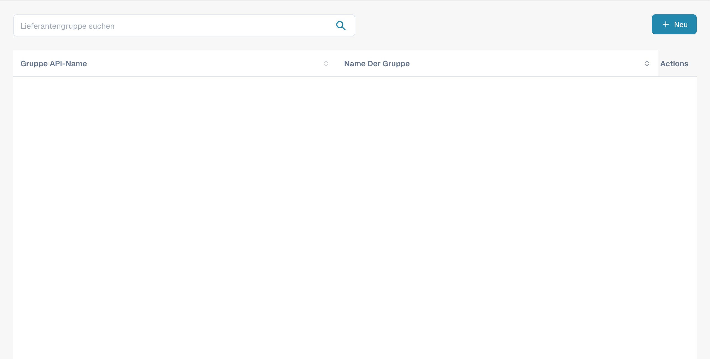
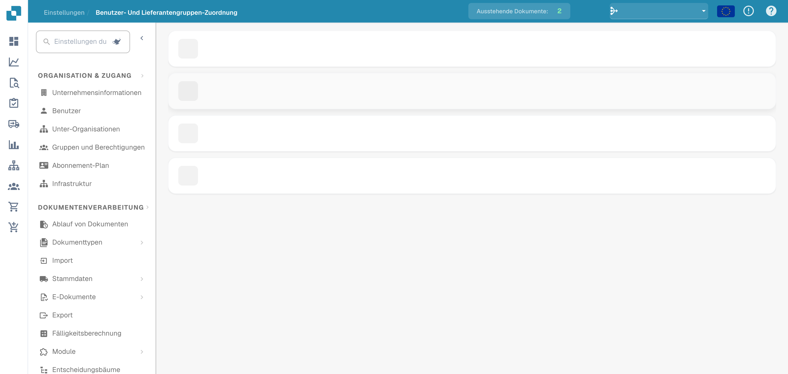

# Lieferantenberechtigungen

### Lieferantengruppe

<figure><figcaption>
Deutsche Lieferantengruppenübersicht. Gruppendaten sind ausgeblendet.
</figcaption></figure>

Verwalten Sie Lieferantengruppen, um Lieferanten nach Typ, Region oder Rolle zu kategorisieren. Jede Gruppe hat die Felder **Gruppe API-Name** (für Integrationen) und **Name Der Gruppe** (Anzeigename).

Klicken Sie auf **+ Neu**, um eine Gruppe anzulegen. Über das Dreipunkt-Menü in jeder Zeile können Sie sie bearbeiten oder löschen.

### Zuordnung von Benutzern zu Lieferantengruppen

<figure><figcaption>
Deutsche Benutzer- und Lieferantengruppen-Zuordnung. Gruppennamen sind ausgeblendet.
</figcaption></figure>

Weisen Sie Benutzer Lieferantengruppen zu, um zu steuern, welche Mitarbeiter auf bestimmte Lieferanten zugreifen und diese verwalten dürfen. Jede Gruppe wird als aufklappbarer Bereich angezeigt, der die zugewiesenen Benutzer und die Anzahl der Mitglieder auflistet.

Klicken Sie innerhalb einer Gruppe auf **+ Neu**, um eine Benutzerzuordnung hinzuzufügen. Über das Dreipunkt-Menü können Sie eine Zuordnung entfernen.
