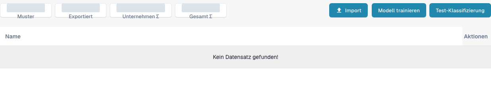

# Dokumententraining

Beim Dokumententraining lernt DocBits, wo Werte auf Dokumenten zu finden sind, die noch nicht richtig gelesen werden. Trainieren Sie Kopffelder und Positionsfelder getrennt.

Um das Klassifikationstraining eines Dokumenttyps anzusehen, öffnen Sie **Einstellungen** → **Dokumenttypen** und wählen auf einer vorhandenen Dokumenttypkarte **Modell Training**. Die Ansicht zeigt Trainingsbeispiele sowie **Import**, **Modell trainieren** und **Test-Klassifizierung**. Prüfen Sie vorhandene Beispiele vor Änderungen und verwenden Sie für spätere Trainingsläufe oder Klassifikationstests freigegebene Testdateien.

<figure><figcaption>
Deutsche Modelltrainingsansicht eines vorhandenen Rechnungstyps. Es sind keine Beispieldokumente aufgelistet; aggregierte Zähler sind abgedeckt. Import, Training und Klassifikationstest wurden nicht ausgeführt.
</figcaption></figure>

* [Kopffelder trainieren](training-header-fields.md): markieren Sie, wo ein Kopfwert wie Datum oder Gesamtbetrag im Dokument steht.
* [Positionsfelder und Tabellen trainieren](training-line-fields-table-training/README.md): legen Sie die Struktur der Positionstabelle für einen bestimmten Lieferanten fest.

Trainingsergebnisse hängen von den verwendeten Dokumenten ab. Prüfen Sie die extrahierten Werte deshalb an einem weiteren Testdokument, bevor Sie sich darauf verlassen.
