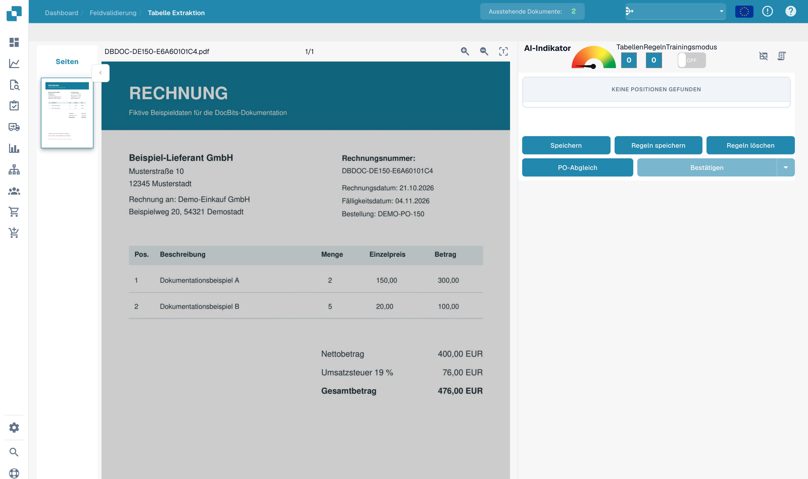
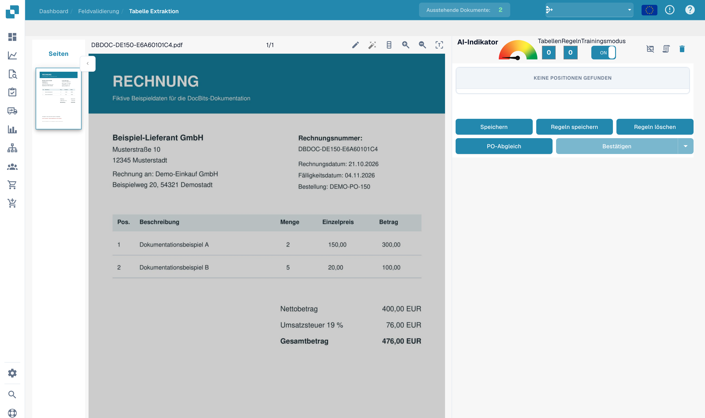
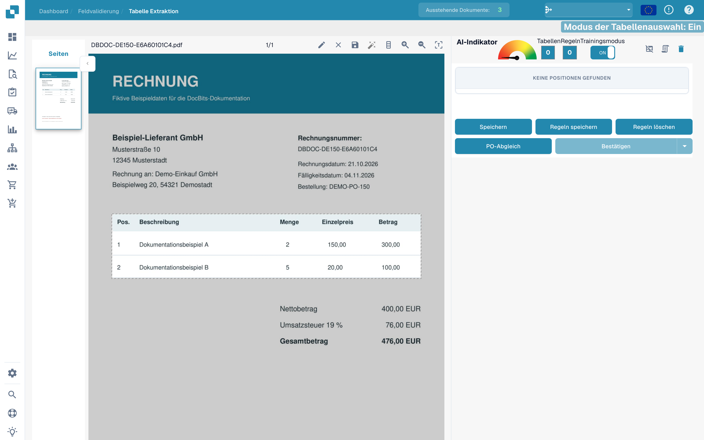
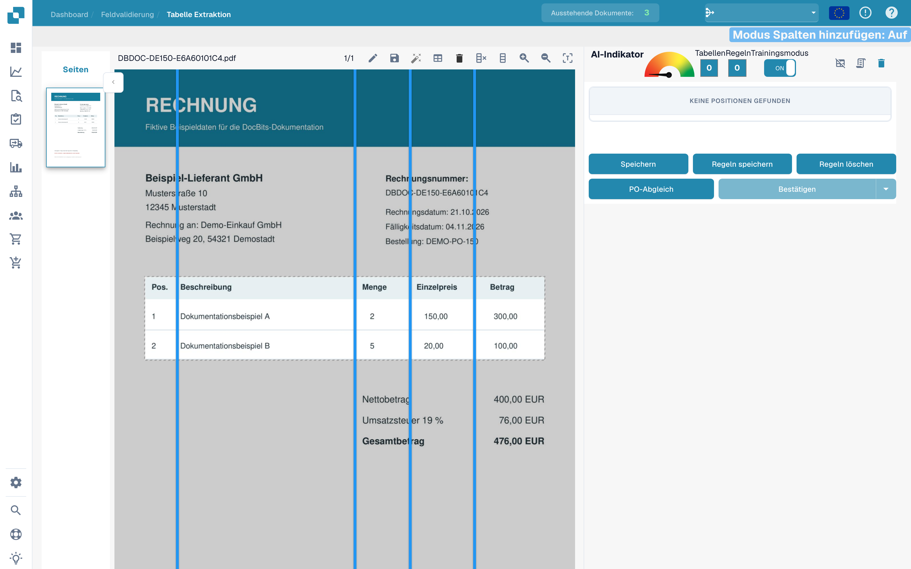
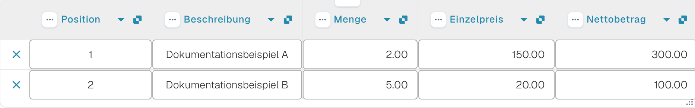

# Tabellen und Spalten definieren

Wenn eine Tabelle nicht vollständig erkannt wird, können Sie ihren Bereich und ihre Spalten im Tabellentraining festlegen. Die Abbildungen verwenden eine fiktive Rechnung. Die gezeigten Trainingsbereiche sind ungespeicherte Entwürfe.

## Tabellentraining öffnen

Öffnen Sie das Dokument in der **Feldvalidierung** und rufen Sie das **Tabellentraining** auf. Der Arbeitsbereich zeigt das Dokument links und die Tabellenwerkzeuge rechts.

<figure><figcaption>
Deutsche Oberfläche zum Definieren von Tabellen und Spalten.
</figcaption></figure>

## Trainingsmodus aktivieren

Aktivieren Sie den Schalter **Trainingsmodus**.

<figure><figcaption>
Tabellentraining mit aktiviertem Trainingsmodus.
</figcaption></figure>

## Tabellenbereich festlegen

Die Werkzeugleiste bietet eine automatische Tabellenerkennung. Prüfen Sie deren Ergebnis am Dokument, bevor Sie Spalten festlegen. Die folgende Aufnahme zeigt die verfügbaren Werkzeuge.

<figure><figcaption>
Werkzeuge des Tabellentrainings einschließlich der automatischen Erkennung.
</figcaption></figure>

Für eine manuelle Auswahl aktivieren Sie das Stiftsymbol und ziehen ein Rechteck um Tabellenüberschrift und Positionszeilen. Summen unterhalb der Tabelle gehören nicht in diesen Bereich.

<figure><figcaption>
Ungespeicherter Tabellenbereich um die Positionen der fiktiven Rechnung.
</figcaption></figure>

## Spalten trennen und prüfen

Wechseln Sie zum Werkzeug für Spalten und setzen beziehungsweise verschieben Sie die senkrechten Trenner an den Grenzen der tatsächlichen Spalten.

<figure><figcaption>
Tabellenbereich im Bearbeitungsmodus mit senkrechten Spaltentrennern.
</figcaption></figure>

Prüfen Sie die Trennung für Position, Beschreibung, Menge, Einzelpreis und Betrag. Im Beispiel umfassen die Trenner die fünf Spalten der Rechnung.

<figure><figcaption>
Tabellenbereich mit gesetzten Spaltentrennern im Trainingsentwurf.
</figcaption></figure>

Kontrollieren Sie den vollständigen Tabellenbereich und die Zuordnung, bevor Sie **Speichern** oder **Regeln speichern** verwenden.

<figure><figcaption>
Tabellenbereich mit Spaltentrennern in einem ungespeicherten Trainingsentwurf.
</figcaption></figure>

## Extrahierte Werte kontrollieren

Vergleichen Sie die extrahierten Positionen mit dem Original. Die folgende Abbildung zeigt die bereits automatisch extrahierten Zeilen der Beispielrechnung in der Validierung. Sie ist kein Ergebnis des oben gezeigten ungespeicherten Trainingsentwurfs.

<figure><figcaption>
Extrahierte Positionen der fiktiven Rechnung in der deutschen Validierungsansicht.
</figcaption></figure>

Mit **Regeln speichern** hinterlegen Sie das beabsichtigte Training. Testen Sie gespeicherte Regeln anschließend an weiteren Dokumenten desselben Lieferanten. Ein einzelnes Beispiel belegt noch keine zuverlässige Erkennung anderer Layouts.
