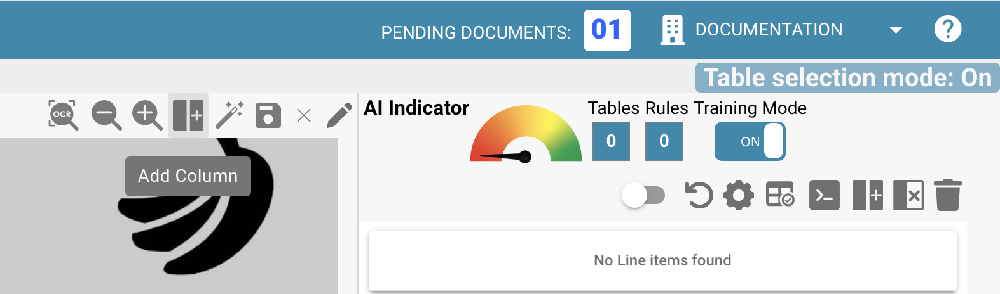
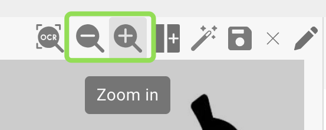

# Tabellen und Spalten definieren

Mit dieser Anleitung definieren Sie Tabellen und Spalten für die Extraktion von Positionszeilen in DocBits manuell. Das ist besonders nützlich, wenn die automatische Erkennung die Tabellenstruktur nicht vollständig erfasst oder wenn Sie eigene Felder hinzufügen möchten.

### 1. Ansicht zur Tabellenextraktion öffnen

Öffnen Sie Ihr Dokument in DocBits und klicken Sie auf die Schaltfläche **„Table Training“**, um die Ansicht zur Tabellenextraktion aufzurufen.

<figure><figcaption></figcaption></figure>

### 2. Trainingsmodus aktivieren

Um Tabellen und Spalten manuell zu definieren oder zu ändern, klicken Sie auf **„TRAINING MODE“**.

<figure><figcaption></figcaption></figure>

### 3. Tabellenbereich definieren

Nach dem Wechsel in den Trainingsmodus können Sie festlegen, wo sich die Tabelle im Dokument befindet. Dafür stehen zwei Möglichkeiten zur Verfügung:

#### Option 1: Automatische Erkennung verwenden

Klicken Sie auf die Schaltfläche **„Auto-Detect Tables“**, damit DocBits versucht, den Tabellenbereich selbstständig zu erkennen.

<figure><figcaption></figcaption></figure>

Wenn die Erkennung erfolgreich ist, wird der Tabellenumriss automatisch angezeigt. Anschließend können Sie mit der Definition der Spalten fortfahren.

#### Option 2: Tabelle manuell definieren

Wenn die automatische Erkennung fehlschlägt oder ungenau ist, können Sie die Tabelle manuell definieren:

1. Klicken Sie auf die Schaltfläche **„Edit“**, um den Tabellenauswahlmodus zu aktivieren.
2. Zeichnen Sie in der Dokumentansicht auf der linken Seite ein Rechteck um den Tabellenbereich.

<figure><figcaption></figcaption></figure>

### 4. Spalten hinzufügen und definieren

Sobald die Tabellen definiert sind, können Sie die Spalten über die folgende Schaltfläche manuell definieren:\

<figure><figcaption></figcaption></figure>

Definieren und sortieren Sie die Spalten per Drag-and-drop im Dokument. Wiederholen Sie dies auch für die Tabellen auf den anderen Seiten. Alternativ können Sie, wenn die Tabellen auf jeder Seite gleich aufgebaut sind, die folgende Schaltfläche verwenden, um dieselben Spalten für alle im Dokument definierten Tabellen zu übernehmen. Diese Funktion kopiert die von Ihnen definierten Spalten auch auf alle anderen Seiten:

<figure><figcaption></figcaption></figure>

Verwenden Sie die **Zoom**-Funktion, um Spalten in unübersichtlichen oder komplexen Dokumenten besser zu definieren, zum Beispiel wenn viele Informationen dicht beieinander liegen und die Definition der Spalten dadurch erschwert wird:

<figure><figcaption></figcaption></figure>

Wenn Sie versehentlich eine Spalte definiert haben, können Sie sie durch Anklicken auswählen und über die folgende Schaltfläche löschen:

<figure><figcaption></figcaption></figure>

<mark style="color:red;">**Hinweis**</mark>: Die Schaltfläche ist nur sichtbar, wenn die Spalte ausgewählt ist.

Wenn Sie alle Tabellen und alle Spalten in Ihrem Dokument definiert haben, klicken Sie auf die Schaltfläche „Save“, um Ihre Änderungen zu aktivieren und die Daten aus dem Dokument zu extrahieren:

<figure><figcaption></figcaption></figure>

Die Daten aller definierten Bereiche werden extrahiert und auf der rechten Seite angezeigt:

<figure><figcaption></figcaption></figure>

### 6. Speichern und extrahieren

Klicken Sie auf **„Save Rules“**, sobald alle Tabellen und Spalten definiert sind.

* Dadurch weiß DocBits, wo sich die Tabellendaten für diesen bestimmten Lieferanten befinden.
* Wenn das nächste Mal ein Dokument desselben Lieferanten hochgeladen wird, extrahiert DocBits die Tabelle automatisch anhand der gespeicherten Regeln.

<mark style="color:red;">**Hinweis**</mark>: Dieses Training gilt nur für den jeweiligen Lieferanten. Es wird nicht auf Dokumente anderer Lieferanten angewendet.
