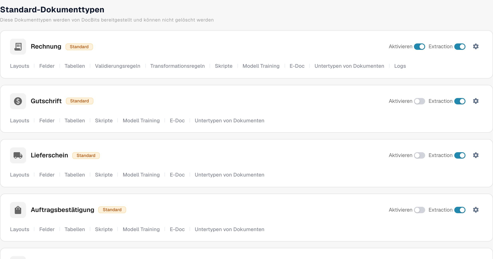
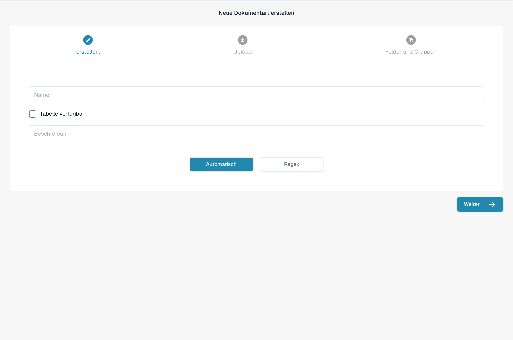

# Dokumenttypen

Dokumenttypen teilen DocBits mit, mit welchen Arten von Dokumenten Ihre Organisation arbeitet. Ein Administrator findet sie unter **Einstellungen → Dokumenttypen** im Bereich **Dokumentenverarbeitung** des Einstellungsmenüs.

Die Seite zeigt zuerst die **Standard-Dokumenttypen**, die DocBits bereitstellt und die Sie nicht löschen können, gefolgt von den **Benutzerdefinierte Dokumenttypen**, die für Ihre Organisation erstellt wurden. Jeder Typ hat eine eigene Karte.

<figure><figcaption>
Deutsche Standard-Dokumenttypen mit Aktivieren, Layouts, Feldern und Tabellen. Extraction ist ein fester Produktbegriff.
</figcaption></figure>

## Was Sie auf einer Karte tun können

| Steuerelement | Funktion |
| --- | --- |
| **Aktivieren** | Macht diesen Dokumenttyp in Ihrer Organisation verfügbar oder nicht verfügbar. Ein blauer Schalter ist eingeschaltet, ein grauer ausgeschaltet. |
| **Extraktion** | Legt den Extraktionsmodus fest: **Flex**, wenn eingeschaltet, oder **Fix**, wenn ausgeschaltet. Der Schalter schaltet die Extraktion nicht einfach ein oder aus. Bewegen Sie den Mauszeiger über den Schalter, um den aktuellen Modus anzuzeigen. |
| **Einstellungen** (Zahnrad) | Öffnet **Weitere Einstellungen** für diesen Typ. Erweitern Sie dort eine Kategorie, um ihre Optionen anzuzeigen. Die Kategorien hängen vom Dokumenttyp ab. |
| **Layouts** | Öffnet die Layout-Konfiguration. Die nächsten Schritte finden Sie im [Layout Builder](layout-builder.md). |
| **Felder** | Öffnet die Feld- und Erkennungseinstellungen für diesen Typ. Wie Sie diese konfigurieren, erfahren Sie unter [Felder](../../settings/global-settings/document-types/fields/README.md). |
| **Tabellen** | Öffnet die Konfiguration der Tabellenspalten für diesen Typ. |
| **Skripte** | Öffnet die Verarbeitungsskripte, sofern diese Funktion verfügbar ist. |
| **Modell Training** | Öffnet das Modelltraining für diesen Typ. |
| **E-Doc** | Öffnet die Einstellungen für elektronische Dokumente, sofern der Typ sie unterstützt. |
| **Untertypen von Dokumenten** | Öffnet die Untertypen dieses Dokumenttyps. |

Je nach den Funktionen Ihrer Organisation sehen Sie möglicherweise weitere Links, etwa zu Validierungs- oder Transformationsregeln. Wählen Sie den Link auf der Karte des Typs, den Sie ändern möchten.

## Felder und Erkennungseinstellungen bearbeiten

Klicken Sie auf einer Karte auf **Felder**, um die Feldgruppen anzuzeigen. Oben auf dieser Seite legen **OCR** und **Abgleichswert** die Schwellenwerte für die Erkennung fest, **Standardwerte wiederherstellen** setzt diese Schwellenwerte zurück und mit **Suche nach Name** finden Sie ein Feld. Mit **Neue Gruppe erstellen** ordnen Sie Felder in Gruppen, mit **Feld erstellen** fügen Sie innerhalb einer Gruppe ein Feld hinzu. **Stammdaten-Einstellungen** öffnet die zugehörige Stammdatenkonfiguration.

Jede Feldzeile enthält Steuerelemente wie **Pflichtfeld**, **Schreibgeschützt**, **Ausgeblendet**, **Validierung erzwingen**, **KI nutzen**, OCR, Match Score und Formula. Lesen Sie die [Anleitung zu Feldern](../../settings/global-settings/document-types/fields/README.md), bevor Sie einzelne Werte ändern. Klicken Sie auf der Seite „Fields“ auf **Einstellungen speichern**, um Ihre Änderungen zu speichern.

<figure><figcaption>
Felder des Dokumenttyps Rechnung in der deutschen Verwaltung.
</figcaption></figure>

## Benutzerdefinierten Dokumenttyp erstellen

Scrollen Sie zu **Benutzerdefinierte Dokumenttypen** und klicken Sie auf **+ Neu**. Folgen Sie der Anleitung [Dokumenttypen hinzufügen/bearbeiten](../../settings/global-settings/document-types/adding-editing-document-types.md), um den neuen Typ einzurichten.

<figure><figcaption>
Erster Schritt Neue Dokumentart erstellen mit Name, Beschreibung, Tabelle verfügbar und Weiter.
</figcaption></figure>
