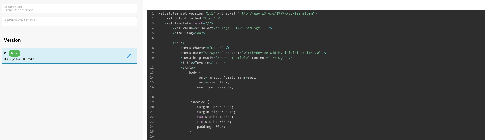

# EDI-Datentransformationsprozess



<figure><figcaption></figcaption></figure>

#### Schritt 1: Strukturbeschreibung (Structure Descriptor)

* **Format**: JSON
* **Zweck**: In diesem Schritt wird die Struktur der EDI-Daten definiert. Dazu gehört die Angabe von Segmenten wie `SAC`, `N1` und `PO1` sowie die Beschreibung der Felder, die in den einzelnen Segmenten enthalten sind. Für Segmente mit verschachtelten Strukturen werden Schleifen (Loops) definiert, damit die Datenhierarchie korrekt abgebildet wird.

```json
{
  "SAC": {"fields": ["SAC", "DTM", "TX1", "TD5"]},
  "N1": {"fields": ["N1", "N2", "N3", "N4", "PER"]},
  "PO1": {
    "fields": ["PO1", "REF"],
    "loops": {
      "SAC": {"fields": ["SAC", "TX1", "DTM"]}
    }
  }
}
```

#### Schritt 2: Transformation mit XSLT

* **Format**: XSLT
* **Zweck**: In diesem Schritt werden die strukturierten JSON-Daten in ein strukturiertes XML-Format transformiert. Die Ausgabe wird dabei gezielt auf die Anforderungen der Weiterverarbeitung oder Integration zugeschnitten. Diese Transformation hilft, präzise Informationen wie Bestätigungstypen, Bestelldetails und bedingte Elemente anhand bestimmter Werte zu extrahieren.

```xml
<xsl:stylesheet version="1.1" xmlns:xsl="http://www.w3.org/1999/XSL/Transform">
    <xsl:output method="xml" />
    <xsl:template match="/">
        <ORDER_CONFIRMATION>
            <ACKNOWLEDGEMENT_TYPE>
                <xsl:value-of select="//BAK/VALUE_2/text()" />
            </ACKNOWLEDGEMENT_TYPE>
            <ACKNOWLEDGEMENT_TYPE_DESCRIPTION>
                <xsl:choose>
                    <xsl:when test="//BAK/VALUE_2='AD'">With detail, no change</xsl:when>
                    <xsl:when test="//BAK/VALUE_2='AC'">With detail and change</xsl:when>
                    <xsl:otherwise>Unknown</xsl:otherwise>
                </xsl:choose>
            </ACKNOWLEDGEMENT_TYPE_DESCRIPTION>
            <!-- Additional fields and conditions are similarly transformed -->
        </ORDER_CONFIRMATION>
    </xsl:template>
</xsl:stylesheet>

```

#### Schritt 3: Vorschau (HTML-Konvertierung)

* **Format**: XSLT (mit HTML-Ausgabe)
* **Zweck**: Konvertiert die XML-Daten aus Schritt 2 in ein HTML-Format, um die transformierten Daten in einer gut lesbaren und ansprechenden Form als Vorschau anzuzeigen. Das HTML-Layout enthält Stile für die Darstellung und strukturiert Daten wie Bestellungen, Lieferantendetails und Bestellbedingungen für eine übersichtliche Ansicht.

```xml
<xsl:stylesheet version="1.1" xmlns:xsl="http://www.w3.org/1999/XSL/Transform">
    <xsl:output method="html" />
    <xsl:template match="/">
        <html lang="en">
            <head>
                <meta charset="UTF-8" />
                <meta name="viewport" content="width=device-width, initial-scale=1.0" />
                <title>Preview of Transformed EDI Data</title>
                <!-- Styles and head elements -->
            </head>
            <body>
                <div>
                    <!-- HTML structure mimicking an invoice or other document type, with data bindings from the transformed XML -->
                </div>
            </body>
        </html>
    </xsl:template>
</xsl:stylesheet>


```

#### Schritt 4: Extraktionspfade

* **Format**: JSON
* **Zweck**: Legt JSON-Pfade fest, mit denen Schlüsselwerte aus den in Schritt 2 erzeugten XML-Daten extrahiert werden. Diese Pfade dienen dazu, bestimmte Datenpunkte wie Bestellungen und Währung abzurufen, die für die nachgelagerte Verarbeitung und die Integration in andere Systeme entscheidend sind.

```json
{
  "fields": {
    "purchase_order": "//ORDER_CONFIRMATION/PURCHASE_ORDER/text()",
    "currency": "//ORDER_CONFIRMATION/CURRENCY/text()",
    ...
  },
  "tables": [
    {
      "name": "ORDER_CONFIRMATION_TABLE",
      "row_path": "//ORDER_CONFIRMATION/ORDER_LINES/ORDER_LINE",
      "columns": [
        {"name": "POSITION", "path": "POSITION/text()"},
        ...
      ]
    }
  ]
}
```

Diese aktualisierte Abfolge gewährleistet einen durchgängigen Prozess, der rohe EDI-Daten in strukturierte, verwertbare Informationen umwandelt: JSON für die Datenstrukturierung, XSLT für die Transformation und die HTML-Vorschau, anschließend JSON-Pfade für die Datenextraktion und Integration.
