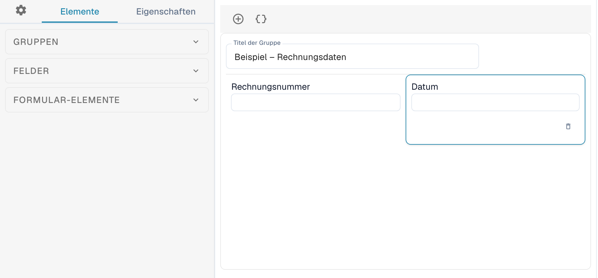
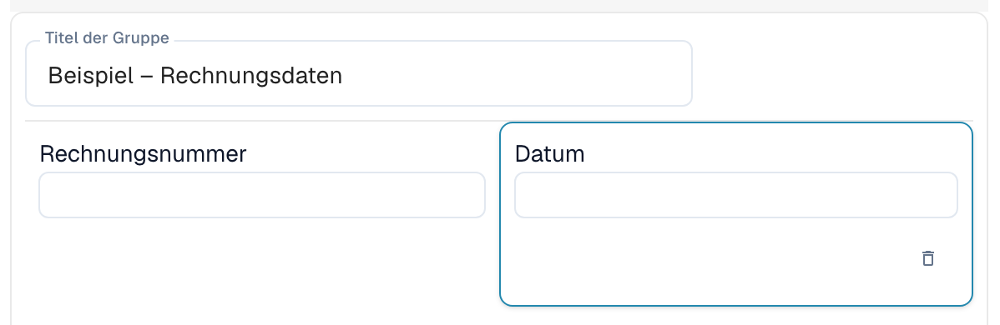
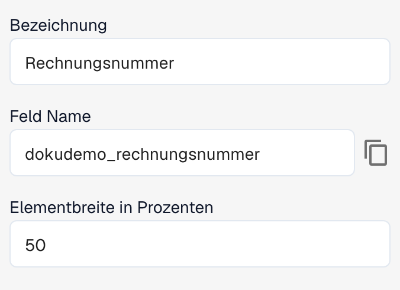

# Layout-Editor

Mit dem Layout-Editor ordnen Sie die Felder und Steuerelemente an, die Personen beim Validieren oder Freigeben eines Dokuments sehen. Ein Layout gehört zu einem Dokumenttyp, einer Herkunft und einem Layouttyp. Prüfen Sie den geöffneten Kontext, bevor Sie Änderungen speichern.

## Layout öffnen

1. Öffnen Sie **Einstellungen → Dokumenttypen**.
2. Öffnen Sie den **Layout-Editor** für den gewünschten Dokumenttyp oder Untertyp. Ist der Layout-Editor nicht verfügbar, muss ein Administrator das Modul möglicherweise für Ihre Organisation freischalten.
3. Prüfen Sie die ausgewählte **Herkunft** in der Aktionsleiste. Daneben zeigt DocBits den Typ des geöffneten Editors an.

<figure><figcaption>
Ausschnitt des Layout-Editors: links die Bereiche Gruppen, Felder und Formular-Elemente, daneben eine Beispielgruppe auf der Layoutfläche.
</figcaption></figure>

Wenn Sie die Herkunft wechseln, kann DocBits dafür ein eigenes Herkunfts-Layout anlegen. Prüfen Sie deshalb die Auswahl, bevor Sie das Layout bearbeiten.

## Die Bereiche des Editors

Links wechseln Sie zwischen **Elemente**, **Eigenschaften** und den allgemeinen Einstellungen über das Zahnradsymbol.

* **Elemente** enthält die Bereiche für Gruppen, Dokumentfelder und weitere Formularelemente. Klappen Sie den benötigten Bereich auf, um die verfügbaren Einträge zu sehen.
* Die Fläche in der Mitte zeigt die Gruppen und Felder Ihres Layouts. Gruppen fassen zusammengehörige Felder zusammen.
* Rechts befindet sich der Bereich für ein Beispieldokument. Dort können Sie ein Dokument zum Vergleich mit dem Layout anzeigen und vergrößern oder verkleinern.

Ziehen Sie einen Eintrag aus dem gewünschten Bereich auf die Layoutfläche, um eine Gruppe, ein Feld oder ein Formularelement hinzuzufügen.

<figure><figcaption>
Detail der Beispielgruppe mit den Feldern Rechnungsnummer und Datum. Beide Felder belegen im gezeigten Beispiel jeweils die Hälfte der Gruppenbreite.
</figcaption></figure>

Wiederverwendbare Dokumentfelder konfigurieren Sie unter [Dokumenttypen](README.md). Die im Editor verfügbaren Felder hängen vom ausgewählten Dokumenttyp und Ihrer Konfiguration ab.

## Eigenschaften eines Elements ändern

Wählen Sie eine Gruppe oder ein Feld auf der Fläche aus und öffnen Sie links **Eigenschaften**. Die verfügbaren Einstellungen richten sich nach dem gewählten Element. Dazu gehören beispielsweise Bezeichnung, technischer Feldname, Breite und Verhalten.

<figure><figcaption>
Detail der Eigenschaften des ausgewählten Felds: Bezeichnung, technischer Feldname und Elementbreite in Prozenten.
</figcaption></figure>

Bei vordefinierten Feldern können Bezeichnung und technischer Feldname gesperrt sein. Je nach Element können Sie außerdem Schreibschutz, Sichtbarkeit, Tab-Reihenfolge, Wertelisten sowie die Ausführung eines Workflows oder Skripts bei einer Änderung einstellen. Für Gruppen und Felder stehen unterschiedliche Optionen zur Verfügung.

Passen Sie die Eigenschaften an und prüfen Sie das Ergebnis auf der Fläche. Die Breite wird als Prozentwert eingestellt; Gruppen und die darin angeordneten Felder können unterschiedliche Breiten haben. Weitere Details finden Sie unter [Feldeigenschaften konfigurieren](../../settings/global-settings/document-types/layout-manager/configuring-field-properties.md).

## Vorlagen und JSON

Die Aktionsleiste bietet neben **Speichern** Funktionen zum automatischen Erzeugen einer Vorlage, zum Anwenden des Standardlayouts auf Herkunfts-Layouts, zum Verwenden der Standardvorlage und zum Bearbeiten von JSON. Welche Funktionen verfügbar sind, hängt vom geöffneten Editor ab.

Das Erzeugen oder Übernehmen einer Vorlage kann ein individuell angeordnetes Layout ersetzen. Prüfen Sie deshalb zuerst den Dokumenttyp, die Herkunft und das bestehende Layout. **JSON bearbeiten** ist für die erweiterte Konfiguration gedacht und sollte nur verwendet werden, wenn Sie das Vorlagenformat kennen. Im JSON-Dialog können Sie die Layoutkonfiguration auch kopieren.

## Prüfen und speichern

Ordnen Sie die Gruppen und Felder an, prüfen Sie das Layout auf der Fläche und verwenden Sie **Speichern** in der Aktionsleiste, sobald das Ergebnis passt. Zu herkunftsspezifischen Layouts siehe [Herkunfts-Layouts](origin-layouts.md).


Die Abbildungen zeigen ein vereinfachtes Beispiel für ein Rechnungslayout. Feldbezeichnungen und verfügbare Optionen hängen von Ihrer Konfiguration ab.

