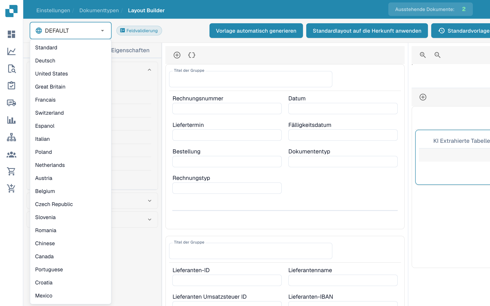
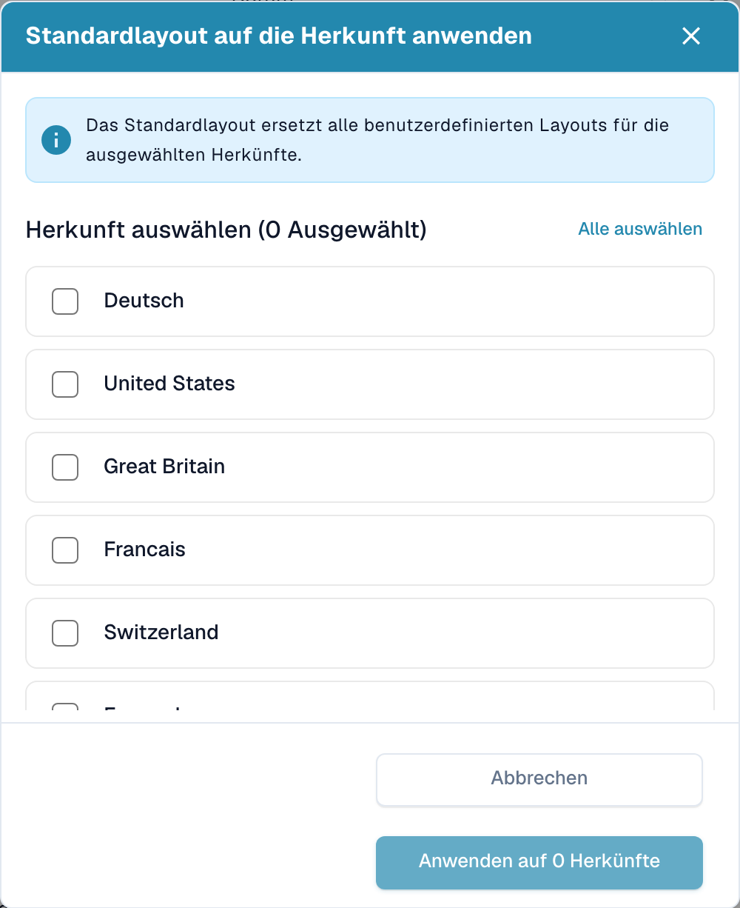

# Herkunftsabhängige Layouts


DocBits Origin Setting Explained: Country Standards for Dates & Number Formats


DocBits passt Dokumentlayouts hervorragend an ihre geografische Herkunft an und standardisiert gleichzeitig Elemente wie Währungsformate anhand der Browser-Einstellungen des Benutzers. Sehen wir uns an, wie Sie mit dem Layout Builder Layouts für unterschiedliche Herkunftsländer anpassen können, zum Beispiel für die USA und Deutschland.

<figure><figcaption>
Layout-Builder mit deutschen Bedienelementen.
</figcaption></figure>

## **Herkunftsbasierte Anpassung verstehen**

* Standardisierung von Währung und Format: Unabhängig von der Währung oder dem Format des Originaldokuments wandelt DocBits diese Elemente auf dem Server entsprechend den Browser-Einstellungen des Benutzers in ein standardisiertes ISO-Format um.
* Geografische Layout-Anpassung: Das System ermöglicht es, Dokumentlayouts anhand ihrer geografischen Herkunft anzupassen. Sie können also für Dokumente aus verschiedenen Ländern jeweils eigene Felder und Formate festlegen.

## **Beispiel: Layouts für die USA und Deutschland**

* US-Layout: Für eine US-Rechnung können Sie Felder für die City Tax aufnehmen, passend zur üblichen Steuerstruktur in den USA.
* Deutschland-Layout: Ein deutsches Rechnungslayout kann das Feld für die City Tax dagegen weglassen, da diese in Deutschland keine übliche Abgabe ist.

## **Den Layout Builder verwenden**

* Origin Layout auswählen: Wählen Sie im Layout Builder das Basislayout, das der Herkunft des Dokuments entspricht.
* Felder anpassen: Passen Sie das Layout an, indem Sie Felder hinzufügen oder entfernen. Nehmen Sie zum Beispiel für ein US-Layout das Feld „City Tax“ auf.
* Anwenden und testen: Wenden Sie das angepasste Layout auf Ihre Dokumente an und testen Sie es, um die Korrektheit sicherzustellen.

<figure><figcaption></figcaption></figure>

## **Tipps für eine wirkungsvolle Anpassung**

* Regionale Unterschiede verstehen: Machen Sie sich mit den steuerlichen und formatbezogenen Besonderheiten der einzelnen Regionen vertraut.
* Regelmäßige Aktualisierung: Aktualisieren Sie Ihre Layouts regelmäßig, damit sie Änderungen regionaler Vorschriften widerspiegeln.
* Feedback der Benutzer: Nutzen Sie das Feedback von Benutzern in unterschiedlichen Regionen, um Layouts weiter zu verfeinern.

## Standardlayout auf mehrere Herkunftsländer anwenden

Wenn Sie das Standardlayout auf mehrere Herkunftsländer anwenden möchten, klicken Sie auf **Standardlayout auf die Herkunft anwenden**.

<figure><figcaption>
Herkunftsauswahl im Layout-Builder; Herkunftscodes bleiben unverändert.
</figcaption></figure>

Es öffnet sich ein Popup, in dem Sie die Herkunftsländer auswählen können, auf die das Standardlayout angewendet werden soll. Mit **Alle auswählen** beziehungsweise durch Aufheben der Auswahl können Sie Ihre Auswahl schnell anpassen. Das Popup zeigt die Anzahl der aktuell ausgewählten Herkunftsländer an.

<figure><figcaption>
Dialog zum Anwenden eines Standardlayouts auf ausgewählte Herkünfte.
</figcaption></figure>

Klicken Sie nach der Auswahl auf **Anwenden auf … Herkünfte**. Eine Erfolgsmeldung bestätigt, dass die Herkunftsländer aktualisiert wurden.
