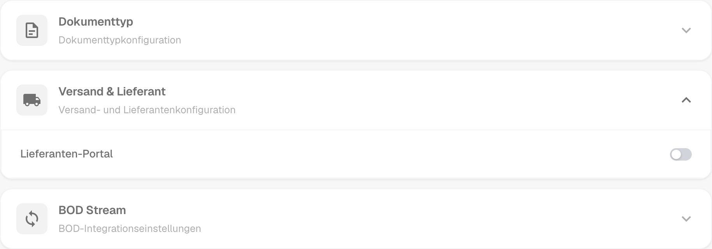
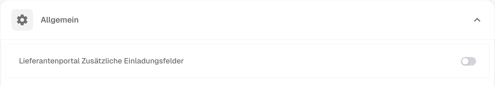
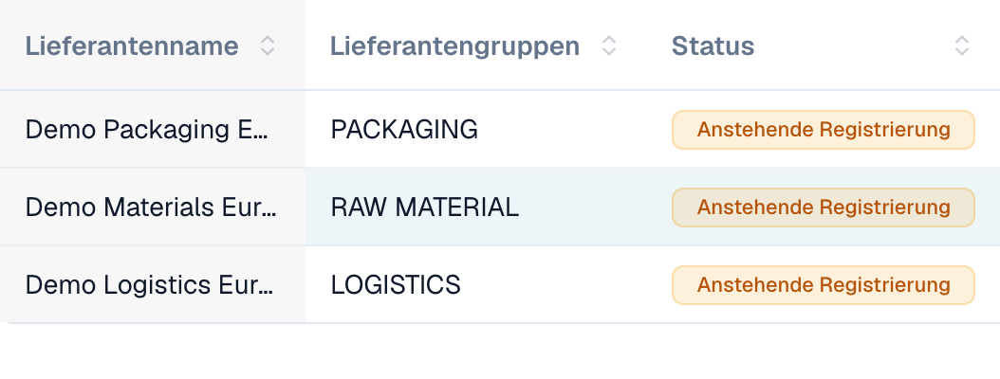
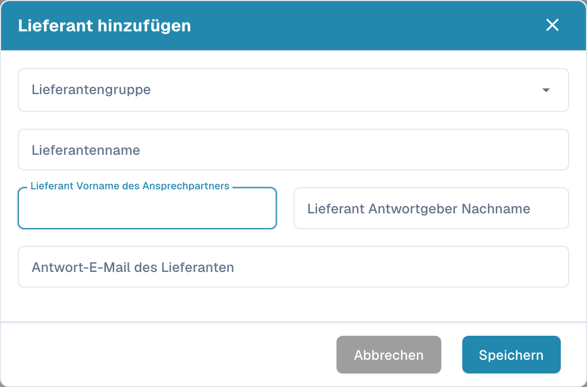

# Lieferantenportal

Mit dem **Lieferantenportal** stellt ein Administrator den Lieferanten seines Unternehmens einen Zugang zu **DocBits** bereit. Der Admin aktiviert das Portal und richtet ein, welche Lieferanten es nutzen und welche Informationen sie sehen dürfen.

Ein eingeladener Lieferant registriert sich und meldet sich mit seinem eigenen Zugang an. Dort kann er die für ihn freigegebenen Informationen und beispielsweise den Status seiner Bestellungen und Rechnungen einsehen. Welche Funktionen verfügbar sind, bestimmt die Konfiguration der Organisation.

## Video: Lieferantenportal und Zugang vorbereiten

Im Video führt ein fiktiver Administrator durch Portaloption und Tarifauswahl, die Vorbereitung einer Einladung und den Registrierungseinstieg. Aktivierung, Versand, Registrierung und Freigabe werden als getrennte Schritte erklärt.



[Video mit deutschen Untertiteln und Kapitelauswahl öffnen](https://docbits-videos.fra1.cdn.digitaloceanspaces.com/settings-assistant/supplier-portal-access-admin/v1/de.html)

*Figur und Stimme sind synthetisch. Die Oberfläche stammt aus einer DocBits-Demoorganisation.*

## Admin: Portal aktivieren

1. Öffnen Sie in den Einstellungen die Module und dort den Bereich **Dokumentenintegration**.
2. Öffnen Sie **Versand & Lieferant** und aktivieren Sie die Option **Lieferanten-Portal**.
3. Falls ein Freischaltungsdialog erscheint, prüfen Sie den angezeigten Plan und bestätigen Sie die gewünschte Freischaltung.

<figure><figcaption>
Portaloption im Bereich „Versand &amp; Lieferant“. Über diesen Schalter wird die Funktion für die Organisation aktiviert.
</figcaption></figure>

## Admin: Portal einrichten

Richten Sie das Portal vor den ersten Einladungen für Ihre Organisation ein:

- [Allgemeine Lieferanteneinstellungen](../../settings/supplier-setting/supplier-general-settings.md): Zusätzliche Einladungsfelder, Status, Logo und Datenschutzhinweise.
- [E-Mail-Vorlagen](../../settings/supplier-setting/editing-email-templates.md): Inhalt und Gestaltung der Einladungsnachrichten.
- [Lieferantenlayout](../../settings/supplier-setting/supplier-layout.md): Felder für die Lieferantenregistrierung und die interne Lieferantenverwaltung. Wählen Sie den passenden Layouttyp.
- [Lieferantenberechtigungen](../../settings/supplier-setting/supplier-permissions.md): Zuordnung interner Mitarbeitender zu Lieferantengruppen. Diese interne Zuständigkeit ist vom eigenen Portalzugang eines Lieferanten zu unterscheiden.

<figure><figcaption>
Allgemeine Lieferanteneinstellungen mit der Option für zusätzliche Einladungsfelder.
</figcaption></figure>

## Admin: Lieferanten einladen

Öffnen Sie die Lieferantenverwaltung. Prüfen Sie vor einer Einladung Firma, Lieferantengruppe, Ansprechperson und E-Mail-Adresse. Beim Anlegen eines Lieferanten fordert das Speichern den Versand der Registrierungseinladung an; es ist nicht nur eine unverbindliche Dateneingabe. Für bestehende Lieferanten verwenden Sie die passende Einladungsaktion. Eine Versandbestätigung bedeutet noch nicht, dass die E-Mail zugestellt oder die Registrierung abgeschlossen wurde.

<figure><figcaption>
Interne Lieferantenverwaltung mit drei fiktiven Beispielunternehmen. Die Statusspalte zeigt hier jeweils eine ausstehende Registrierung.
</figcaption></figure>

<figure><figcaption>
Formular zum Anlegen und Einladen eines Lieferanten. Firma, Ansprechperson und E-Mail-Adresse werden vor dem Speichern geprüft.
</figcaption></figure>

## Lieferant: registrieren und auf DocBits zugreifen

Der Lieferant öffnet seine Einladung, erstellt beziehungsweise verwendet den vorgesehenen eigenen Zugang und durchläuft die konfigurierten Registrierungsschritte. Danach kann er die für ihn freigegebenen Informationen in DocBits einsehen. Der genaue Ablauf und die verfügbaren Funktionen richten sich nach der Organisation.

[Zur Registrierung für Lieferanten](supplier-registration.md).

## Zugang und Status richtig einordnen

Portal aktiviert, Einladung versendet, Registrierung abgeschlossen und Freigabe erteilt sind unterschiedliche Zustände. Ein angelegter Lieferant oder gespeicherte Stammdaten beweisen keinen fertigen Portalzugang. Die Lieferantenansicht richtet sich nach den zugewiesenen Berechtigungen; sie ist nicht mit der internen Admin-Ansicht gleichzusetzen.
