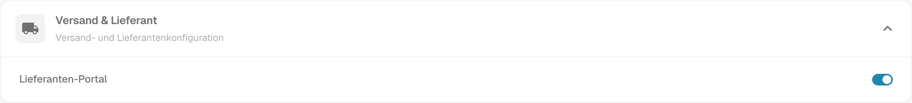
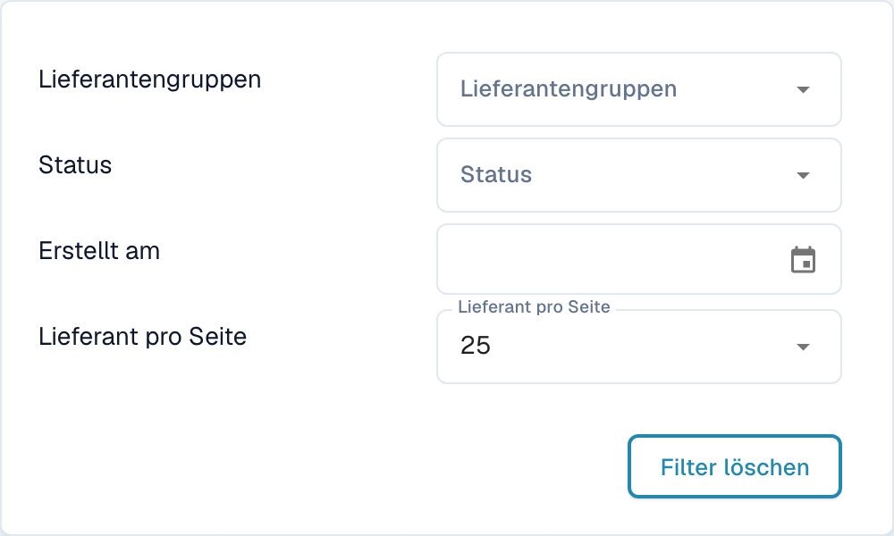
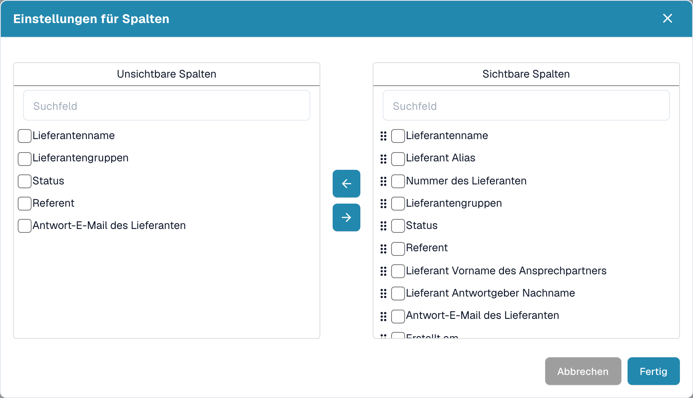
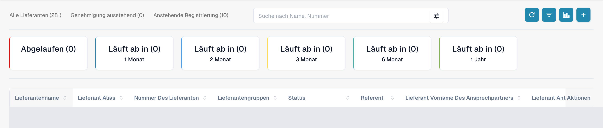
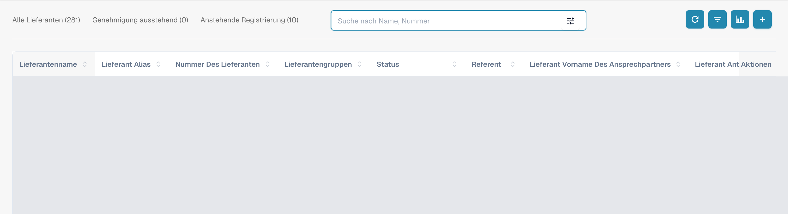
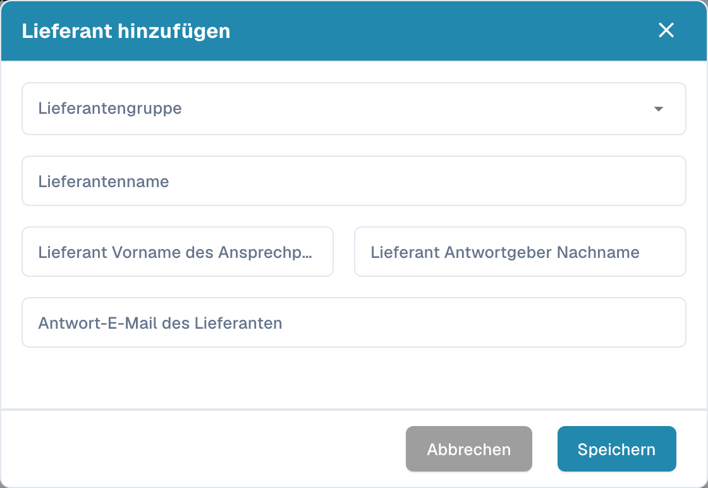

# Lieferantenportal

Mit dem **Lieferantenportal** stellt ein Administrator den Lieferanten seines Unternehmens einen Zugang zu **DocBits** bereit. Der Admin aktiviert das Portal und richtet ein, welche Lieferanten es nutzen und welche Informationen sie sehen dürfen.

Ein eingeladener Lieferant registriert sich und meldet sich mit seinem eigenen Zugang an. Dort kann er die für ihn freigegebenen Informationen und beispielsweise den Status seiner Bestellungen und Rechnungen einsehen. Welche Funktionen verfügbar sind, bestimmt die Konfiguration der Organisation.

## Video: Lieferantenportal und Zugang vorbereiten

Im Video führt ein Administrator durch Portaloption und Tarifauswahl, die Vorbereitung einer Einladung und den Registrierungseinstieg. Aktivierung, Versand, Registrierung und Freigabe werden als getrennte Schritte erklärt.



[Video mit deutschen Untertiteln und Kapitelauswahl öffnen](https://docbits-videos.fra1.cdn.digitaloceanspaces.com/settings-assistant/supplier-portal-access-admin/v1/de.html)

## Admin: Portal aktivieren

1. Öffnen Sie in den Einstellungen die Module und dort den Bereich **Dokumentenintegration**.
2. Öffnen Sie **Versand & Lieferant** und aktivieren Sie die Option **Lieferanten-Portal**.
3. Falls ein Freischaltungsdialog erscheint, prüfen Sie den angezeigten Plan und bestätigen Sie die gewünschte Freischaltung.

<figure><figcaption>
Reale deutsche Dev-Ansicht von Versand &amp; Lieferant: Der Lieferanten-Portal-Schalter ist in dieser Testorganisation bereits eingeschaltet. Für die Aufnahme wurde er nicht betätigt.
</figcaption></figure>

## Admin: Portal einrichten

Richten Sie das Portal vor den ersten Einladungen für Ihre Organisation ein:

- [Allgemeine Lieferanteneinstellungen](../../settings/supplier-setting/supplier-general-settings.md): Zusätzliche Einladungsfelder, Status, Logo und Datenschutzhinweise.
- [E-Mail-Vorlagen](../../settings/supplier-setting/editing-email-templates.md): Inhalt und Gestaltung der Einladungsnachrichten.
- [Lieferantenlayout](../../settings/supplier-setting/supplier-layout.md): Felder für die Lieferantenregistrierung und die interne Lieferantenverwaltung. Wählen Sie den passenden Layouttyp.
- [Lieferantenberechtigungen](../../settings/supplier-setting/supplier-permissions.md): Zuordnung interner Mitarbeitender zu Lieferantengruppen. Diese interne Zuständigkeit ist vom eigenen Portalzugang eines Lieferanten zu unterscheiden.

<figure><figcaption>
Reale deutsche Dev-Ansicht der zusätzlichen Einladungsfelder: Die Option ist bereits eingeschaltet, Felder zeigt die unveränderte konfigurierte Auswahl Assigned User. Es wurde nichts gespeichert.
</figcaption></figure>

## Admin: Lieferanten suchen und filtern

Öffnen Sie das **Lieferanten-Dashboard** für die interne Verwaltung. Die Statussummen **Alle Lieferanten**, **Genehmigung ausstehend** und **Anstehende Registrierung** grenzen die angezeigte Liste ein. Das Suchfeld **Suche nach Name, Nummer** dient zur Suche nach Lieferantenname oder -nummer.

Über das Filtersymbol im Suchfeld öffnen Sie **Lieferantengruppen**, **Status** und **Erstellt am**. **Lieferant pro Seite** steuert die Seitengröße; **Filter löschen** entfernt die aktiven Suchfilter. Diese Bedienelemente betreffen die Lieferantenliste.

<figure><figcaption>
Filtermenü mit Lieferantengruppen, Status, Erstellt am, Lieferant pro Seite und Filter löschen. Die Aufnahme zeigt die verfügbaren Filter, ohne eine Filterwirkung als getestet zu behaupten.
</figcaption></figure>

## Admin: Sichtbare Spalten auswählen

Öffnen Sie neben Aktualisieren die Spalteneinstellungen. Der Tooltip lautet **Tabellenspalten für die Organisation festlegen**. Wählen Sie Felder unter **Unsichtbare Spalten** oder **Sichtbare Spalten** und verschieben Sie sie mit den Pfeilen zwischen den Listen. Mit den Ziehgriffen ordnen Sie die sichtbaren Felder. **Fertig** übernimmt die Auswahl für die Organisation; **Abbrechen** schließt den Dialog ohne Übernahme. Bei einer breiten Tabelle erreichen Sie weitere Spalten durch horizontales Scrollen.

<figure><figcaption>
Einstellungen für Spalten mit Unsichtbare Spalten, Sichtbare Spalten, Pfeilen und den Aktionen Abbrechen und Fertig. Der Dialog wurde unverändert mit Abbrechen geschlossen.
</figcaption></figure>

## Admin: Ablauf-Analytik anzeigen

Über **Analytik**, das Diagrammsymbol neben den Spalteneinstellungen, blenden Sie die Ablaufübersicht ein oder aus. Die Karten zeigen **Abgelaufen** sowie **Läuft ab in** mit den Zeiträumen **1 Monat**, **2 Monat**, **3 Monat**, **6 Monat** und **1 Jahr**, wie sie in der Oberfläche bezeichnet sind. Eine ausgewählte Karte grenzt die Lieferantenliste auf den jeweiligen Ablaufzeitraum ein. Die Zähler beziehen sich auf die Ablaufdaten der Lieferanten.

<figure><figcaption>
Analytik zeigt Abgelaufen und Läuft ab in für einen, zwei, drei oder sechs Monate und ein Jahr. Die Lieferantenzeilen sind abgedeckt; keine Karte wurde ausgewählt.
</figcaption></figure>

## Admin: Lieferanten einladen

Öffnen Sie die Lieferantenverwaltung. Prüfen Sie vor einer Einladung Firma, Lieferantengruppe, Ansprechperson und E-Mail-Adresse. Beim Anlegen eines Lieferanten fordert das Speichern den Versand der Registrierungseinladung an; es ist nicht nur eine unverbindliche Dateneingabe. Für bestehende Lieferanten verwenden Sie die passende Einladungsaktion. Eine Versandbestätigung bedeutet noch nicht, dass die E-Mail zugestellt oder die Registrierung abgeschlossen wurde.

<figure><figcaption>
Internes Lieferanten-Dashboard mit Alle Lieferanten, Genehmigung ausstehend, Anstehende Registrierung, Suche und Werkzeugleiste. Bestehende Lieferantenzeilen sind abgedeckt.
</figcaption></figure>

<figure><figcaption>
Leeres Formular Lieferant hinzufügen mit Lieferantengruppe, Lieferantenname, Kontaktfeldern, Abbrechen und Speichern. Speichern fordert eine Registrierungseinladung an; für diese Aufnahme wurde nur Abbrechen verwendet.
</figcaption></figure>

## Admin: Lieferantendetails im Lieferanten-Dashboard öffnen

Interne Mitarbeitende öffnen die Ansicht **Lieferantendetails** über die Zeile eines Lieferanten im Lieferanten-Dashboard. Sie enthält dieselben sechs Bereiche, die der Lieferant ausfüllt, und seinen Status. Dort prüfen und pflegen Sie eingereichte Angaben und führen die fachliche Freigabe durch. Für die hier gezeigten Aufnahmen wurde keine bestehende Lieferantenzeile geöffnet.

## Lieferant: registrieren und auf DocBits zugreifen

Der Lieferant öffnet seine Einladung, erstellt beziehungsweise verwendet den vorgesehenen eigenen Zugang und durchläuft die konfigurierten Registrierungsschritte. Danach kann er die für ihn freigegebenen Informationen in DocBits einsehen. Der genaue Ablauf und die verfügbaren Funktionen richten sich nach der Organisation.

[Zur Registrierung für Lieferanten](supplier-registration.md).

## Zugang und Status richtig einordnen

Portal aktiviert, Einladung versendet, Registrierung abgeschlossen und Freigabe erteilt sind unterschiedliche Zustände. Ein angelegter Lieferant oder gespeicherte Stammdaten beweisen keinen fertigen Portalzugang. Die Lieferantenansicht richtet sich nach den zugewiesenen Berechtigungen; sie ist nicht mit der internen Admin-Ansicht gleichzusetzen.

Die Aufnahmen wurden mit dem autorisierten Dev-Testkonto in deutscher Oberflächensprache erstellt. Geprüft wurden lesende UI- und Listenabfragen, die sichtbaren Bedienelemente und unverändert abgebrochene Formulare. Es wurden keine Einstellungen oder Spaltenauswahl gespeichert, keine Lieferanten angelegt oder verändert und keine Einladung, Registrierung oder Freigabe ausgeführt. Such- und Filterergebnisse sowie E-Mail-Zustellung sind damit nicht als funktional getestet belegt. Das vorhandene Video bleibt erhalten; eine neue Audio-, Sprach- oder Synchronitätsprüfung wurde nicht durchgeführt.
