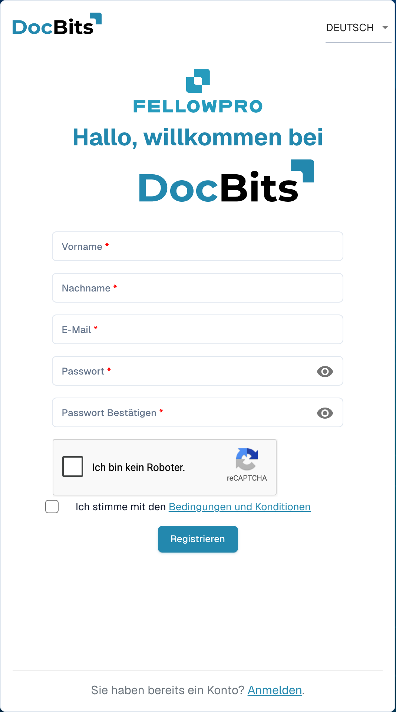

# Registrierung für Lieferanten

Diese Anleitung richtet sich an Lieferanten, die von einer Organisation zu deren DocBits-Portal eingeladen wurden. Verwenden Sie den Link aus dieser Einladung. Der Zugang gehört Ihnen als Lieferant; die einladende Organisation bestimmt die freigegebenen Informationen und erforderlichen Registrierungsschritte.

## 1. Einladung öffnen

Prüfen Sie, von welcher Organisation die Einladung stammt und für welche E-Mail-Adresse sie bestimmt ist. Öffnen Sie den Registrierungslink aus der Einladung. Ist der Link abgelaufen oder für die falsche Person bestimmt, bitten Sie die einladende Organisation um eine neue Einladung.

## 2. Eigenen Zugang einrichten

Prüfen Sie vorbelegte Namen und E-Mail-Adresse. Ergänzen Sie die angeforderten Zugangsdaten und beachten Sie die angezeigten Kennwortregeln. Lesen Sie die eingeblendeten Bedingungen und Datenschutzhinweise. Schließen Sie die Kontoregistrierung mit der angezeigten Registrierungsfunktion ab. Ein bereits vorhandener Zugang und eine neue Registrierung sind unterschiedliche Fälle; verwenden Sie den für Ihre Einladung vorgesehenen Ablauf.

<figure><figcaption>
Registrierungsformular für den Lieferantenzugang. Gezeigt ist der Einstieg ohne eingegebene Daten; eine Einladung kann Angaben bereits vorbelegen.
</figcaption></figure>

## 3. Lieferantenangaben vervollständigen

Ergänzen Sie die von der Organisation angeforderten Daten und gegebenenfalls Nachweise. Die Felder und Abschnitte hängen vom eingerichteten Lieferantenlayout ab. Kennzeichnungen und Fehlermeldungen zeigen, welche Angaben erforderlich sind. Speichern Sie einen Zwischenstand, wenn die Ansicht dies anbietet; eine Speicherung ist nicht automatisch die abschließende Übermittlung.

## 4. Registrierung und Freigabe prüfen

Übermitteln Sie die Angaben über die dafür vorgesehene Abschlussfunktion. Falls eine Prüfung oder Freigabe eingerichtet ist, warten Sie deren Ergebnis ab. Melden Sie sich anschließend mit Ihrem eigenen Zugang an. Welche Bestellungen, Rechnungen und weiteren Informationen Sie sehen können, bestimmt die Organisation.

## Wenn der Zugang nicht funktioniert

Bei einem ungültigen Einladungslink, fehlender Berechtigung oder unklaren Pflichtangaben wenden Sie sich an die einladende Organisation. Ein sichtbarer Lieferantenstammsatz im internen Dashboard ersetzt weder Ihre Registrierung noch die erforderliche Zugangsfreigabe.

[Zur Einrichtung des Lieferantenportals](README.md).

[Video: Portalzugang und Registrierung vorbereiten – mit deutschen Untertiteln](https://docbits-videos.fra1.cdn.digitaloceanspaces.com/settings-assistant/supplier-portal-access-admin/v1/de.html)
