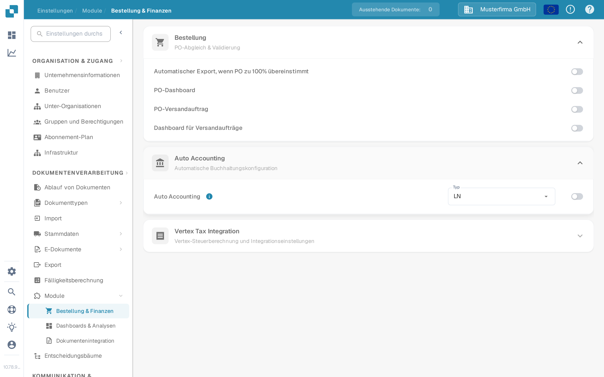
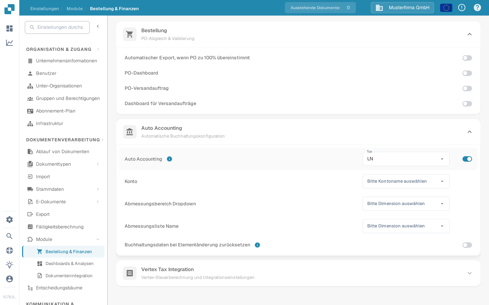

# Auto Accounting testen

Auto Accounting benötigt ein aktiviertes Modul, buchhalterische Stammdaten und eine Rechnung mit verwertbaren Beträgen oder Positionen. Dieser Leitfaden trennt die Einstellungen, die Sie vor dem Öffnen einer Rechnung prüfen können, von den Prüfungen, die eine eingerichtete LN- oder M3-Anbindung erfordern.

## Einstellungen des Moduls prüfen

1. Öffnen Sie **Einstellungen → Modul → Bestellung & Finanzen** und klappen Sie **Auto Accounting** auf. Der ältere Pfad **Dokumentenverarbeitung → Modul → Purchase Order / Auto Accounting** ist in der aktuellen Anwendung nicht mehr der angezeigte Weg.
2. Wählen Sie den **Typ** Ihres angebundenen Systems (**LN** oder **M3**). Schalten Sie **Auto Accounting** erst ein, wenn die erforderlichen Stammdaten und die Anbindung bereit sind.
3. Wählen Sie im aktivierten Zustand die **Konto**-Liste und die zu Ihrem System passenden Dimensionslisten. Bei LN sind darunter die Felder **Abmessungsbereich Dropdown** und **Abmessungsliste Name**. M3 hat andere Felder. Nutzen Sie **Buchhaltungsdaten bei Elementänderung zurücksetzen** nur, wenn eine Neuberechnung nach einer Elementänderung beabsichtigt ist.

<figure><figcaption>
Auto Accounting ist in der deutschen Sandbox-Testorganisation ausgeschaltet.
</figcaption></figure>

<figure><figcaption>
Die Felder, die bei aktivierter Einstellung sichtbar werden. Nach der Aufnahme wurde die Einstellung wieder ausgeschaltet; es wurden keine Konten oder Dimensionen konfiguriert.
</figcaption></figure>

## Test mit einer eingerichteten Rechnung

Verwenden Sie eine Rechnung, deren Positionen und buchhalterische Stammdaten verfügbar sind. Öffnen Sie sie im Validierungsbildschirm und wählen Sie **Auto Accounting**. Fehlt die Aktion, prüfen Sie die Moduleinstellung und ob diese Rechnung dafür infrage kommt. Validieren Sie die Rechnung vor der Navigation; die Anwendung speichert und validiert, sobald die Aktion ausgewählt wird.

Prüfen Sie auf dem Buchhaltungsbildschirm Folgendes mit Ihren eigenen LN- oder M3-Daten:

1. Führen Sie, wenn verfügbar, **Validate Setup** aus und beheben Sie fehlende Konto- oder Dimensionskonfiguration, bevor Sie fortfahren. Ein grünes Ergebnis beschreibt nur die Prüfungen in Ihrer Umgebung.
2. Prüfen Sie, ob die Rechnung über den **Gesamtbetrag** oder über **einzelne Positionen** zugeordnet werden soll. Vergleichen Sie die Buchhaltungsbeträge mit der ursprünglichen Rechnung.
3. Wenn Sie einen Betrag aufteilen, wählen Sie für jede Aufteilungszeile das gewünschte Konto. Geben Sie Beträge oder Prozentsätze ein und prüfen Sie, dass die verteilten Werte den übergeordneten Betrag ergeben. Fügen Sie eine Zeile hinzu oder entfernen Sie eine nur, wenn nötig.
4. Prüfen Sie einen etwaigen **Unsettled amount** oder eine Validierungswarnung und korrigieren Sie diese vor dem Speichern oder Exportieren. Bestätigen Sie das Ergebnis separat im angebundenen System.

Die Sandbox-Testorganisation, die für die obigen Screenshots verwendet wurde, hat keine konfigurierten Konto- und Dimensionslisten und keine Rechnungspositionen für diesen Ablauf. Der Buchhaltungsbildschirm, das Aufteilen und der Export wurden daher **hier nicht getestet oder abgebildet**. Verwenden Sie die Einstellungs-Screenshots nicht als Nachweis, dass die Verbuchung oder der Export erfolgreich war.

Für die systemspezifische Einrichtung fahren Sie mit dem [LN-Leitfaden](ln.md) oder dem [M3-Leitfaden](m3.md) fort.
