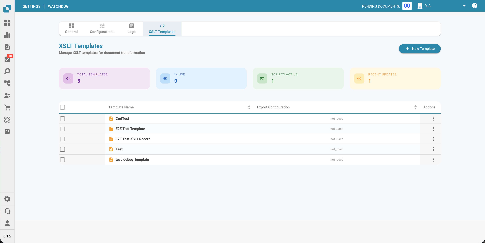

# WatchDog Admin-FAQ und Fehlerbehebung

<figure><figcaption></figcaption></figure>

Diese Dokumentation hilft Administratoren, WatchDog-Fehlermeldungen zu verstehen und Probleme zu beheben.

**Ort in der Oberfläche:** Settings → Document Processing → WatchDog

---

## 1. WatchDog-Einstellungsseiten (Oberfläche)

### 1.1 Registerkarte „General“

<figure><figcaption></figcaption></figure>

* **Download:** Die neueste WatchDog.exe herunterladen
* **API Key:** Den Konfigurationsbefehl kopieren
* **Auto-Update Schedule:** Die Häufigkeit der Updates konfigurieren
* **Installation Guide:** Schritt-für-Schritt-Anleitung zur Einrichtung

### 1.2 Registerkarte „Configurations“

* **Import Configurations:** Überwachungsordner und Dokumenttypen definieren
* **Export Configurations:** Exportziele und Exportmethoden definieren
* **Bulk Copy:** Konfigurationen auf Unterorganisationen kopieren
* **Import/Export:** Konfigurationen als JSON importieren/exportieren

> **Wichtig:** Export-Konfigurationen **erfordern jetzt einen Dokumenttyp** (`doc_type`). Konfigurationen ohne gültigen Dokumenttyp werden abgelehnt.

### 1.3 Registerkarte „Status“

<figure><figcaption></figcaption></figure>

* Zeigt den Verbindungsstatus von WatchDog in Echtzeit an
* **Neue Felder:** `last_restart`, `version_first_seen`, `latest_version_checked_at`
* **Systeminformationen:** Installationspfad, freier Arbeitsspeicher, freier Festplattenspeicher

### 1.4 Registerkarte „Logs“

<figure><figcaption></figcaption></figure>

* Zeigt alle WatchDog-Ereignisse aus OpenSearch an
* Filterbar nach Ereignistyp, Zeitraum usw.
* **Ereignistypen:**
  * `FILE_IMPORT_STARTED`: Dateiimport gestartet
  * `FILE_IMPORT_COMPLETED`: Import erfolgreich
  * `FILE_IMPORT_FAILED`: Import fehlgeschlagen
  * `EXPORT_STARTED`: Export gestartet
  * `EXPORT_COMPLETED`: Export erfolgreich
  * `EXPORT_FAILED`: Export fehlgeschlagen
  * `FOLDER_VALIDATION_FAILED`: Ordner nicht erreichbar
  * `CONFIG_LOADED`: Konfiguration geladen
  * `SERVICE_RESTART_INITIATED`: Dienstneustart angefordert
  * `SERVICE_RESTART_COMPLETED`: Dienst neu gestartet

### 1.5 Registerkarte „XSLT Templates“

<figure><figcaption></figcaption></figure>

* XSLT-Transformationsvorlagen hochladen und verwalten
* Live-Validierung mit Feldanalyse
* Vorlagen mit Export-Konfigurationen verknüpfen

---

## 2. Fehlermeldungen bei der Ordnervalidierung

| Fehler | Bedeutung | Lösung |
| :--- | :--- | :--- |
| `not_found` | Ordner existiert nicht | Ordner anlegen oder Pfad korrigieren |
| `no_read_access` | Keine Leseberechtigung | Berechtigungen für das WatchDog-Dienstkonto setzen |
| `no_write_access` | Keine Schreibberechtigung | Dem Dienstkonto Schreibrechte erteilen |
| `not_configured` | Ordnerpfad nicht konfiguriert | Pfad in der Konfiguration eintragen |

**Betroffene Ordner:**

* **Watch Folder (Import):** Hier sucht WatchDog nach neuen Dateien
* **Success Folder:** Hierhin werden erfolgreich importierte Dateien verschoben
* **Export Folder:** Hier werden exportierte XML-/PDF-Dateien abgelegt

---

## 3. Fehlermeldungen beim Import

| Fehler | Bedeutung | Lösung |
| :--- | :--- | :--- |
| `file_not_found` | Datei wurde vor dem Import gelöscht | Datei erneut bereitstellen |
| `invalid_file_type` | Es werden nur PDF-Dateien unterstützt | Andere Dateitypen entfernen |
| `api_not_accessible` | DocBits-API nicht erreichbar | Netzwerk/Firewall prüfen, API-URL verifizieren |
| `api_check_failed` | API-Health-Check fehlgeschlagen | API-Schlüssel und Verbindung prüfen |
| `upload_failed` | Upload zur API fehlgeschlagen | API-Schlüssel, Netzwerk und Serverstatus prüfen |

---

## 4. Fehlermeldungen beim Export

| Fehler | Bedeutung | Lösung |
| :--- | :--- | :--- |
| `transformation_error` | XSLT-Transformation fehlgeschlagen | XSLT-Vorlage prüfen, XML-Struktur validieren |
| `folder_error` | Exportordner nicht erreichbar | Ordner anlegen, Berechtigungen prüfen |
| `file_write_error` | Datei konnte nicht geschrieben werden | Speicherplatz, Berechtigungen und Dateisperren prüfen |
| `permission_denied` | Keine Schreibberechtigung | Berechtigungen des Dienstkontos setzen |
| `creation_failed` | Ordner konnte nicht erstellt werden | Berechtigungen des übergeordneten Ordners prüfen |
| `no_config_match` | Keine passende Export-Konfiguration | Export-Konfiguration mit dem richtigen Dokumenttyp anlegen |

> **Hinweis:** Export-Konfigurationen erfordern einen `doc_type`. Wenn Sie `no_config_match` sehen, prüfen Sie, ob für den Typ des Dokuments eine aktive Export-Konfiguration existiert.

---

## 5. Konfiguration deaktiviert — Gründe

Wenn eine Konfiguration deaktiviert ist, wird einer dieser Gründe angezeigt:

| Deaktivierungsgrund | Bedeutung |
| :--- | :--- |
| `Watch folder: not_found` | Importordner existiert nicht |
| `Watch folder: no_read_access` | Importordner nicht lesbar |
| `Export folder: not_found` | Exportordner existiert nicht |
| `Export folder: no_write_access` | Exportordner nicht beschreibbar |
| `Success folder: not_found` | Success-Ordner existiert nicht |
| `Success folder: no_write_access` | Success-Ordner nicht beschreibbar |

**Automatische Reaktivierung:** WatchDog prüft die Ordner regelmäßig (alle 60 Sekunden). Sobald der Ordner wieder erreichbar ist, wird die Konfiguration automatisch reaktiviert.

---

## 6. Fehlerordner (`_error`)

Fehlgeschlagene Dateien werden in den Ordner `_error` verschoben:

**Speicherort:** `{import_folder}/_error/{error_type}/`

**Dateiformat:** `{original_name}_{YYYYMMDD_HHMMSS}.pdf`

**Sidecar-Datei:** Zu jeder fehlgeschlagenen Datei gibt es eine zugehörige `.error`-Datei mit:

```
Error Type: transformation_error
Error Message: XSLT template not found
Timestamp: 2026-03-26 08:30:15
Original File: invoice_001.pdf
Original Path: C:\WatchDog\Import\invoice_001.pdf
```

---

## 7. Heartbeat und Verbindungsstatus

WatchDog sendet etwa alle 10 Sekunden einen Heartbeat mit Systeminformationen an DocBits:

| Gesendete Daten | Beschreibung |
| :--- | :--- |
| Timestamp | Aktuelle Uhrzeit |
| Version | Installierte WatchDog-Version |
| Last Restart | Zeitpunkt des letzten Dienstneustarts |
| Auto-Update Enabled | Ob Auto-Update aktiv ist |
| Latest Version | Neueste verfügbare Version |
| Installation Path | Installationsort von WatchDog |
| Free RAM / Disk | Verfügbare Systemressourcen |

### Verbindungsstatus

| Status | Bedeutung |
| :--- | :--- |
| ✅ **Online** | WatchDog ist verbunden und aktiv |
| ⚠️ **Offline** | Seit mehr als 30 Sekunden kein Heartbeat |
| ❌ **Not Installed** | WatchDog hat sich noch nie verbunden |

**Heartbeat-Fehler:**

* `Heartbeat failed - invalid API key` → API-Schlüssel ist ungültig
* `Heartbeat failed: 401` → Authentifizierung fehlgeschlagen
* `Heartbeat failed: 5xx` → Serverproblem

---

## 8. Häufige Probleme und Lösungen

### Problem: WatchDog importiert keine Dateien

1. Prüfen Sie, ob der Dienst läuft: `services.msc` → WatchDog
2. Prüfen Sie die Protokolle: Settings → WatchDog → Registerkarte „Logs“
3. Prüfen Sie die Ordnerberechtigungen für das WatchDog-Dienstkonto
4. Testen Sie die API-Verbindung: `WatchDog.exe debug` in der Eingabeaufforderung
5. Prüfen Sie, ob der Dateityp PDF ist

### Problem: Export funktioniert nicht

1. Existiert eine Export-Konfiguration mit dem richtigen Dokumenttyp?
2. Stimmt der Dokumenttyp zwischen Dokument und Konfiguration überein?
3. Ist die XSLT-Vorlage verknüpft (beim Ordnerexport)?
4. Ist der Exportordner für das Dienstkonto beschreibbar?
5. Bei Infor-Exporten: Sind die ION-Zugangsdaten korrekt konfiguriert?

### Problem: Konfiguration ist deaktiviert

1. Existiert der Ordnerpfad?
2. Sind die Berechtigungen für `NT AUTHORITY\LOCAL SERVICE` oder das Dienstkonto gesetzt?
3. Ist das Netzlaufwerk erreichbar? (UNC-Pfade prüfen)
4. WatchDog reaktiviert die Konfiguration automatisch, sobald die Ordner wieder verfügbar sind

### Problem: XSLT-Transformation schlägt fehl

1. Ist die XSLT-Vorlage gültig? (Registerkarte „XSLT Templates“ → Validate verwenden)
2. Passt die Vorlage zum Dokumenttyp?
3. Prüfen Sie die XML-Struktur des Dokuments
4. Der V3-Ordnerexport verwendet serverseitige Transformation — prüfen Sie die API-Konnektivität

### Problem: REST-API-Export schlägt fehl

1. Sind die ION-OAuth-Zugangsdaten in der Export-Konfiguration konfiguriert?
2. Ist der Ziel-API-Endpunkt vom WatchDog-Server aus erreichbar?
3. Prüfen Sie, ob das Payload-Format den Erwartungen der Ziel-API entspricht
4. Prüfen Sie die Konfiguration der Request-Kette auf JSONPath-Fehler

---

## 9. Befehlszeilenbefehle

```bash
# Configure API connection
WatchDog.exe -api YOUR_API_KEY

# Install Service
WatchDog.exe install

# Start Service
WatchDog.exe start

# Stop Service
WatchDog.exe stop

# Run in debug mode (console output)
WatchDog.exe debug

# Uninstall Service
WatchDog.exe remove

# Show version
WatchDog.exe --version

# List watch folders
WatchDog.exe --list-folders

# Add/remove watch folder
WatchDog.exe --add-folder "C:\Import\Invoices"
WatchDog.exe --remove-folder "C:\Import\Invoices"

# Check Windows service status
sc query WatchDog
```

---

## 10. Protokolldateien

**Speicherort:** `C:\WatchDog\logs\{module}\`

**Protokollformat:**
```
INFO  - 2026-03-26 10:00:00 - module_name - Message - function=func_name - line=42
```

**Protokollebene:** DEBUG, INFO, WARNING, ERROR

**Remote-Protokolle:** WatchDog sendet Protokolle auch an DocBits (einsehbar auf der Registerkarte „Logs“) und optional an das Cloud-Logging Logtail.
