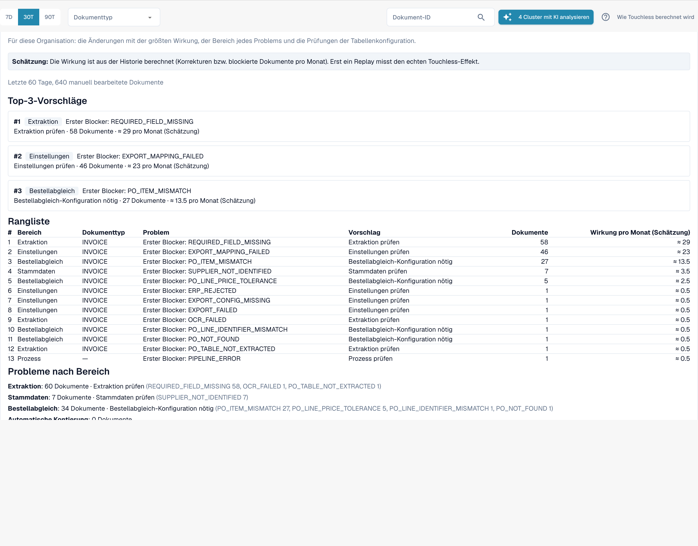

# Touchless Intelligence: Änderungsvorschläge und Berichte

Eine Empfehlung kann einen **Änderungsvorschlag** enthalten, eine einzelne Einstellungsänderung, die helfen sollte. Administratoren arbeiten damit in vier Schritten:

1. **Vorschau**: zeigt die Änderung (aktueller → vorgeschlagener Wert) und was DocBits erwartet. Es wird nichts gespeichert. **Anwenden** ist erst möglich, nachdem Sie eine Vorschau angesehen haben.
2. **Anwenden**: speichert genau die in der Vorschau gezeigte Änderung. Sie wird protokolliert.
3. **Messen**: DocBits vergleicht die Touchless-Quote desselben Dokumenttyps **vorher und nachher** über gleich lange Zeiträume. In jedem Zeitraum sind mindestens **20 Dokumente** nötig, sonst heißt es *nicht messbar*.
4. **Rückgängig machen**: nimmt die Änderung zurück.


Ein Vorher/Nachher-Unterschied ist eine **Beobachtung**, kein Beweis für die Ursache. Gleichzeitig können sich andere Dinge ändern (ein neuer Lieferant, eine saisonale Spitze).


**Beispiel.** Sie wenden *Automatischen Bestellabgleich und Export einschalten* für Rechnungen an. Zwei Wochen später sagt die **Änderungshistorie**: Pure-Quote vorher 52 % (210 Dokumente), nachher 61 % (198 Dokumente). Das sind +9 PP, mit genügend Dokumenten, um messbar zu sein.

Administratoren sehen außerdem zwei Abschnitte zwischen den Kennzahlen und den Diagrammen:

* **Verbesserungsanfragen** (Improvement requests): Vorschläge, die Benutzer aus dem Validierungsassistenten gesendet haben, in zwei Tabs **Offen** und **Verlauf**.
* **Vorschläge für gelernte Regeln** (Learned rule proposals): Regeln, die DocBits aus den Korrekturen Ihres Teams gelernt hat, zum Beispiel „für Lieferant X den Wert in Feld Y ersetzen“. Prüfen Sie vor dem Anlegen die Dokumente, bei denen sie einen Wert ersetzen würde, den Ihr Team akzeptiert hatte. Der Abschnitt **Nach der Aktivierung** zeigt die manuellen Korrekturen des Zielfelds vor und nach dem Start einer Regel.

<figure><figcaption>
Der Consulting-Bericht: die wichtigsten Vorschläge, eine Rangliste aller Blocker mit Dokumenten und geschätzter Wirkung pro Monat sowie die Probleme nach Bereich. Beispielorganisation mit Demodaten; die Lieferantennamen sind frei erfunden.
</figcaption></figure>

Administratoren finden den **Consulting-Bericht** unten im Tab. Klicken Sie auf **Bericht erstellen** (Create report), um ihn zu laden. Er fasst für Ihre Organisation zusammen:

* die **Änderungen mit der größten Wirkung**, als Rangliste, jeweils mit Bereich, Problem, empfohlener Maßnahme, Anzahl der Dokumente und der **geschätzten** Wirkung pro Monat,
* **den Bereich jedes Problems** (Extraktion, Stammdaten, Bestellabgleich, Auto Accounting, Einstellungen, Prozess),
* **Prüfungen der Tabellenkonfiguration**, zum Beispiel *strukturierte Tabellenausgabe nicht verwendet* oder *Spaltentyp der Tabelle passt nicht* je Dokumenttyp und Spalte.

Die Wirkungswerte sind **Schätzungen**. Antwortet der Bericht *forbidden*, erlaubt Ihre Rolle ihn nicht.

## Weiterführende Seiten

* [Touchless Intelligence](touchless-intelligence.md)
* [Lieferantendiagnose und Fehlermuster](touchless-supplier-diagnosis.md)
* [Bestellabgleich-Diagnose](touchless-po-matching-diagnosis.md)
