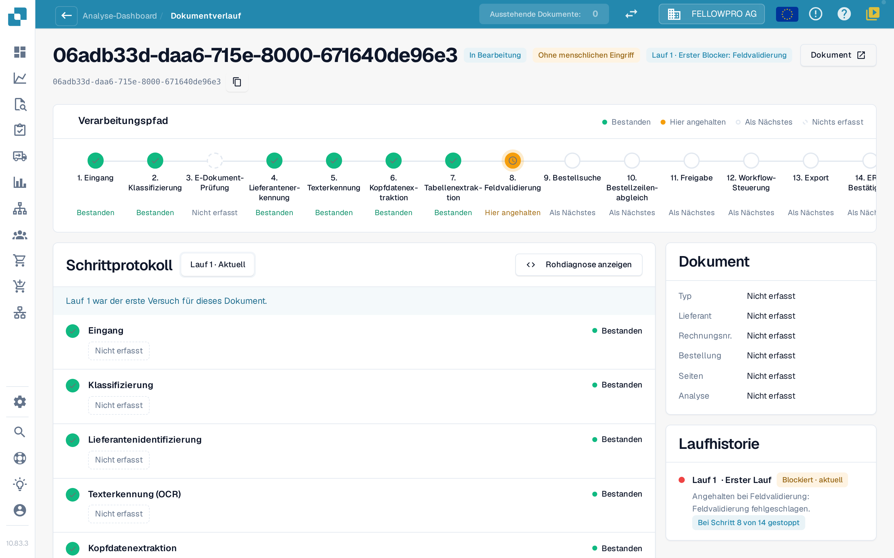
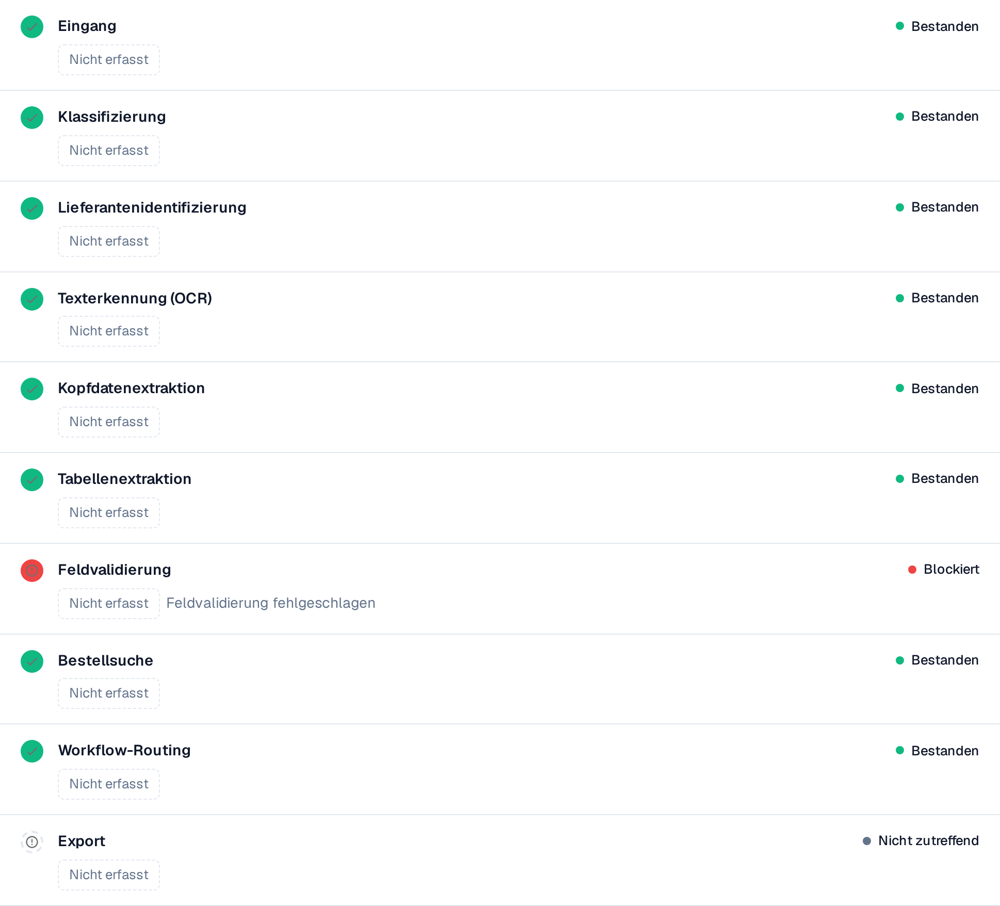

# Touchless Intelligence: Dokumentverlauf

Geben Sie eine Dokument-ID in **Dokument-ID** ein oder öffnen Sie ein Beispieldokument aus einem Cluster, um zu sehen, **was mit genau diesem Dokument passiert ist**.

Die Kopfzeile zeigt die Datei, ihren Status (zum Beispiel **In Bearbeitung**), den Lauf, den Sie gerade ansehen, und dessen ersten Blocker sowie eine Schaltfläche **Dokument** mit der Dokument-ID.

<figure><figcaption>
Der Dokumentverlauf: der Verarbeitungspfad mit allen Schritten und das Schrittprotokoll mit den Angaben, die jeder Schritt aufgezeichnet hat.
</figcaption></figure>

Der **Verarbeitungspfad** zeigt 14 Schritte: Eingang, Klassifizierung, E-Dokument-Prüfung, Lieferantenerkennung, Texterkennung, Kopfdatenextraktion, Tabellenextraktion, Feldvalidierung, Bestellsuche, Bestellzeilenabgleich, Freigabe, Workflow-Steuerung, Export, ERP-Bestätigung. Jeder Schritt trägt genau einen Zustand:

| Zustand | Bedeutung |
| --- | --- |
| **Bestanden** (grün) | Der Schritt ist fehlerfrei gelaufen |
| **Hier angehalten** (orange) | Der Schritt hat das Dokument blockiert |
| **Als Nächstes** | Das Dokument ist nie so weit gekommen |
| **Nichts erfasst** (gestrichelt) | Für diesen Schritt wurden keine Daten aufgezeichnet |
| **Nicht zutreffend** | Der Schritt gilt für dieses Dokument nicht |

### Schrittprotokoll

Das **Schrittprotokoll** unter dem Pfad listet dieselben Schritte mit dem auf, was jeder von ihnen aufgezeichnet hat. Ein Statuspunkt und das Statuswort stehen links und rechts in jeder Zeile.

* Jeder Wert ist ein **Wert-Chip**: eine Zahl mit ihrer Einheit, zum Beispiel **Konfidenz 100 %**, **Schwellenwert 60 %**, **Fehlgeschlagene Regeln 0**, **8 fehlende Felder** oder **0 Zuordnungslücken**. Prozentwerte erscheinen als `97 %`, nie als `0.97`.
* **Details** öffnet die vollständige Liste der Werte, die ein Schritt aufgezeichnet hat, einschließlich der geprüften Alternativen.
* Der Schritt, der das Dokument blockiert hat, nennt den Grund, zum Beispiel **Feldvalidierung fehlgeschlagen**.
* Ein Wert, den kein Schritt aufgezeichnet hat, erscheint als **Nicht erfasst**, nie als erfundener Wert. Werte sind Zahlen und feste Begriffe, nie Dokumenttext.
* **Rohdiagnose anzeigen** blendet die Rohdaten ein, wenn der Support danach fragt.

<figure><figcaption>
Jeder Schritt zeigt, was er aufgezeichnet hat; der blockierte Schritt nennt seine Ursache.
</figcaption></figure>

### Läufe und Änderungen

Die Laufauswahl oben im Schrittprotokoll (**Lauf 1 · Aktuell**) wechselt zwischen den Läufen des Dokuments. Die **Laufhistorie** rechts listet jeden Lauf mit seinem Ergebnis und der Stelle auf, an der er stehen geblieben ist. Wenn ein Dokument mehrfach gelaufen ist, wählen Sie in der Auswahl einen Lauf, um ihn mit dem aktuellen zu vergleichen: Die geänderten Werte tragen dann ein Abzeichen mit der Differenz und ihrer Einheit, zum Beispiel **−2 Felder** oder **+3 %**.

Die Karte **Dokument** neben dem Schrittprotokoll nennt Dokumenttyp, Lieferant, Rechnungsnummer, Bestellung, Seitenzahl und ob die Analyse **regelbasiert** ist oder von einer KI geschrieben wurde.

**Beispiel.** Die Dokumente eines Lieferanten bleiben alle bei Schritt 8 stehen. Im Verlauf sehen Sie jedes Mal dieselben fehlenden Felder. Das ist kein Extraktionsproblem einzelner Dokumente, sondern ein fehlender Standardwert in Ihrer Feldkonfiguration: Beheben Sie ihn einmal, und das ganze Cluster ist rückgewinnbar.

## Weiterführende Seiten

* [Touchless Intelligence](touchless-intelligence.md)
* [Lieferantendiagnose und Fehlermuster](touchless-supplier-diagnosis.md)
* [Bestellabgleich-Diagnose](touchless-po-matching-diagnosis.md)

Die Screenshots auf dieser Seite zeigen die deutsche Benutzeroberfläche.
