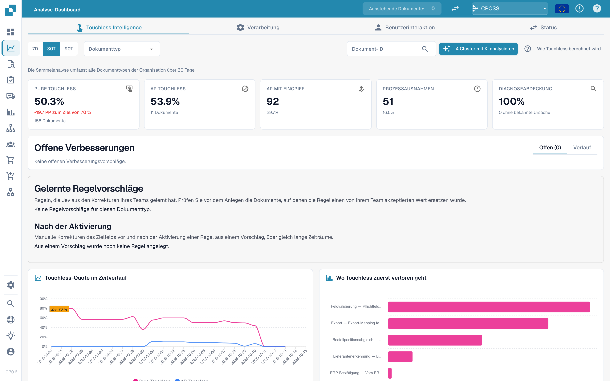
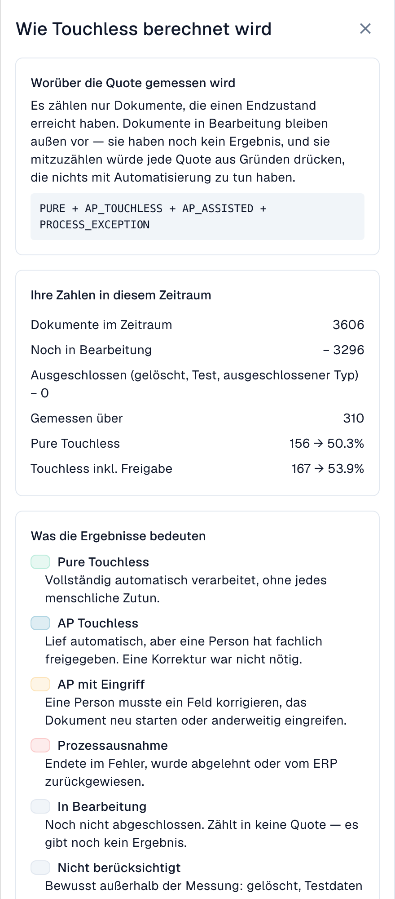
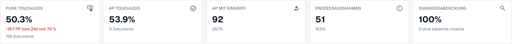
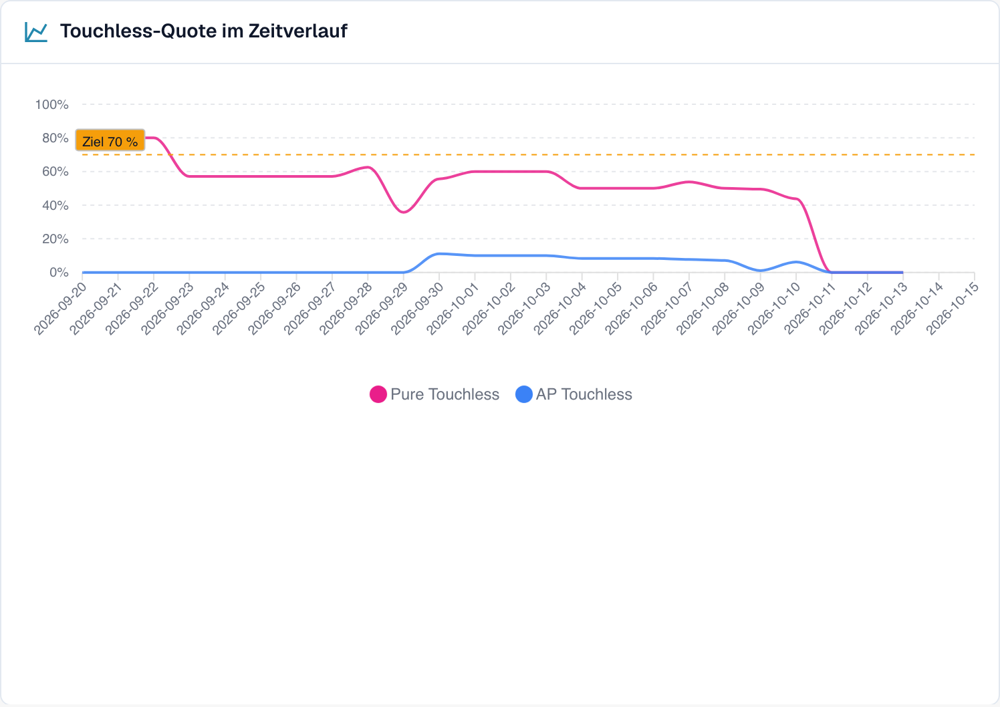
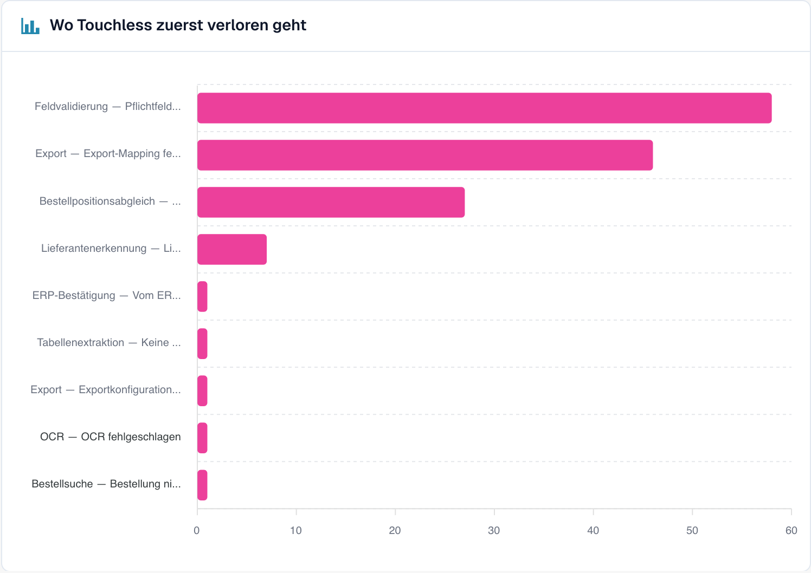
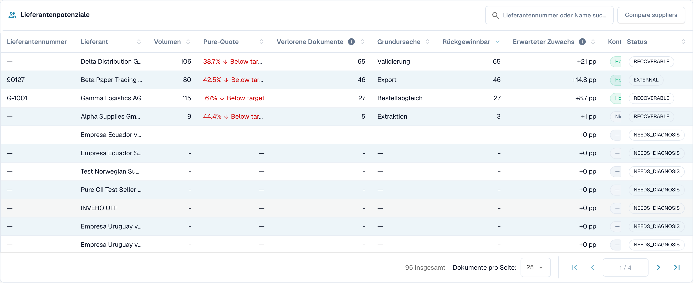
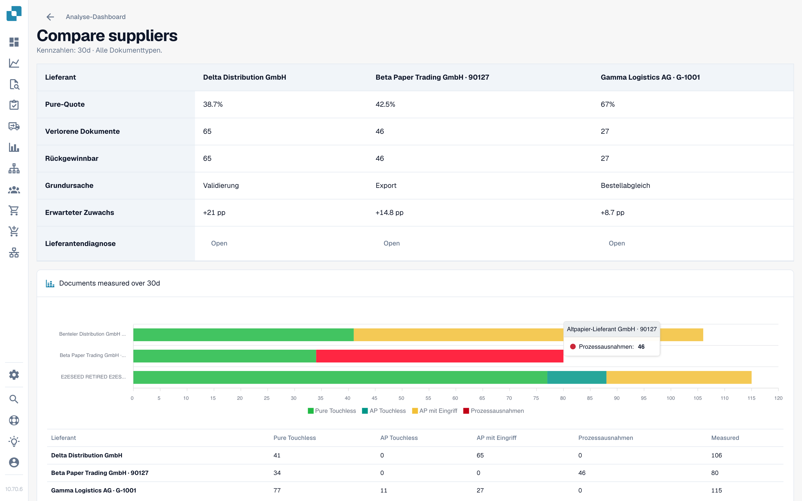

# Touchless Intelligence



## Übersicht

**Touchless Intelligence** beantwortet zwei Fragen zu Ihrer Dokumentenverarbeitung:

1. **Wie viele Dokumente laufen durch DocBits, ohne dass jemand eingreift?** Das ist Ihre *Touchless-Quote*.
2. **Warum bleiben die anderen stehen, und was sollten wir ändern, damit weniger stehen bleiben?** Das ist die *Diagnose*.

Touchless Intelligence ist ein Tab des [Analytics Dashboards](analytics-dashboard.md). Es verursacht keinen zusätzlichen Aufwand für Ihr Team: DocBits zeichnet auf, was in der Verarbeitungs-Pipeline mit jedem Dokument passiert, und wertet das Ergebnis alle 15 Minuten aus.

<figure><figcaption><p>Der Tab Touchless Intelligence: Kennzahlen, Verbesserungen, die Quote im Zeitverlauf und das Diagramm „Wo Touchless zuerst verloren geht“. Beispielorganisation mit Demodaten; die Lieferantennamen sind frei erfunden.</p></figcaption></figure>

### Was Sie damit tun können

| Sie möchten … | Verwenden Sie | Beispiel |
| --- | --- | --- |
| sehen, wie stark Sie automatisiert sind | Die fünf **Kennzahlen** (Key Figures) oben | „63,2 % unserer Dokumente liefen im letzten Monat ohne Eingreifen einer Person“ |
| den Trend sehen | **Touchless-Quote im Zeitverlauf** (Touchless rate over time) | „Die Quote ist von 55 % auf 68 % gestiegen, seit wir die Lieferantenstammdaten korrigiert haben“ |
| herausfinden, wo Dokumente hängen bleiben | **Wo Touchless zuerst verloren geht** (Where touchless is lost first) | „Die meisten Dokumente bleiben bei der Feldvalidierung stehen“ |
| entscheiden, welchen Lieferanten Sie zuerst verbessern | **Lieferantenpotenziale** (Supplier opportunities) | „Lieferant A würde uns +4,0 Prozentpunkte bringen“ |
| einen Lieferanten verstehen | Seite **Lieferantendiagnose** (Supplier Diagnosis) | „Seine Rechnungen haben keine Bestellnummer, deshalb scheitert der Bestellabgleich“ |
| ein Dokument verstehen | **Dokumentverlauf** (Document Trace) | „Diese Rechnung ist bei Schritt 8, der Feldvalidierung, stehen geblieben“ |
| Lieferanten vergleichen | **Lieferanten vergleichen** (Compare suppliers) | „Lieferant A und B nutzen dasselbe Template, aber nur bei B gibt es Fehler“ |
| eine hilfreiche Einstellung ändern | **Änderungsvorschläge** (Change proposals) | „Automatischen Bestellabgleich einschalten: Vorschau, anwenden, messen, rückgängig machen“ |

## Wer es sehen kann

* Der Tab gehört zum Analytics Dashboard. Ihr Administrator aktiviert ihn für die Organisation. Fehlt der Tab, fragen Sie Ihren Administrator.
* **Organisations-Administratoren** sehen ihn immer.
* Andere Benutzer sehen ihn, wenn ein Administrator ihrer Rolle den Tab **Analyse-Dashboard** (Analytics dashboard) freigegeben hat (**Einstellungen → Rollen**). Ohne diese Freigabe haben nur Administratoren Zugriff.
* Einige Aktionen sind nur für Administratoren: **KI-Analyse** (AI analysis), **Änderungen anwenden und rückgängig machen**, **Vorschläge für gelernte Regeln** und der **Consulting-Bericht**.

Wenn Sie keine Berechtigung haben, zeigt die Seite *Aktion nicht erlaubt, bitte kontaktieren Sie den Administrator*.

## Was „Touchless“ bedeutet

Jedes Dokument endet in genau **einem** Ergebnis:

| Ergebnis | Bedeutung | Zählt in der Quote |
| --- | --- | --- |
| **Pure Touchless** | Vom Import bis zum Export **ganz ohne menschliches Zutun** verarbeitet | Ja, als Erfolg |
| **AP Touchless** | Lief automatisch, und eine Person hat nur die **fachliche Freigabe** erteilt. Eine Korrektur war nicht nötig | Ja, als Erfolg |
| **AP mit Eingriff** (AP assisted) | Eine Person musste **ein Feld korrigieren, das Dokument neu starten** oder anderweitig eingreifen | Ja, als Fehlschlag. Es ist kein Fehler, nur Automatisierung, die das Dokument nicht vollständig getragen hat |
| **Prozessausnahme** (Process exception) | Endete in einem **Fehler**, wurde **abgelehnt**, wurde **vom ERP zurückgewiesen** oder **blieb in der Pipeline hängen** | Ja, als Fehlschlag |
| **In Bearbeitung** (In progress) | Noch nicht abgeschlossen | **Nein**. Es gibt noch kein Ergebnis |
| **Nicht berücksichtigt** (Not eligible) | Gelöscht, archiviert, ein Testdokument oder ein ausgeschlossener Dokumenttyp | **Nein** |

Die **Touchless-Quote** lautet:

```
rate = (Pure touchless + AP touchless)
       ÷ (Pure touchless + AP touchless + AP assisted + Process exception)
```

Dokumente, die noch **in Bearbeitung** oder **nicht berücksichtigt** sind, gehen nie in die Berechnung ein. Das schützt die Quote: Ein Dokument, das vor fünf Minuten eingegangen ist, kann sie nicht senken.


**Eine Berührung zählt dauerhaft.** Sobald eine Person ein Dokument bearbeitet hat, bleibt es als bearbeitet gezählt, auch wenn ein späterer automatischer Lauf niemanden gebraucht hätte. **Ein Neustart macht ein Dokument nicht wieder zu einem Touchless-Dokument.** Die Quote spiegelt die Arbeit wider, die tatsächlich stattgefunden hat.


### Beispielrechnung (Zahlen zur Veranschaulichung)

In 30 Tagen sind 200 Dokumente eingegangen:

| Ergebnis | Dokumente |
| --- | --- |
| Pure Touchless | 120 |
| AP Touchless | 30 |
| AP mit Eingriff | 30 |
| Prozessausnahme | 10 |
| In Bearbeitung | 8 |
| Nicht berücksichtigt (Testdokumente) | 2 |

* Nenner: 120 + 30 + 30 + 10 = **190**. Die 8 Dokumente in Bearbeitung und die 2 nicht berücksichtigten Dokumente bleiben außen vor.
* **Pure Touchless**: 120 ÷ 190 = **63,2 %**
* **AP Touchless**: 30 ÷ 190 = **15,8 %**
* **Touchless-Quote**: (120 + 30) ÷ 190 = **78,9 %**

Der Tab zeigt ein **Ziel** (70 %, sofern Ihre Organisation kein anderes verwendet). In diesem Beispiel liegt die Quote über dem Ziel.

Klicken Sie oben rechts auf **Wie Touchless berechnet wird** (How touchless is calculated), um diese Erklärung direkt in DocBits zu öffnen, mit den Zahlen Ihres eigenen Zeitraums (Dokumente im Zeitraum, noch in Bearbeitung, ausgeschlossen, gemessen).

<figure><figcaption><p>Die Seitenleiste <strong>Wie Touchless berechnet wird</strong>: die Formel, <strong>Ihre Zahlen in diesem Zeitraum</strong> (hier 2.425 Dokumente, 2.115 noch in Bearbeitung, 310 gemessen) und was die einzelnen Ergebnisse bedeuten. Beispielorganisation mit Demodaten; die Lieferantennamen sind frei erfunden.</p></figcaption></figure>

### Wie aktuell sind die Zahlen

Die Ergebnisse werden **alle 15 Minuten neu berechnet**. Das Ergebnis eines Dokuments kann sich auch nach seinem ersten Erscheinen noch ändern: Das ERP bestätigt einen Export unter Umständen erst Stunden später. Die Zeile **Datenstand …** (Data as of …) unten im Tab zeigt, wann die Zahlen zuletzt berechnet wurden.

## Der Übersichts-Tab

### Filter

| Filter | Was er bewirkt |
| --- | --- |
| **7D / 30D / 90D** | Der Zeitraum für die Kennzahlen und die Warteschlange. Standard sind 30 Tage |
| **Dokumenttyp** (Document Type) | Beschränkt jede Zahl auf einen Typ, zum Beispiel INVOICE |
| **Segmentfeld / Segmentwert** (Segment field / Segment value) | Nur, wenn Ihre Organisation mehrere Prozesse über einen Dokumenttyp abwickelt (zum Beispiel direkte, indirekte und EAM-Bestellungen im Feld `order_type`). Wählen Sie ein Feld, um die Aufschlüsselung zu sehen, und einen Wert, um alles darauf einzugrenzen |
| **Dokument-ID** (Document ID) | Öffnet den **Dokumentverlauf** für ein Dokument |

Die **Unterorganisation**, die Sie oben in DocBits gewählt haben, grenzt die Kennzahlen und die Lieferanten-Warteschlange ein. Fehlermuster (Cluster) und die KI-Analyse betreffen immer die gesamte Organisation.

### Die fünf Kennzahlen

<figure><figcaption><p>Die fünf Kennzahlen. Hier liegt die Pure-Quote bei 50,3 % (156 Dokumente), das sind 19,7 Punkte unter dem Ziel von 70 %, und die Diagnoseabdeckung beträgt 100 %. Beispielorganisation mit Demodaten; die Lieferantennamen sind frei erfunden.</p></figcaption></figure>

| Karte | Zeigt | Beispiel (zur Veranschaulichung) |
| --- | --- | --- |
| **Pure Touchless** | Den Prozentwert und die Abweichung vom Ziel | **63,2 %** · „120 Dokumente“ · „−6,8 PP zum Ziel von 70 %“ (rot, unter dem Ziel) |
| **AP Touchless** | Den Prozentwert | **15,8 %** · „30 Dokumente“ |
| **AP mit Eingriff** | Die Anzahl der Dokumente und ihren Anteil | **30** · 15,8 % |
| **Prozessausnahmen** | Die Anzahl der Dokumente und ihren Anteil | **10** · 5,3 % |
| **Diagnoseabdeckung** (Diagnosis coverage) | Bei wie vielen blockierten Dokumenten die Ursache **bekannt** ist | **80 %** · „10 ohne bekannte Ursache“ |

* Eine Karte zeigt einen Strich (—) statt **0 %**, wenn es nichts zu messen gibt. Ein Strich bedeutet „keine Daten“, nicht „null“.
* **Diagnoseabdeckung** = Dokumente mit bekanntem Blockadegrund ÷ alle blockierten Dokumente. Beispiel: 50 blockierte Dokumente, 10 davon mit unbekannter Ursache → 40 ÷ 50 = **80 %**. Ein niedriger Wert bedeutet „wir verstehen noch nicht, warum Dokumente stehen bleiben“. Verbessern Sie ihn, bevor Sie einzelne Ursachen beheben.
* **Klicken Sie auf eine Karte**, um die Dokumentenliste hinter der Zahl in einem neuen Tab zu öffnen („Dokumente zu dieser Zahl anzeigen“). Karten mit 0 Dokumenten sind nicht anklickbar.

### Touchless-Quote im Zeitverlauf

<figure><figcaption><p>Die Quote pro Tag mit der Ziellinie. Hier bleibt die Quote zwischen 40 und 60 % und fällt ab dem 10. Oktober stark ab. Beispielorganisation mit Demodaten; die Lieferantennamen sind frei erfunden.</p></figcaption></figure>

Ein Diagramm mit einer Linie für **Pure Touchless**, einer für **AP Touchless** und der **Ziellinie**. Kurze Zeiträume zeigen Tagespunkte, lange Zeiträume Wochenpunkte.

**Beispiel.** Nachdem Sie am 1. Oktober den automatischen Bestellabgleich eingeschaltet haben, steigt die Pure-Quote innerhalb von zwei Wochen von 55 % auf 68 %. Das Diagramm zeigt den Tag, an dem die Kurve dreht, sodass Sie ihn Ihrer Änderung zuordnen können.

### Wo Touchless zuerst verloren geht

<figure><figcaption><p>Blockierte Dokumente nach Schritt und Grund, an dem sie zuerst stehen geblieben sind. Hier kostet <strong>Feldvalidierung: Pflichtfeld fehlt</strong> die meisten Dokumente (58), danach <strong>Export-Mapping fehlgeschlagen</strong> (46) und <strong>PO-Positionsabweichung</strong> (27). Beispielorganisation mit Demodaten; die Lieferantennamen sind frei erfunden.</p></figcaption></figure>

Ein Balkendiagramm der **blockierten Dokumente** pro Pipeline-Schritt: der **erste** Schritt, der ein Dokument gestoppt hat.

**Beispiel.** Balken: Lieferantenerkennung 12, Feldvalidierung 41, Bestellpositionsabgleich 7. Der größte Balken sagt Ihnen, dass Sie sich zuerst die **Feldvalidierung** ansehen sollten, meist weil ein Pflichtfeld nicht extrahiert wird.

### Lieferantenpotenziale

<figure><figcaption><p>Die Lieferanten-Warteschlange (gekürzt auf die ersten vier Zeilen). Der erste Lieferant hat 106 Dokumente, eine Pure-Quote von 38,7 % und 65 rückgewinnbare Dokumente, daher bringt seine Behebung <strong>+21 PP</strong>. Beispielorganisation mit Demodaten; die Lieferantennamen sind frei erfunden.</p></figcaption></figure>

Die Warteschlange beantwortet die Frage **„Welchen Lieferanten sollten wir zuerst verbessern?“** Sie ist nach **rückgewinnbaren** Dokumenten sortiert, die höchsten zuerst, mit 25 Zeilen pro Seite.

| Spalte | Bedeutung |
| --- | --- |
| **Lieferantennummer / Lieferant** (Supplier Number / Supplier) | Der Lieferant. Dokumente ohne erkannten Lieferanten erscheinen als **Lieferant nicht erkannt (n Dokumente)** |
| **Volumen** (Volume) | Berücksichtigte Dokumente des Lieferanten im Zeitraum |
| **Pure-Quote** (Pure Rate) | Anteil der Pure-Touchless-Dokumente. Grün, wenn sie dem Ziel entspricht oder darüber liegt, rot, wenn sie darunter liegt |
| **Verlorene Dokumente** (Lost Documents) | Dokumente, die als AP mit Eingriff oder als Prozessausnahme endeten. Nicht immer war es eine Person: Auch eine ERP-Ablehnung oder ein Dokument, das sieben Tage lang hing, zählt dazu |
| **Grundursache** (Root Cause) | Wer die Behebung verantwortet: Konfiguration, ERP-Integration, Export, Extraktion, Stammdaten, Messung, Bestellabgleich, Benutzerprozess, Validierung oder Unbekannt |
| **Rückgewinnbar** (Recoverable) | Verlorene Dokumente, deren Ursache DocBits beheben kann: Konfiguration, Stammdaten oder Lieferanten-Template |
| **Erwarteter Zuwachs** (Expected Lift) | Um wie viele **Prozentpunkte** die Quote Ihrer Organisation steigen würde, wenn jedes rückgewinnbare Dokument dieses Lieferanten touchless liefe (**+x PP**) |
| **Konfidenz** (Confidence) | **Hoch**, **Mittel** oder **Niedrig**: wie sicher die Diagnose ist |
| **Status** | Neu, Offen, In Untersuchung, In Bearbeitung, Bestätigt, Behoben, Verworfen. Ein Lieferant mit zu wenigen Dokumenten zeigt **NEEDS_DIAGNOSIS** |

**Beispiel.** Ihre Organisation hat im Zeitraum 1.000 berücksichtigte Dokumente. Lieferant A hat 40 rückgewinnbare Dokumente, Lieferant B hat 90 verlorene Dokumente, aber nur 10 rückgewinnbare (sein Problem liegt auf seiner Seite).

* Lieferant A: 40 ÷ 1.000 = **+4,0 PP erwarteter Zuwachs**
* Lieferant B: 10 ÷ 1.000 = **+1,0 PP**, obwohl B mehr verlorene Dokumente hat

Die Warteschlange stuft A über B ein, weil der **erwartete Zuwachs** an Ihrer gesamten Organisation gemessen wird, nicht am Lieferanten. Ein Lieferant mit vier schlechten Dokumenten kann keinen mit vierhundert verdrängen.

Mit dem Suchfeld („Lieferantennummer oder Name suchen“) finden Sie einen Lieferanten. Ein Klick auf eine Zeile öffnet die **Lieferantendiagnose**.

### Lieferanten vergleichen

<figure><figcaption><p>Drei Lieferanten nebeneinander: Pure-Quote, verlorene und rückgewinnbare Dokumente, Grundursache, erwarteter Zuwachs und ein Balkendiagramm der Ergebnisse. Jedes <strong>Öffnen</strong> führt zur Lieferantendiagnose. Beispielorganisation mit Demodaten; die Lieferantennamen sind frei erfunden.</p></figcaption></figure>

Klicken Sie auf **Lieferanten vergleichen**, wählen Sie **zwei bis fünf** Lieferanten aus (jeder wird mit seiner Anzahl blockierter Dokumente aufgeführt) und klicken Sie auf **Vergleichen**.

Der Vergleich zeigt die Lieferanten nebeneinander: **Pure-Quote**, **Verlorene Dokumente**, **Rückgewinnbar**, **Grundursache**, **Erwarteter Zuwachs**, ein Balkendiagramm der Ergebnisse und einen Link zur jeweiligen **Lieferantendiagnose**.

**Beispiel.** Lieferant A und B senden dasselbe Rechnungslayout. B hat eine Pure-Quote von 80 %, A nur 35 %. Beide haben die Grundursache „Stammdaten“. Der Vergleich zeigt, dass das Layout in Ordnung ist und dass der Lieferantensatz von A unvollständig ist. Korrigieren Sie die Stammdaten von A, statt das Template zu ändern.

### Mit KI analysieren

Die Schaltfläche **{n} Cluster mit KI analysieren** (Analyse n clusters with AI) analysiert die Fehlermuster mit dem höchsten Touchless-Potenzial (jeweils mindestens eine Mindestanzahl Dokumente). Das dauert etwa 13 Sekunden pro Cluster und betrifft die **gesamte Organisation**. Nur Administratoren können sie starten.

Während die Analyse läuft, sehen Sie für jedes Cluster **In Warteschlange**, **Läuft**, **Fertig**, **Bereits analysiert** oder **Fehler**, mit einem Link **Cluster öffnen**. Ist die KI abgeschaltet oder in der Umgebung nicht konfiguriert, ist die Schaltfläche mit Angabe des Grundes deaktiviert, und **alles andere auf der Seite funktioniert weiter**.

## Weiter in die Tiefe

| Seite | Was sie behandelt |
| --- | --- |
| [Lieferantendiagnose und Fehlermuster](touchless-supplier-diagnosis.md) | Ein Lieferant im Detail: Ergebniskacheln, Trend, Fehlermuster, woher eine Empfehlung kommt |
| [Bestellabgleich-Diagnose](touchless-po-matching-diagnosis.md) | Warum Dokumente bei der Bestellsuche oder beim Bestellpositionsabgleich stehen bleiben, und der Entscheidungsablauf, der zeigt, wie DocBits Rechnungspositionen mit Bestellpositionen abgleicht |
| [Dokumentverlauf](touchless-document-trace.md) | Was mit einem Dokument passiert ist, Schritt für Schritt |
| [Änderungsvorschläge und Berichte](touchless-change-proposals.md) | Eine Änderung in der Vorschau prüfen, anwenden, messen und rückgängig machen; Vorschläge für gelernte Regeln; der Consulting-Bericht |

## Mit Touchless Intelligence arbeiten: eine Routine

1. **Wöchentlich**: Öffnen Sie den Tab und prüfen Sie die **Quote** und den **Trend** im Vergleich zum Ziel.
2. Sehen Sie sich die **Diagnoseabdeckung** an. Liegt sie unter etwa 80 %, finden Sie zuerst heraus, warum Dokumente stehen bleiben.
3. Lesen Sie **Wo Touchless zuerst verloren geht** und wählen Sie den größten Schritt.
4. Öffnen Sie die **Lieferantenpotenziale**. Sortieren Sie nach **Erwartetem Zuwachs** und nehmen Sie den obersten Lieferanten mit dem Status **RECOVERABLE**.
5. Lesen Sie die **Fehlermuster**, prüfen Sie **Fehlende Evidenz** und folgen Sie dann **Was zu ändern ist**.
6. Wenden Sie immer nur eine Änderung an, mit einer **Vorschau**, damit die **Änderungshistorie** sie messen kann.
7. Prüfen Sie nach zwei Wochen das **Vorher/Nachher**-Ergebnis.

## In einfacher Sprache fragen: DocBits MCP

All das steht auch Ihrem KI-Assistenten über den [DocBits MCP](../advanced-functions-and-tools/docbits-mcp/README.md) zur Verfügung. Beispiele, die Sie fragen können:

* „Wie hoch ist unsere Touchless-Quote in den letzten 30 Tagen?“
* „Welche drei Lieferanten kosten uns die meisten Touchless-Dokumente?“
* „Warum bleiben Dokumente dieses Lieferanten für einen Menschen stehen?“
* „Warum ist der Bestellabgleich für dieses Dokument gescheitert?“

## FAQ

**Die Quoten zeigen einen Strich (—).**
Im Zeitraum hat kein Dokument ein Endergebnis erreicht, oder es wurden weniger Dokumente als das Minimum gemessen. Dokumente, die noch in Bearbeitung sind, werden nicht gezählt.

**Der Tab fehlt.**
Bitten Sie Ihren Administrator, das Modul zu aktivieren und Ihrer Rolle den Tab **Analyse-Dashboard** freizugeben.

**Ein Dokument wird als bearbeitet gezählt, ist diesmal aber ohne jemanden durchgelaufen.**
Es wurde in einem früheren Lauf bearbeitet (eine Korrektur oder ein Neustart). Die Quote zählt die Arbeit, die stattgefunden hat.

**Warum ändert sich die Zahl nach ein paar Stunden?**
Das ERP bestätigt einen Export unter Umständen erst Stunden nach dem Versand. Das Ergebnis wird alle 15 Minuten neu berechnet.

**Ändert die KI etwas von selbst?**
Nein. Die KI schreibt nur Erklärungen. Eine Einstellung ändert sich erst, wenn ein Administrator sie in der Vorschau geprüft und angewendet hat.

## Weiterführende Seiten

* [Lieferantendiagnose und Fehlermuster](touchless-supplier-diagnosis.md)
* [Bestellabgleich-Diagnose](touchless-po-matching-diagnosis.md)
* [Dokumentverlauf](touchless-document-trace.md)
* [Änderungsvorschläge und Berichte](touchless-change-proposals.md)
* [Analytics Dashboard](analytics-dashboard.md)
* [Einstellungs-Assistent](settings/global-settings/company-information/settings-assistant.md)
* [DocBits MCP](../advanced-functions-and-tools/docbits-mcp/README.md)

<!-- Source notes (not shown): screenshots come from the dev test organisation with synthetic demo data (seed script) and fictional supplier names; the PO matching decision flow has no screenshot yet. facts read from the doc2app code (TouchlessIntelligence pages and components) and the dev UI on 14 Oct 2026; NOVA gates the tab with its own organisation flag, VESTA with the Analytics module. Consulting report export format not verified, so no export is described. -->
