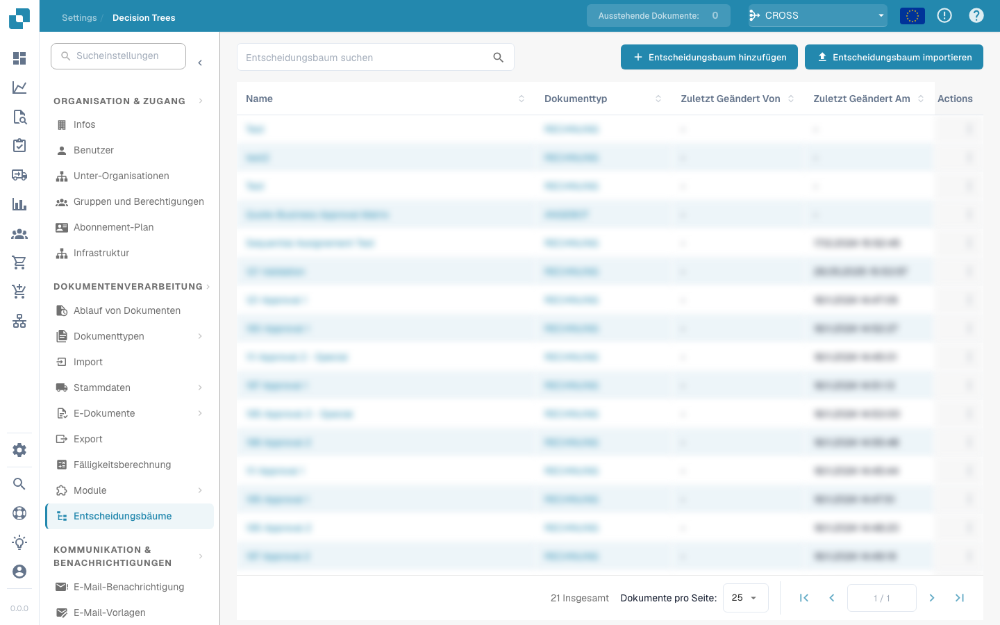

# Workflow

<figure><figcaption></figcaption></figure>

## DocBits Workflow Engine: Vereinfachung der Prozessautomatisierung

### Workflows verstehen und vorbereiten 

Die Anleitung zeigt das echte DocBits-Testkonto: acht Workflow-Ausführungen im Dashboard, zwei gespeicherte Workflows mit Reihenfolge 100/200 und drei bestandene Testszenarien. Außerdem erklärt sie Standard und Advanced Workflows, Lizenzen, Vorlagen und das Card SDK.



[Mit Untertiteln ansehen](https://docbits-videos.fra1.cdn.digitaloceanspaces.com/settings-assistant/workflow-orientation-admin/v1/de.html) · [Video öffnen](https://docbits-videos.fra1.cdn.digitaloceanspaces.com/settings-assistant/workflow-orientation-admin/v1/de.mp4) · [Untertitel (WebVTT)](https://docbits-videos.fra1.cdn.digitaloceanspaces.com/settings-assistant/workflow-orientation-admin/v1/de.vtt) · [Transkript](https://docbits-videos.fra1.cdn.digitaloceanspaces.com/settings-assistant/workflow-orientation-admin/v1/de.txt) · 3:11

Kapitel und Transkript

| Kapitel | Start |
| --- | --- |
| Den Administrator kennenlernen | [0:00](https://docbits-videos.fra1.cdn.digitaloceanspaces.com/settings-assistant/workflow-orientation-admin/v1/de.mp4#t=0.000) |
| Organisation und Zugriff | [0:02](https://docbits-videos.fra1.cdn.digitaloceanspaces.com/settings-assistant/workflow-orientation-admin/v1/de.mp4#t=2.375) |
| Dashboard und Filter | [0:14](https://docbits-videos.fra1.cdn.digitaloceanspaces.com/settings-assistant/workflow-orientation-admin/v1/de.mp4#t=14.750) |
| Workflow-Liste | [0:49](https://docbits-videos.fra1.cdn.digitaloceanspaces.com/settings-assistant/workflow-orientation-admin/v1/de.mp4#t=49.583) |
| Ausführungsreihenfolge | [1:04](https://docbits-videos.fra1.cdn.digitaloceanspaces.com/settings-assistant/workflow-orientation-admin/v1/de.mp4#t=64.042) |
| Standard Workflow | [1:22](https://docbits-videos.fra1.cdn.digitaloceanspaces.com/settings-assistant/workflow-orientation-admin/v1/de.mp4#t=82.667) |
| Advanced Workflow | [1:36](https://docbits-videos.fra1.cdn.digitaloceanspaces.com/settings-assistant/workflow-orientation-admin/v1/de.mp4#t=96.083) |
| Lizenzen | [1:53](https://docbits-videos.fra1.cdn.digitaloceanspaces.com/settings-assistant/workflow-orientation-admin/v1/de.mp4#t=113.333) |
| Vorlagen | [2:11](https://docbits-videos.fra1.cdn.digitaloceanspaces.com/settings-assistant/workflow-orientation-admin/v1/de.mp4#t=131.042) |
| Test Manager | [2:24](https://docbits-videos.fra1.cdn.digitaloceanspaces.com/settings-assistant/workflow-orientation-admin/v1/de.mp4#t=144.250) |
| Card SDK | [2:39](https://docbits-videos.fra1.cdn.digitaloceanspaces.com/settings-assistant/workflow-orientation-admin/v1/de.mp4#t=159.875) |
| Vorbereitung prüfen | [2:55](https://docbits-videos.fra1.cdn.digitaloceanspaces.com/settings-assistant/workflow-orientation-admin/v1/de.mp4#t=175.042) |

**Den Administrator kennenlernen**

Ich kümmere mich hier um DocBits.

**Organisation und Zugriff**

Gut, ich prüfe zuerst oben die Organisation. Die Workflow-Einstellungen gelten für die ausgewählte Organisation. Für diese Anleitung verwende ich unser Dokumentations-Testkonto.

**Dashboard und Filter**

Das Workflow-Dashboard gibt mir den Überblick. Für diese Übersicht habe ich zwei Trainingsworkflows achtmal manuell mit einer Beispielrechnung ausgeführt. Hier stehen acht Gesamtläufe und sechs erfolgreiche Läufe. Bei zwei Läufen war die Betragsbedingung nicht erfüllt. Die Erfolgsquote zählt auch diese korrekt beendeten Prüfungen. Ich filtere nach Workflownamen und kontrolliere den Zeitraum. So ändern sich Kennzahlen und Diagramm. Rechts wechsle ich zwischen gespeicherten Workflows und Testszenarien. Test-Manager-Läufe zählen separat.

**Workflow-Liste**

In der Workflow-Liste verwalte ich einzelne Workflows. Ich prüfe Name, Typ, Ausführungsreihenfolge, Auslöser und verfügbare Aktionen. Über die Suche finde ich bestehende Workflows, bevor ich einen weiteren anlege.

**Ausführungsreihenfolge**

Die Ausführungsreihenfolge ist wichtig, wenn mehrere Workflows dasselbe Dokument bearbeiten. Ich prüfe, welcher zuerst laufen soll und welche Daten der nächste benötigt. Hier steht die Rechnungsprüfung auf hundert und die weitere Prüfung auf zweihundert. Kleinere Werte laufen zuerst.

**Standard Workflow**

Für eine lineare Regel verwende ich Standard Workflow. Wenn legt den Auslöser fest, Und ergänzt Bedingungen, Dann führt Aktionen aus. Die Kartenbibliothek enthält die verfügbaren Bausteine.

**Advanced Workflow**

Für alternative Wege verwende ich Advanced Workflow. Diese Designer-Vorschau zeigt Start und ausdrückliche Verbindungen. Erfolg, eine nicht erfüllte Bedingung und ein Fehler können unterschiedliche Wege nehmen. Die Kartenposition bestimmt keine Ausführungsreihenfolge.

**Lizenzen**

Unter Lizenz prüfe ich das grundlegende Workflow-Modul und Advanced Workflow getrennt. Hier sind beide inaktiv. Der Plandialog zeigt die verfügbaren Abonnements. Ich schließe diese Ansicht ohne Änderung. Eine Designer-Vorschau aktiviert die Workflow-Engine nicht.

**Vorlagen**

Vorlagen helfen mir, einen Ausgangspunkt wiederzuverwenden. Ich öffne die Vorlagenbibliothek und die Option für Standardvorlagen. Felder, Empfänger und Aktionen prüfe ich trotzdem für meinen eigenen Prozess.

**Test Manager**

Der Test Manager enthält gespeicherte Testszenarien für Standard und Advanced Workflows. Nach der Konfiguration ergänze ich passende Eingaben und erwartete Ergebnisse. Mit Alle Tests ausführen prüfe ich Änderungen gegen diese Szenarien.

**Card SDK**

Das Card SDK ist für eigene Erweiterungen gedacht. Entwickler können eine Vorlage verwenden, ein Paket hochladen oder aus GitHub importieren. Für die normale Administration beginne ich mit der vorhandenen Kartenbibliothek.

**Vorbereitung prüfen**

Vor dem Aufbau prüfe ich Organisation, Zugriff, benötigte Lizenz, Dokumentfelder und gewünschtes Ergebnis. Ich entscheide, ob eine lineare Regel genügt. Im nächsten Video erstellen wir einen Standard Workflow Schritt für Schritt.

### Einführung

Im Bereich der Prozessautomatisierung zeichnet sich die DocBits Workflow Engine durch ihren unkomplizierten und intuitiven Ansatz aus. Diese Engine rationalisiert die Erstellung und Verwaltung von Workflows durch eine klare und einfache regelbasierte Struktur. Das Grundprinzip hinter ihrem Design ist die "Easy When-And-Then"-Regel, die den Automatisierungsprozess in drei grundlegende Komponenten unterteilt: Trigger, Bedingung und Aktion. Dieser Leitfaden erklärt, wie jede Komponente innerhalb des Systems funktioniert und wie sie zusammenarbeiten, um eine nahtlose Automatisierung zu ermöglichen.

### Die "Easy When-And-Then"-Regel erklärt

Die DocBits Workflow Engine basiert auf einem grundlegenden, aber leistungsstarken Prinzip, das die Workflow-Automatisierung für Benutzer aller Fähigkeitsstufen zugänglich macht. Dieses Prinzip ist in der "Easy When-And-Then"-Regel zusammengefasst, die wie folgt aufgeschlüsselt werden kann:

#### [When](./#when-trigger) (Trigger)

* **Definition**: Die "When"-Komponente repräsentiert den _Trigger_ des Workflows. Dies ist das Ereignis oder die Bedingung, die die Ausführung des Workflows initiiert. Trigger können eine Vielzahl von Vorkommen sein, wie z.B. der Eingang einer neuen E-Mail, ein bestimmtes Datum und eine bestimmte Uhrzeit oder die Erstellung eines neuen Dokuments.
* **Beispiel**: "Wenn ein neues Kundenformular eingereicht wird..."

#### [And](./#and-condition) (Bedingung)

* **Definition**: Die "And"-Komponente führt die _Bedingung_ ein, die erfüllt sein muss, damit die Aktion fortgesetzt werden kann. Bedingungen dienen als Filter oder Kriterien, die den Trigger verfeinern und sicherstellen, dass der Workflow nur unter bestimmten Umständen ausgeführt wird.
* **Beispiel**: "...und der Kunde aus dem 'Enterprise'-Segment stammt..."

#### [Then](./#then-action) (Aktion)

* **Definition**: Schließlich legt der "Then"-Teil die _Aktion_ fest, die ergriffen werden soll, sobald der Trigger eintritt und die Bedingung erfüllt ist. Aktionen sind die Aufgaben oder Operationen, die vom Workflow ausgeführt werden, wie z.B. das Senden einer E-Mail, das Aktualisieren einer Datenbank oder das Erstellen einer Aufgabe in einem Projektmanagement-Tool.
* **Beispiel**: "...dann weise den Lead dem Enterprise-Vertriebsteam zu und sende eine Willkommens-E-Mail."

### Kombination von Komponenten für leistungsstarke Automatisierungen

Durch die Zusammenstellung dieser drei Komponenten – Trigger, Bedingung und Aktion – ermöglicht die DocBits Workflow Engine den Benutzern, hochgradig angepasste und effiziente Workflows zu erstellen. Dieser modulare Ansatz vereinfacht nicht nur den Prozess der Einrichtung von Automatisierungen, sondern bietet auch die Flexibilität, komplexe Workflows zu erstellen, die in der Lage sind, eine breite Palette von Aufgaben und Prozessen zu bewältigen.

### Fazit

Die "Easy When-And-Then"-Regel der DocBits Workflow Engine veranschaulicht das Engagement der Engine, eine benutzerfreundliche Plattform für die Automatisierung von Prozessen bereitzustellen. Diese unkomplizierte Regel macht es den Benutzern durch die Aufschlüsselung der Automatisierung in die wesentlichen Elemente Trigger, Bedingung und Aktion leichter, Workflows zu konzipieren, zu erstellen und zu verwalten. Unabhängig davon, ob Sie neu in der Workflow-Automatisierung sind oder ein erfahrener Profi, bietet die DocBits Workflow Engine ein effizientes und zugängliches Tool zur Steigerung der Produktivität und Rationalisierung von Abläufen.
