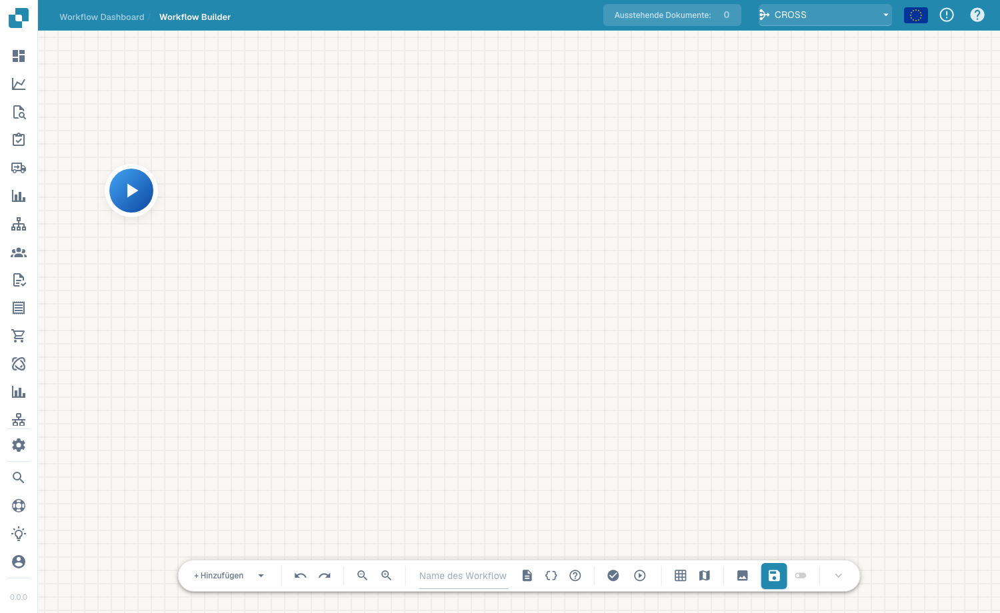
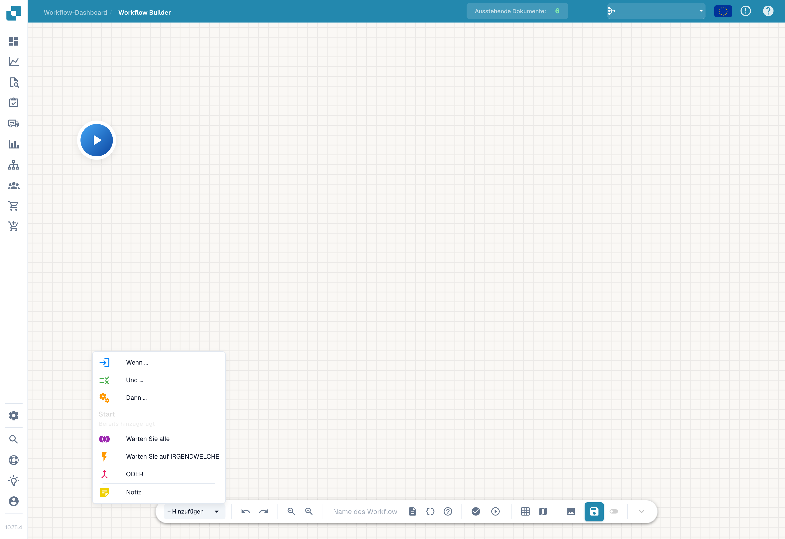

# Erweiterter Workflow

Der **Erweiterter Workflow**-Builder ist ein Node-Graph-Editor für Workflows, die Verzweigungen, parallele Pfade und Ablaufsteuerung benötigen — über das lineare When/And/Then des Standard-Builders hinaus. Sie ordnen Knoten auf einer Canvas an und verbinden sie, um den Ausführungsfluss zu definieren.

## Aktueller Konfigurations- und Ergebnisvertrag

ALL verlangt einen passenden verbundenen Ausgang von **jeder unterschiedlichen Quelle**. ANY und OR benötigen mindestens eine passende Quelle. Verbinden Sie eine Quelle über Grün und Orange, zählt sie weiterhin einmal. OR erzeugt keine exklusive Verzweigung und beendet andere Aktionen nicht. Auch ANY ist keine Zusage „der schnellste Zweig gewinnt“.

Im geprüften Scheduler warten diese Knoten zunächst auf alle eingehenden Vorgänger. Bleibt eine Quelle wegen eines nicht gewählten Zweigs unerreichbar, überspringt der echte Ablauf die wartende Zusammenführung. Der Testmodus kann sie mit den vorhandenen Ergebnissen trotzdem auswerten. **Ein grüner Teiltest beweist deshalb nicht, dass derselbe Graph im Dokumentlauf weiterläuft.**

Für zwei verpflichtende Prüfungen führen Sie beide Prüfungen tatsächlich aus und verbinden passende Ergebnisse mit ALL. Für alternative Routen in dieser Version verwenden Sie die direkte gemeinsame Then-Abschlusskarte aus dem v2-Geschäftsfall. Diese Zusammenführung ist für gegenseitig ausschließende Routen gedacht; sie ersetzt keine Schranke für mehrere gleichzeitig ausgeführte Aktionen.

Prüfen Sie Quelle, verbundenen Ausgang, gewählten Ausgang und tatsächliche Erreichbarkeit getrennt. Eine Quelle mit Error bleibt ein Fehler im Gesamtlauf, auch wenn ANY/OR anschließend erfolgreich sind. Ein nicht erfülltes ALL besitzt im geprüften Code zusätzlich einen Fehlerhinweis; nur auf seine orange Farbe zu schauen genügt nicht.

[P0: Wait ALL, Wait ANY und OR richtig verbinden](masterclass/control-nodes.md)

Der **Advanced Workflow**-Builder ist ein Node-Graph-Editor für Workflows, die Verzweigungen, parallele Pfade und Ablaufsteuerung benötigen — über das lineare When/And/Then des Standard-Builders hinaus. Sie ordnen Knoten auf einer Canvas an und verbinden sie, um den Ausführungsfluss zu definieren.

## Video: Rechnungsrouting direkt in DocBits

Lernen Sie Thomas kennen und folgen Sie seiner Erklärung direkt in der deutschen DocBits-Oberfläche. Er prüft Workflow-Dashboard, Workflow-Liste und Lizenz und öffnet anschließend einen ungespeicherten Designerentwurf. Schritt für Schritt benennt er den Workflow, konfiguriert die Betragsprüfung und zwei Aktionen, ordnet die Karten an und verbindet beide Routen. Danach zeigt er die Testvorbereitung mit Dokumenten und eigenen Daten. Das Demokonto besitzt kein Advanced-Workflow-Abonnement und blockiert die Validierung; der Entwurf bleibt ungespeichert und inaktiv.



[Video öffnen](https://docbits-videos.fra1.cdn.digitaloceanspaces.com/settings-assistant/advanced_workflows_canvas-admin/v7/de.mp4) · [Untertitel (WebVTT)](https://docbits-videos.fra1.cdn.digitaloceanspaces.com/settings-assistant/advanced_workflows_canvas-admin/v7/de.vtt) · [Transkript (Text)](https://docbits-videos.fra1.cdn.digitaloceanspaces.com/settings-assistant/advanced_workflows_canvas-admin/v7/de.txt) · 3:21

| In diesem Video | Start |
| --- | --- |
| Administrator kennenlernen | [0:00](https://docbits-videos.fra1.cdn.digitaloceanspaces.com/settings-assistant/advanced_workflows_canvas-admin/v7/de.mp4#t=0) |
| Workflow-Zugang prüfen | [0:08](https://docbits-videos.fra1.cdn.digitaloceanspaces.com/settings-assistant/advanced_workflows_canvas-admin/v7/de.mp4#t=8) |
| Workflow benennen | [0:33](https://docbits-videos.fra1.cdn.digitaloceanspaces.com/settings-assistant/advanced_workflows_canvas-admin/v7/de.mp4#t=33) |
| Betragsprüfung einrichten | [0:46](https://docbits-videos.fra1.cdn.digitaloceanspaces.com/settings-assistant/advanced_workflows_canvas-admin/v7/de.mp4#t=46) |
| Aktion Approval hinzufügen | [1:08](https://docbits-videos.fra1.cdn.digitaloceanspaces.com/settings-assistant/advanced_workflows_canvas-admin/v7/de.mp4#t=68) |
| Aktion Standard hinzufügen | [1:28](https://docbits-videos.fra1.cdn.digitaloceanspaces.com/settings-assistant/advanced_workflows_canvas-admin/v7/de.mp4#t=88) |
| Karten anordnen | [1:49](https://docbits-videos.fra1.cdn.digitaloceanspaces.com/settings-assistant/advanced_workflows_canvas-admin/v7/de.mp4#t=109) |
| Routen verbinden | [2:02](https://docbits-videos.fra1.cdn.digitaloceanspaces.com/settings-assistant/advanced_workflows_canvas-admin/v7/de.mp4#t=122) |
| Testfälle vorbereiten | [2:27](https://docbits-videos.fra1.cdn.digitaloceanspaces.com/settings-assistant/advanced_workflows_canvas-admin/v7/de.mp4#t=147) |
| Validieren, speichern und aktivieren | [2:53](https://docbits-videos.fra1.cdn.digitaloceanspaces.com/settings-assistant/advanced_workflows_canvas-admin/v7/de.mp4#t=173) |

Transkript

**Administrator kennenlernen**

Ich kümmere mich hier um DocBits. Ich zeige euch, wie ich einen Rechnungsworkflow mit zwei Routen aufbaue.

**Workflow-Zugang prüfen**

Ich beginne im Workflow-Dashboard und öffne die Workflow-Liste. Dann prüfe ich die Lizenz. Workflow und Advanced Workflow benötigen beide einen aktiven Zugang. Mit diesen Freigaben bietet Neuer Workflow auch Advanced Workflow an. Dieses Dokumentationskonto hat keine aktive Workflow-Lizenz. Deshalb arbeite ich mit einer ungespeicherten Vorschau im Designer weiter.

**Workflow benennen**

Ich arbeite im echten DocBits-Designer. Zuerst gebe ich dem Entwurf einen klaren Namen. Wir prüfen einen Rechnungsbetrag und zeigen die beiden möglichen Routen mit einfachen Aktionen. Der Entwurf bleibt ungespeichert.

**Betragsprüfung einrichten**

Ich öffne das Menü zum Hinzufügen und wähle eine Bedingungskarte. Unter Dokumentenfeld wähle ich die Docfield-Bedingung. Als Feld trage ich total_amount ein. Dann wähle ich den Vergleich größer als. Und gebe eintausend ein. Verwendet euren eigenen Dokumentenfeldschlüssel. Genau eintausend erfüllt diesen Vergleich nicht.

**Aktion Approval hinzufügen**

Jetzt füge ich eine Aktionskarte aus der Kategorie Dokumentenfeld hinzu. Die Aktion setzt ein Dokumentenfeld. Ich verwende den Beispielschlüssel approval_route. Und trage den Wert Approval ein. Das kennzeichnet die Route. Ein echter Freigabeprozess benötigt die passenden Geschäftsaktionen.

**Aktion Standard hinzufügen**

Ich füge eine zweite Aktionskarte mit derselben Aktion hinzu. Die Aktion setzt ein Dokumentenfeld. Ich verwende den Beispielschlüssel approval_route. Diesmal erhält das Beispielfeld den Wert Standard. Beide Karten sind konfiguriert. Erst ihre Verbindungen bestimmen, welche Aktion ausgeführt wird.

**Karten anordnen**

Ich ziehe die Karten in eine übersichtliche Anordnung. Die beiden Aktionen kommen nach rechts. Die Bedingung steht in der Mitte, Start links. Verschieben ändert nur die Position. Es erstellt keine Verbindung.

**Routen verbinden**

Ich ziehe vom Ausgang von Start zum Eingang der Bedingung. Die Erfolgsroute führt über die blaue Verbindung zu Approval. Die orange Route für eine nicht erfüllte Bedingung führt zu Standard. Der rote Fehlerausgang ist ein eigener Ausgang für Auswertungsfehler. Hier bleibt er unverbunden. Legt für einen produktiven Workflow fest, wie solche Fehler behandelt werden.

**Testfälle vorbereiten**

Die Test-Schaltfläche in der Werkzeugleiste öffnet die Auswahl eines Testdokuments. Ich kann ein Beispieldokument auswählen oder vollständige benutzerdefinierte Daten vorbereiten. Testet Beträge über, unter und genau bei eintausend. Prüft auch einen fehlenden Betrag. Dieses Konto hat keine Advanced-Workflow-Lizenz. Ich zeige die Testvorbereitung, kein ausgeführtes Testergebnis.

**Validieren, speichern und aktivieren**

Mit Validieren prüft man Verbindungen und Karteneinstellungen. Hier blockiert die fehlende Lizenz die Validierung. Mit einem freigeschalteten Konto würde ich ausdrücklich auf dem Server speichern. Danach prüfe ich die Aktivierung getrennt. Vor dem ersten Speichern ist der Schalter deaktiviert. Der automatische Entwurfsstatus bezieht sich auf eine lokale Browserkopie. Er bedeutet nicht, dass der Workflow gespeichert oder aktiviert ist.

## Zugang

Öffnen Sie den Advanced-Workflow-Designer aus dem Workflow-Bereich (die Advanced-Builder-Canvas). Sie starten an einem **Start**-Knoten und bauen den Ablauf durch Hinzufügen weiterer Knoten auf.

<figure><figcaption>
Die Advanced-Workflow-Canvas — ein Node-Graph mit Zoom, Ausführen, Raster und Speichern. Vergeben Sie in der Toolbar einen Namen für den Workflow.
</figcaption></figure>

## Knoten hinzufügen

Klicken Sie auf **+ Hinzufügen**, um das Knoten-Menü zu öffnen. Zusätzlich zu den bekannten **Wenn**-, **Und**- und **Dann**-Karten bietet der Advanced-Builder Knoten zur Ablaufsteuerung:

<figure><figcaption>
Deutsches Hinzufügen-Menü des Advanced Workflow Builders mit Wenn, Und, Dann, Warten und Notiz.
</figcaption></figure>

- **Wenn / Und / Dann** — dieselben Bedingungs- und Aktionskarten wie im Standard-Builder.
* **Wait ALL** — jede unterschiedliche Quelle muss einen verbundenen Ausgang gewählt haben. Der Scheduler wartet auf alle Vorgänger.
* **Wait ANY** — mindestens eine Quelle muss einen verbundenen Ausgang gewählt haben. Der Scheduler wartet trotzdem auf alle Vorgänger; kein Wettlauf.
* **OR** — mindestens eine passende Quelle; keine exklusive Auswahl. Weniger als zwei Quellen erzeugen im Backend eine Warnung.
- **Note** — eine freie Text-Anmerkung auf der Canvas (ohne Einfluss auf die Ausführung).

Führen Sie den Ablauf über die Play-Schaltfläche aus, validieren Sie ihn und speichern Sie ihn über die Speichern-Schaltfläche in der Toolbar.

[Weiter zur fünfteiligen Videoanleitung auf Deutsch](advanced-workflow-videos.md): Knoten, Variablen, Tests und Workflow Logs.

## Nächste Schritte

- Was die einzelnen Karten tun, sehen Sie im Abschnitt **Karten**.
- Für einfache lineare Automatisierungen ist der **Standard-Workflow**-Builder schneller eingerichtet.
