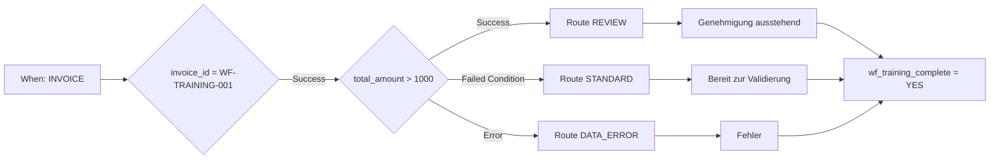

# Advanced-Geschäftsfall: Rechnungsrouting

Eine Trainingsrechnung über 1000 Euro benötigt eine Prüfung. Bis einschließlich 1000 Euro erhält sie die Standardroute. Fehlt der Betrag oder ist er nicht als Zahl auswertbar, führt der Fehlerweg zur Datenkorrektur. Alle drei Wege enden an einer gemeinsamen Abschlussaktion.

## Voraussetzungen und Aufbau

Verwenden Sie eine Testorganisation mit aktiver Advanced-Freigabe und das [Übungspaket](workflow-training-kit.md). Importieren Sie `advanced-workflow.json` über **Import Workflow**, lassen Sie die Regel inaktiv und öffnen Sie den importierten Graphen. Der When-Einstieg prüft Rechnung; die erste And-Karte begrenzt die Übung auf `invoice_id = WF-TRAINING-001`. Die Regel wird inaktiv importiert und enthält keine Empfänger und keinen Export.

Die vorgeschaltete Feldprüfung verwendet `invoice_id`, `eq` und `WF-TRAINING-001`. Ein abweichender Wert lässt alle nachfolgenden Aktionen aus. Die Betragsprüfung verwendet **Docfield is**, Version 2, mit `total_amount`, `gt` und `1000`. Die drei Textaktionen schreiben `wf_training_route`. Die Statuskarten verwenden Version 3 und **Trigger Workflows = false**.

**v2:** Die Statuskarte der gewählten Route verbindet sich direkt mit der gemeinsamen Then-Karte `complete`, die `wf_training_complete = YES` schreibt. Es gibt hier keinen wartenden OR-Knoten. v1 belegte nur den Testmodus: Bei unerreichten Vorgängern kann der echte Scheduler eine Zusammenführung überspringen, die der Test trotzdem auswertet. Die [P0-Knotenreferenz](masterclass/control-nodes.md) zeigt den Unterschied. Eine direkte gemeinsame Then-Karte ersetzt bei mehreren gleichzeitig laufenden Pflichtaktionen keine Wartebarriere.

## Nachbauen und prüfen

1. Validieren Sie den vollständigen Graphen.
2. Bereiten Sie die Dateien für Ihre Organisation nach der Anleitung im Übungspaket vor.
3. Öffnen Sie **Test → Custom Data** und verwenden Sie die vollständige Datei des jeweiligen Falls. Ein Objekt nur mit `total_amount` genügt nicht.
4. Starten Sie vom vollständigen Einstieg. Prüfen Sie den Ausgang von `amount`, den erreichten Routenknoten, die Statusmeldung und `complete`.
5. Vergleichen Sie mit den unabhängig festgelegten Erwartungen. Die gespeicherten Testantworten im Paket zeigen die tatsächlich beobachteten Knotenergebnisse.

| Fall | Betrag | Ausgang von amount | Route / Status | Gesamtergebnis |
| --- | --- | --- | --- | --- |
| above | 1785,00 | Success | REVIEW / validated_pending_approval | success |
| below | 999,00 | Failed Condition | STANDARD / ready_for_validation | success |
| boundary | 1000,00 | Failed Condition | STANDARD / ready_for_validation | success |
| just-above | 1000,01 | Success | REVIEW / validated_pending_approval | success |
| missing | fehlt | Error | DATA_ERROR / error | error |
| invalid-number | invalid | Error | DATA_ERROR / error | error |
| other-invoice | 1785,00 | nicht ausgeführt | andere Rechnungsnummer; keine Aktion | failed_condition |

Im Fehlerfall können `data_error` und `complete` erfolgreich sein, während der Gesamtlauf **error** bleibt. Die Fehlerbehandlung beseitigt die ursprüngliche fehlerhafte Auswertung nicht.

## Vom Routing zum Geschäftsprozess

Die Prüfung wurde am 21. Oktober 2026 gegen den bereitgestellten Dev-Dienst DocFlow **2.10.38** durchgeführt. Das Paket enthält echte Testantworten; Status- und Feldänderungen darin sind simuliert. Es enthält keine gespeicherten Dokument-Workflow-Logs und belegt weder eine persönliche Freigabe noch einen tatsächlichen Export.

Ersetzen Sie die Routenmarkierung für Ihren Geschäftsprozess durch konfigurierte Zuständigkeiten und Freigabeaktionen. Schließen Sie einen Export erst an eine ausdrücklich geprüfte Freigabebedingung an. Bestätigen Sie einen echten Lauf anschließend am Dokument und die Zustellung beim Empfänger; verwenden Sie dafür einen eigenen Trainingsbeleg und ein vorgesehenes Testziel. Die [Fehlerdiagnose](workflow-troubleshooting.md) beschreibt die nötigen Nachweise.

## WF-02: Übung und Abnahme

Führen Sie alle sieben Fälle aus. Halten Sie Ausgang von amount, gewählte Route, Statusmeldung, complete und Gesamtergebnis fest. Nehmen Sie Test und echten Dokumentlauf getrennt ab; einen Fehlerweg trotz erfolgreichem Abschluss nicht als fehlerfreien Lauf markieren.

[Lernweg](workflow-learning-path.md)
