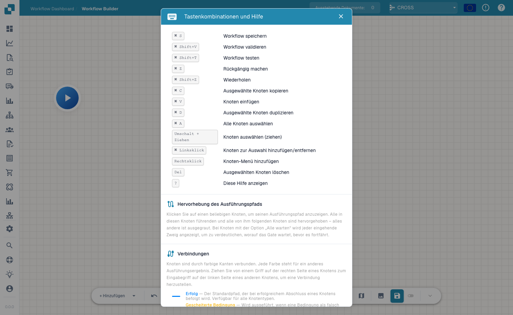

# Symbolleiste & Arbeitsfläche

## Video: Builder und Canvas

Lernen Sie Thomas kennen und folgen Sie seiner Erklärung direkt in der deutschen DocBits-Oberfläche. Er prüft Workflow-Dashboard, Workflow-Liste und Lizenz und öffnet anschließend einen ungespeicherten Designerentwurf. Schritt für Schritt benennt er den Workflow, konfiguriert die Betragsprüfung und zwei Aktionen, ordnet die Karten an und verbindet beide Routen. Danach zeigt er die Testvorbereitung mit Dokumenten und eigenen Daten. Das Demokonto besitzt kein Advanced-Workflow-Abonnement und blockiert die Validierung; der Entwurf bleibt ungespeichert und inaktiv.



[Video öffnen](https://docbits-videos.fra1.cdn.digitaloceanspaces.com/review/advanced_workflows_canvas-admin/20261019-paced-e/de.mp4) · [Untertitel (WebVTT)](https://docbits-videos.fra1.cdn.digitaloceanspaces.com/review/advanced_workflows_canvas-admin/20261019-paced-e/de.vtt) · [Transkript (Text)](https://docbits-videos.fra1.cdn.digitaloceanspaces.com/review/advanced_workflows_canvas-admin/20261019-paced-e/de.txt) · 3:21

| In diesem Video | Start |
| --- | --- |
| Administrator kennenlernen | [0:00](https://docbits-videos.fra1.cdn.digitaloceanspaces.com/review/advanced_workflows_canvas-admin/20261019-paced-e/de.mp4#t=0) |
| Workflow-Zugang prüfen | [0:08](https://docbits-videos.fra1.cdn.digitaloceanspaces.com/review/advanced_workflows_canvas-admin/20261019-paced-e/de.mp4#t=8) |
| Workflow benennen | [0:33](https://docbits-videos.fra1.cdn.digitaloceanspaces.com/review/advanced_workflows_canvas-admin/20261019-paced-e/de.mp4#t=33) |
| Betragsprüfung einrichten | [0:46](https://docbits-videos.fra1.cdn.digitaloceanspaces.com/review/advanced_workflows_canvas-admin/20261019-paced-e/de.mp4#t=46) |
| Aktion Approval hinzufügen | [1:08](https://docbits-videos.fra1.cdn.digitaloceanspaces.com/review/advanced_workflows_canvas-admin/20261019-paced-e/de.mp4#t=68) |
| Aktion Standard hinzufügen | [1:28](https://docbits-videos.fra1.cdn.digitaloceanspaces.com/review/advanced_workflows_canvas-admin/20261019-paced-e/de.mp4#t=88) |
| Karten anordnen | [1:49](https://docbits-videos.fra1.cdn.digitaloceanspaces.com/review/advanced_workflows_canvas-admin/20261019-paced-e/de.mp4#t=109) |
| Routen verbinden | [2:02](https://docbits-videos.fra1.cdn.digitaloceanspaces.com/review/advanced_workflows_canvas-admin/20261019-paced-e/de.mp4#t=122) |
| Testfälle vorbereiten | [2:27](https://docbits-videos.fra1.cdn.digitaloceanspaces.com/review/advanced_workflows_canvas-admin/20261019-paced-e/de.mp4#t=147) |
| Validieren, speichern und aktivieren | [2:53](https://docbits-videos.fra1.cdn.digitaloceanspaces.com/review/advanced_workflows_canvas-admin/20261019-paced-e/de.mp4#t=173) |

Transkript

**Administrator kennenlernen**

Ich kümmere mich hier um DocBits. Ich zeige euch, wie ich einen Rechnungsworkflow mit zwei Routen aufbaue.

**Workflow-Zugang prüfen**

Ich beginne im Workflow-Dashboard und öffne die Workflow-Liste. Dann prüfe ich die Lizenz. Workflow und Advanced Workflow benötigen beide einen aktiven Zugang. Mit diesen Freigaben bietet Neuer Workflow auch Advanced Workflow an. Dieses Dokumentationskonto hat keine aktive Workflow-Lizenz. Deshalb arbeite ich mit einer ungespeicherten Vorschau im Designer weiter.

**Workflow benennen**

Ich arbeite im echten DocBits-Designer. Zuerst gebe ich dem Entwurf einen klaren Namen. Wir prüfen einen Rechnungsbetrag und zeigen die beiden möglichen Routen mit einfachen Aktionen. Der Entwurf bleibt ungespeichert.

**Betragsprüfung einrichten**

Ich öffne das Menü zum Hinzufügen und wähle eine Bedingungskarte. Unter Dokumentenfeld wähle ich die Docfield-Bedingung. Als Feld trage ich total_amount ein. Dann wähle ich den Vergleich größer als. Und gebe eintausend ein. Verwendet euren eigenen Dokumentenfeldschlüssel. Genau eintausend erfüllt diesen Vergleich nicht.

**Aktion Approval hinzufügen**

Jetzt füge ich eine Aktionskarte aus der Kategorie Dokumentenfeld hinzu. Die Aktion setzt ein Dokumentenfeld. Ich verwende den Beispielschlüssel approval_route. Und trage den Wert Approval ein. Das kennzeichnet die Route. Ein echter Freigabeprozess benötigt die passenden Geschäftsaktionen.

**Aktion Standard hinzufügen**

Ich füge eine zweite Aktionskarte mit derselben Aktion hinzu. Die Aktion setzt ein Dokumentenfeld. Ich verwende den Beispielschlüssel approval_route. Diesmal erhält das Beispielfeld den Wert Standard. Beide Karten sind konfiguriert. Erst ihre Verbindungen bestimmen, welche Aktion ausgeführt wird.

**Karten anordnen**

Ich ziehe die Karten in eine übersichtliche Anordnung. Die beiden Aktionen kommen nach rechts. Die Bedingung steht in der Mitte, Start links. Verschieben ändert nur die Position. Es erstellt keine Verbindung.

**Routen verbinden**

Ich ziehe vom Ausgang von Start zum Eingang der Bedingung. Die Erfolgsroute führt über die blaue Verbindung zu Approval. Die orange Route für eine nicht erfüllte Bedingung führt zu Standard. Der rote Fehlerausgang ist ein eigener Ausgang für Auswertungsfehler. Hier bleibt er unverbunden. Legt für einen produktiven Workflow fest, wie solche Fehler behandelt werden.

**Testfälle vorbereiten**

Die Test-Schaltfläche in der Werkzeugleiste öffnet die Auswahl eines Testdokuments. Ich kann ein Beispieldokument auswählen oder vollständige benutzerdefinierte Daten vorbereiten. Testet Beträge über, unter und genau bei eintausend. Prüft auch einen fehlenden Betrag. Dieses Konto hat keine Advanced-Workflow-Lizenz. Ich zeige die Testvorbereitung, kein ausgeführtes Testergebnis.

**Validieren, speichern und aktivieren**

Mit Validieren prüft man Verbindungen und Karteneinstellungen. Hier blockiert die fehlende Lizenz die Validierung. Mit einem freigeschalteten Konto würde ich ausdrücklich auf dem Server speichern. Danach prüfe ich die Aktivierung getrennt. Vor dem ersten Speichern ist der Schalter deaktiviert. Der automatische Entwurfsstatus bezieht sich auf eine lokale Browserkopie. Er bedeutet nicht, dass der Workflow gespeichert oder aktiviert ist.

[Alle fünf Kapitel ansehen](../advanced-workflow-videos.md)

Die Symbolleiste des Advanced Workflow verläuft am unteren Rand der Arbeitsfläche und bietet Ihnen alles, was Sie zum Erstellen, Navigieren und Verwalten des Ablaufs benötigen.

## Steuerelemente der Symbolleiste

- **+ Add** — öffnet das Knotenmenü zum Hinzufügen eines Knotens (siehe [Knoten](nodes.md)).
- **Undo / Redo** — schrittweise rückwärts oder vorwärts durch Ihre Änderungen.
- **Zoom in / Zoom out** — ändert die Zoomstufe der Arbeitsfläche.
- **Workflow name** — benennt den Workflow direkt vor Ort.
- **Edit description** — fügt eine Beschreibung für den Workflow hinzu.
- **Variables** — öffnet das Panel [Variablen](variables.md).
- **Help** — öffnet den Dialog mit Tastenkürzeln und Hilfe.
- **Validate / Test** — prüft und startet den Ablauf (siehe [Validierung & Test](validation-and-testing.md)).
- **Snap to grid** — schaltet das Einrasten von Knoten am Raster für aufgeräumte Layouts um.
- **Mini-map** — schaltet eine kleine Übersichtskarte zum Navigieren großer Graphen um.
- **Save** — speichert den Workflow. Eine **auto-save**-Anzeige zeigt, wann der Ablauf zuletzt automatisch gespeichert wurde.

## Tastenkürzel

Drücken Sie jederzeit <kbd>?</kbd> auf der Arbeitsfläche, um den Dialog mit Tastenkürzeln und Hilfe zu öffnen.

<figure><figcaption>
Der Dialog mit Tastenkürzeln und Hilfe — Tastenkürzel, Hervorhebung des Ausführungspfads und Verbindungsfarben.
</figcaption></figure>

| Tastenkürzel | Aktion |
|---|---|
| <kbd>Cmd/Ctrl</kbd> + <kbd>S</kbd> | Workflow speichern |
| <kbd>Cmd/Ctrl</kbd> + <kbd>Shift</kbd> + <kbd>V</kbd> | Workflow validieren |
| <kbd>Cmd/Ctrl</kbd> + <kbd>Shift</kbd> + <kbd>T</kbd> | Workflow testen |
| <kbd>Cmd/Ctrl</kbd> + <kbd>Z</kbd> / <kbd>Shift</kbd> + <kbd>Z</kbd> | Rückgängig / Wiederholen |
| <kbd>Cmd/Ctrl</kbd> + <kbd>C</kbd> / <kbd>V</kbd> / <kbd>D</kbd> | Ausgewählte Knoten kopieren / einfügen / duplizieren |
| <kbd>Cmd/Ctrl</kbd> + <kbd>A</kbd> | Alle Knoten auswählen |
| <kbd>Shift</kbd> + Ziehen | Knoten auswählen (Ziehen) |
| <kbd>Cmd/Ctrl</kbd> + Linksklick | Knoten zur Auswahl hinzufügen/entfernen |
| Rechtsklick | Menü zum Hinzufügen von Knoten |
| <kbd>Del</kbd> | Ausgewählten Knoten löschen |
| <kbd>?</kbd> | Diese Hilfe anzeigen |

## Nächste Schritte

- Erstellen Sie den Ablauf mit [Knoten](nodes.md) und [Variablen](variables.md).
