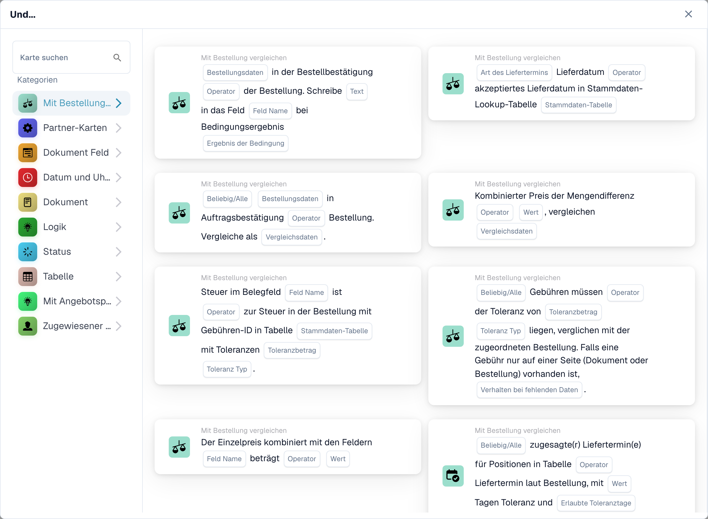
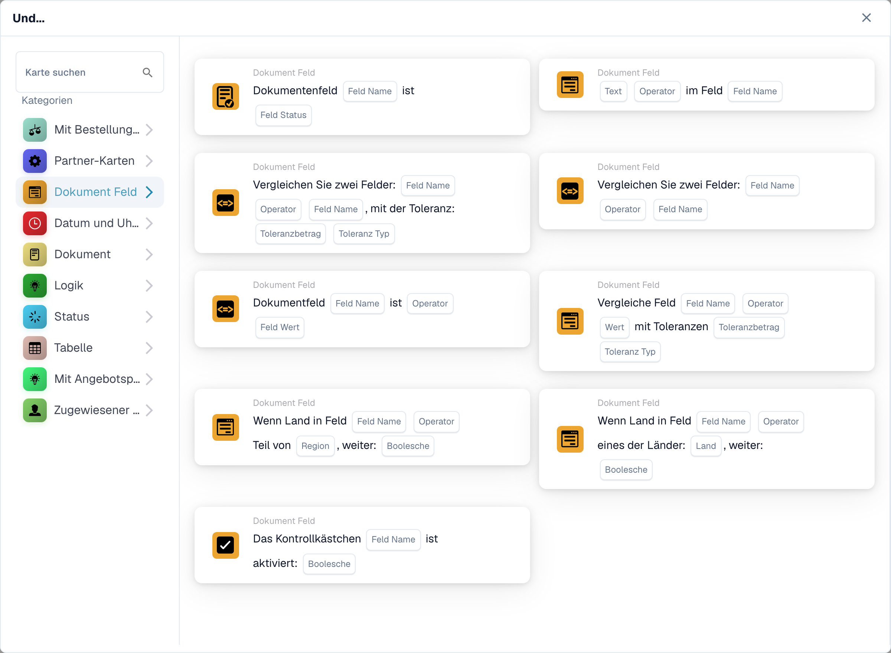
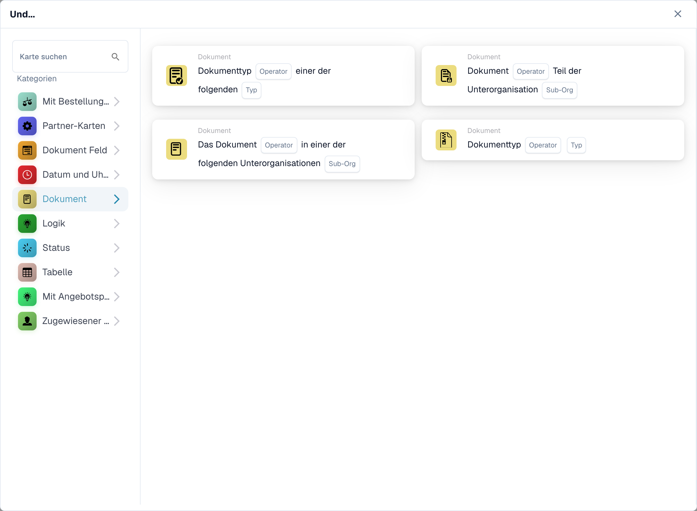
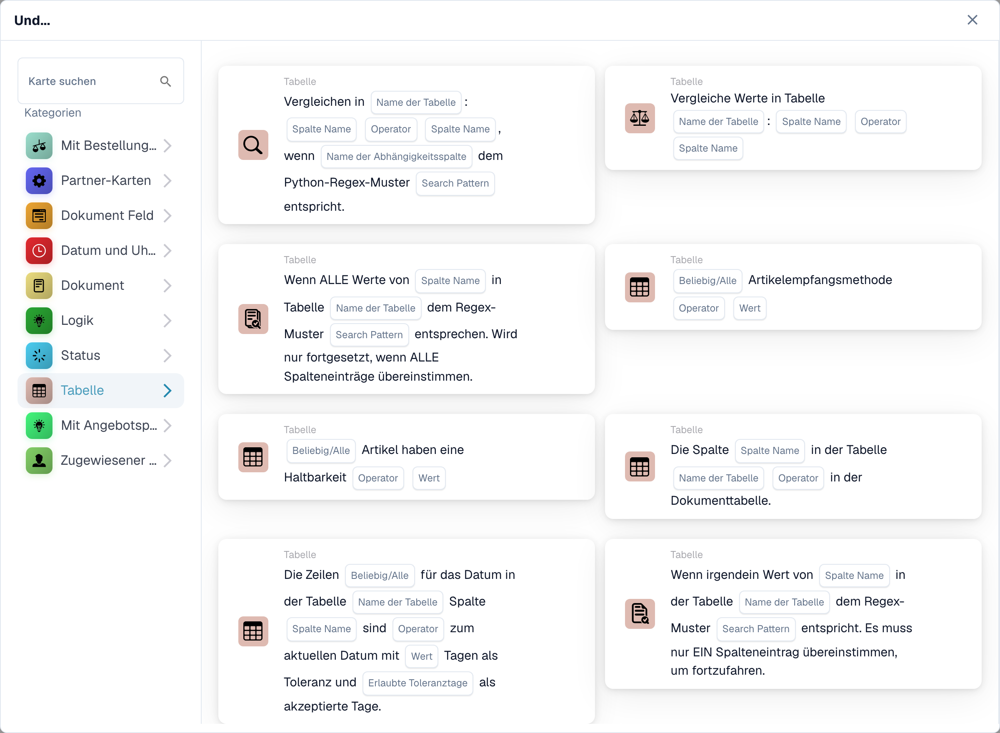
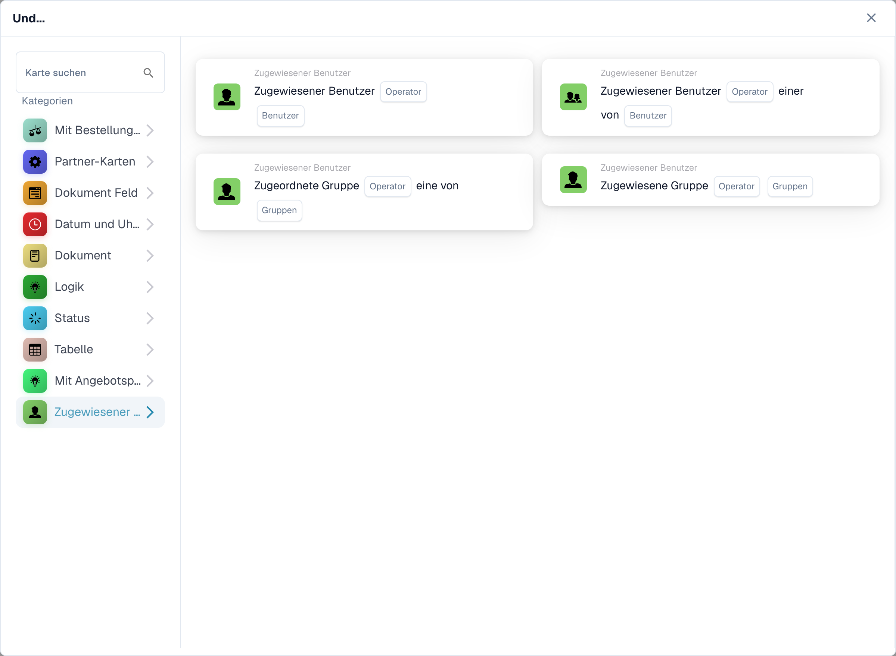

# Und

Die Aufnahmen zeigen die deutsche Und-Kartenauswahl. Einzelne Platzhalter wie **Search Pattern**, **data** und **status code** sowie einige Sätze der Angebotspreis-Karten sind im Produkt noch englisch.

Verwenden Sie eine **Und**-Karte, um zu entscheiden, ob ein Workflow nach seinem **Wenn**-Auslöser fortgesetzt werden soll. Fügen Sie die erforderlichen Prüfungen vor der Aktion **Dann** hinzu. Auf jeder Karte werden die auszufüllenden Felder angezeigt, z. B. **Operator**, **Feldname** oder **Wert**; Die Screenshots zeigen die verfügbaren Kartenvorlagen, keine abgeschlossenen Regeln.

Wählen Sie im **Workflow-Builder** unter **Und...** **Karte hinzufügen** aus. Wählen Sie links eine Kategorie oder geben Sie einen Kartennamen in **Karte suchen** ein. Wählen Sie eine Kartenvorschau aus, um sie dem Workflow hinzuzufügen. Sie können durch die Vorschauliste scrollen, um weitere Karten anzuzeigen. Verwenden Sie **×**, um die Auswahl zu schließen, ohne eine andere Karte auszuwählen. Speichern Sie den Workflow nach der Konfiguration der Karten. Siehe [Workflow](..) für die umgebenden Schritte **Wann**, **Und** und **Dann**.

## Vergleichen Sie mit der Bestellung

Verwenden Sie diese Karten, um Bestell- oder Rechnungsdaten mit einer Bestellung zu vergleichen, z. B. Stückpreis, versprochenes Lieferdatum, Gebühren oder Menge. Wählen Sie die Felder, den Operator und alle Toleranzen aus, die für die ausgewählte Karte erforderlich sind. Die einzelnen Karten finden Sie unter [Mit Bestellung vergleichen](compare-with-purchase-order)].

<figure><figcaption>
Verfügbare Karten der ausgewählten Kategorie. Füllen Sie die Platzhalter vor der Verwendung aus.
</figcaption></figure>

## Dokumentfeld

Wählen Sie diese Kategorie, um ein Kontrollkästchen oder einen Feldstatus zu aktivieren, ein Feld mit einem Wert zu vergleichen oder zwei Felder zu vergleichen. Füllen Sie die Platzhalter **Feldname** und **Operator** auf der ausgewählten Karte aus. Manche Vergleiche verlangen auch eine Toleranz. Siehe [Dokumentfeld](document-field).

<figure><figcaption>
Verfügbare Karten der ausgewählten Kategorie. Füllen Sie die Platzhalter vor der Verwendung aus.
</figcaption></figure>

## Datum und Uhrzeit

Verwenden Sie **Datum und Uhrzeit**, um ein Datum oder eine Uhrzeit mit einem Bereich zu vergleichen, oder vergleichen Sie **Heute** mit einem ausgewählten Datum. Wählen Sie den **Operator** und die Datumswerte auf der Karte aus. Siehe [Datum und Uhrzeit](date-and-time).

<figure><figcaption>
Verfügbare Karten der ausgewählten Kategorie. Füllen Sie die Platzhalter vor der Verwendung aus.
</figcaption></figure>

## Dokument

Verwenden Sie diese Karten, wenn ein Workflow vom **Dokumenttyp** oder **Unterorganisation** abhängen soll. Wählen Sie den auf der Karte genannten Typ oder die Organisation aus. Siehe [Dokument](document).

<figure><figcaption>
Verfügbare Karten der ausgewählten Kategorie. Füllen Sie die Platzhalter vor der Verwendung aus.
</figcaption></figure>

## Logik

Diese Kategorie umfasst Prüfungen anhand einer Entscheidungstabelle, einer HTTPS-Antwort, der Modulverfügbarkeit, eines angegebenen Artikelpreises, eines Zufallswerts oder zweier Werte. Öffnen Sie die jeweilige Karte und füllen Sie die benannten Platzhalter aus; Beispielsweise fragt die HTTPS-Karte nach einer URL, einer Methode und einem akzeptierten Statuscode. Siehe [Logik](logic).

<figure><figcaption>
Verfügbare Karten der ausgewählten Kategorie. Füllen Sie die Platzhalter vor der Verwendung aus. Einzelne Feldbeschriftungen dieser Kartenversion sind in der Oberfläche derzeit noch englisch. Die Erläuterungen auf dieser Seite sind übersetzt.
</figcaption></figure>

## Status

Verwenden Sie **Status**, um zu prüfen, ob ein Dokument einen ausgewählten Status hat oder ob sich sein Status in einem ausgewählten Satz befindet. Wählen Sie in der Karte den **Operator** und **Status**. Siehe [Status](status).

<figure><figcaption>
Verfügbare Karten der ausgewählten Kategorie. Füllen Sie die Platzhalter vor der Verwendung aus.
</figcaption></figure>

## Tabelle

Diese Karten untersuchen Dokumenttabellenzeilen. Zu den sichtbaren Optionen gehören Datumsprüfungen, Textmuster, Haltbarkeit und Vergleiche zwischen Spalten. Wählen Sie **Tabellenname** und **Spaltenname** aus, bevor Sie einen Operator oder ein Muster auswählen. Siehe [Tabelle](table).

<figure><figcaption>
Verfügbare Karten der ausgewählten Kategorie. Füllen Sie die Platzhalter vor der Verwendung aus. Einzelne Feldbeschriftungen dieser Kartenversion sind in der Oberfläche derzeit noch englisch. Die Erläuterungen auf dieser Seite sind übersetzt.
</figcaption></figure>

## Vergleichen Sie mit dem Angebotspreis

Verwenden Sie diese Karten, um einen Artikel mit den angegebenen Preisdaten zu vergleichen. Die sichtbaren Auswahlmöglichkeiten umfassen Artikel-ID, Lieferantentyp, Lieferantenartikel-ID, Stückpreis und Maßeinheit. Der **Operator** und die Datenplatzhalter hängen von der von Ihnen ausgewählten Karte ab.

<figure><figcaption>
Verfügbare Karten der ausgewählten Kategorie. Füllen Sie die Platzhalter vor der Verwendung aus. Einzelne Feldbeschriftungen dieser Kartenversion sind in der Oberfläche derzeit noch englisch. Die Erläuterungen auf dieser Seite sind übersetzt.
</figcaption></figure>

## Bevollmächtigter

Verwenden Sie **Zuständiger**, wenn die Bedingung vom zugewiesenen Benutzer oder der zugewiesenen Gruppe abhängt. Wählen Sie, ob Sie mit einem Benutzer oder einer Gruppe oder einem ausgewählten Satz vergleichen möchten. Siehe [Beauftragter](assignee).

<figure><figcaption>
Verfügbare Karten der ausgewählten Kategorie. Füllen Sie die Platzhalter vor der Verwendung aus.
</figcaption></figure>

[Detaillierte Angebotsvergleichskarten und Alle/Alle-Verhalten](../cards-overview/quote-comparison-guide.md).
