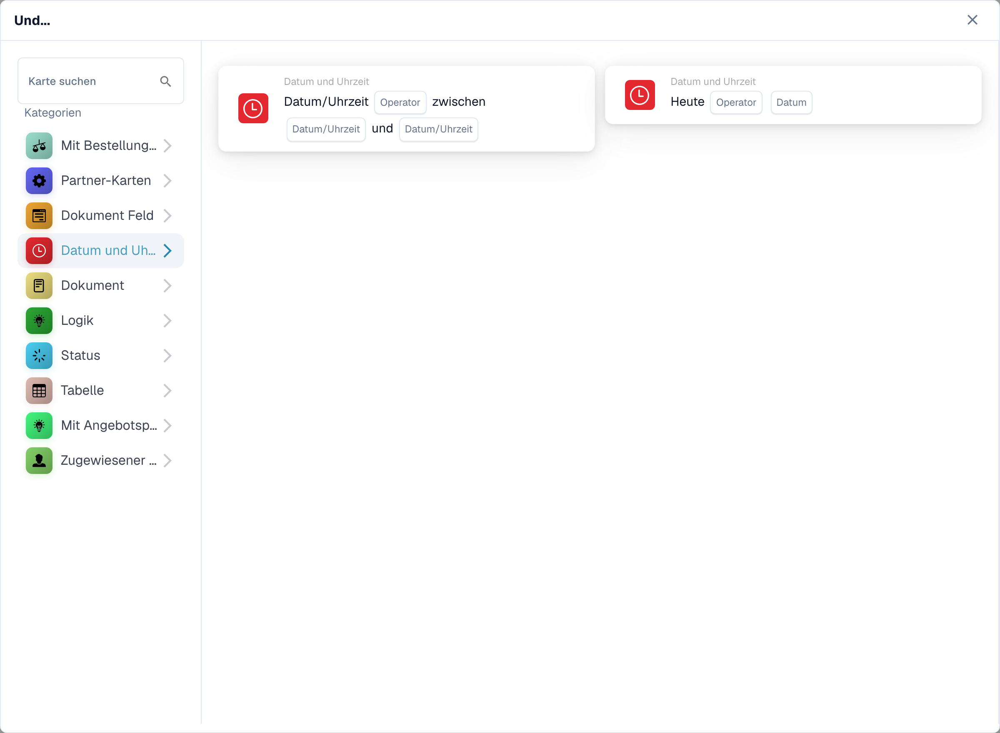
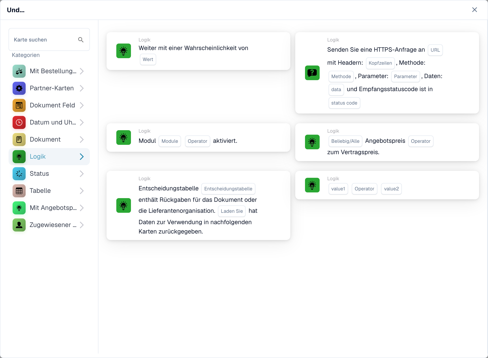
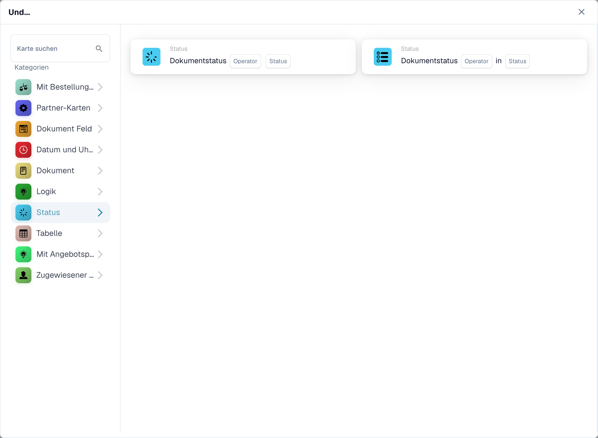
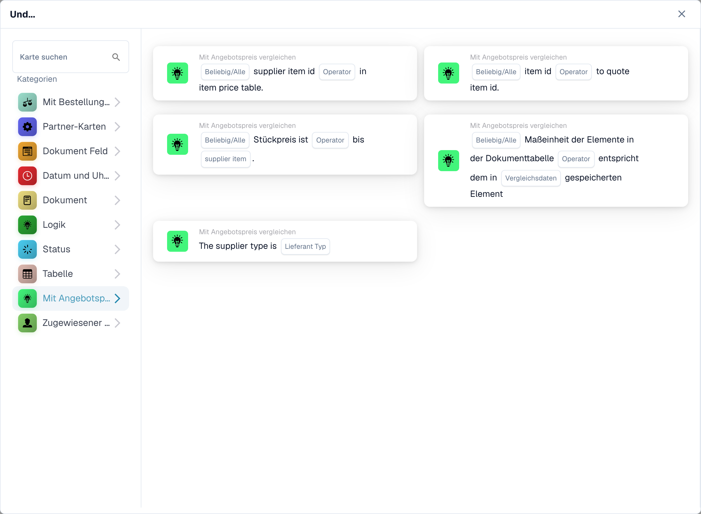

# Und: eine Bedingungskarte auswählen

Die Aufnahmen zeigen die deutsche Und-Kartenauswahl. Einzelne Platzhalter wie **Search Pattern**, **data** und **status code** sowie einige Sätze der Angebotspreis-Karten sind im Produkt noch englisch.

Verwenden Sie eine **Und**-Karte, um zu entscheiden, ob ein Workflow nach seinem **Wenn**-Auslöser fortgesetzt werden soll. Fügen Sie die benötigten Prüfungen vor der **Dann**-Aktion hinzu. Jede Karte zeigt Felder zum Ausfüllen, etwa **Operator**, **Feld Name** oder **Wert**; die Screenshots zeigen die verfügbaren Kartenvorlagen, keine fertig ausgefüllten Regeln.

Wählen Sie im **Workflow Builder** unter **Und...** die Option **Karte hinzufügen**. Wählen Sie links eine Kategorie aus oder geben Sie in **Karte suchen** den Namen einer Karte ein. Wählen Sie eine Kartenvorschau aus, um sie dem Workflow hinzuzufügen. Sie können in der Vorschauliste scrollen, um weitere Karten zu sehen. Mit **×** schließen Sie die Auswahl, ohne eine weitere Karte zu wählen. Speichern Sie den Workflow, nachdem Sie die Karten konfiguriert haben. Die umgebenden Schritte **Wenn**, **Und** und **Dann** finden Sie unter [Workflow](../README.md).

## Mit Bestellung vergleichen {#compare-with-purchase-order}

Mit diesen Karten vergleichen Sie Bestell- oder Rechnungsdaten mit einer Bestellung, etwa Stückpreis, zugesagtes Lieferdatum, Gebühren oder Menge. Wählen Sie die Felder, den Operator und gegebenenfalls die Toleranz, nach der die gewählte Karte fragt. Die einzelnen Karten finden Sie unter [Compare with Purchase Order](compare-with-purchase-order/README.md).

<figure><figcaption>
Deutsche Und-Kartenauswahl: Mit Bestellung vergleichen.
</figcaption></figure>

## Dokument Feld {#document-field}

Wählen Sie diese Kategorie, um ein Kontrollkästchen oder einen Feldstatus zu prüfen, ein Feld mit einem Wert zu vergleichen oder zwei Felder miteinander zu vergleichen. Füllen Sie auf der gewählten Karte die Platzhalter **Feld Name** und **Operator** aus. Einige Vergleiche fragen zusätzlich nach einer Toleranz. Siehe [Document Field](document-field/README.md).

<figure><figcaption>
Deutsche Und-Kartenauswahl: Dokument Feld mit Feldstatus, Wertvergleich und Toleranzen.
</figcaption></figure>

## Datum und Uhrzeit {#date-and-time}

Verwenden Sie **Datum und Uhrzeit**, um ein Datum oder eine Uhrzeit mit einem Bereich zu vergleichen oder **Heute** mit einem gewählten Datum zu vergleichen. Wählen Sie in der Karte den **Operator** und die Datumswerte aus. Siehe [Date & Time](date-and-time/README.md).

<figure><figcaption>
Deutsche Und-Kartenauswahl: Datum und Uhrzeit mit Bereichsvergleich und Heute.
</figcaption></figure>

## Dokument {#document}

Verwenden Sie diese Karten, wenn ein Workflow vom **Dokumenttyp** oder von der **Unterorganisation** abhängen soll. Wählen Sie den Typ oder die Organisation, die in der Karte genannt wird. Siehe [Document](document/README.md).

<figure><figcaption>
Deutsche Und-Kartenauswahl: Dokumenttyp und Zugehörigkeit zu Unterorganisationen.
</figcaption></figure>

## Logik {#logic}

Diese Kategorie enthält Prüfungen mit einer Entscheidungstabelle, einer HTTPS-Antwort, der Verfügbarkeit eines Moduls, einem angebotenen Artikelpreis, einem Zufallswert oder zwei Werten. Öffnen Sie die jeweilige Karte und füllen Sie die benannten Platzhalter aus; die HTTPS-Karte fragt zum Beispiel nach einer URL, einer Methode und einem akzeptierten Statuscode. Siehe [Logic](logic/README.md).

<figure><figcaption>
Deutsche Und-Kartenauswahl: Logik mit Entscheidungstabelle, HTTPS-Anfrage und Modulprüfung. Technische Platzhalter bleiben teilweise englisch.
</figcaption></figure>

## Status

Verwenden Sie **Status**, um zu prüfen, ob ein Dokument einen gewählten Status hat oder ob sein Status in einer ausgewählten Menge enthalten ist. Wählen Sie in der Karte den **Operator** und den **Status**. Siehe [Status](status/README.md).

<figure><figcaption>
Deutsche Und-Kartenauswahl: Status mit Dokumentstatus und Statusauswahl.
</figcaption></figure>

## Tabelle {#table}

Diese Karten untersuchen die Zeilen von Dokumenttabellen. Die sichtbaren Optionen umfassen Datumsprüfungen, Textmuster, Haltbarkeit und Vergleiche zwischen Spalten. Wählen Sie den **Namen der Tabelle** und den **Spaltennamen**, bevor Sie einen Operator oder ein Muster auswählen. Siehe [Table](table/README.md).

<figure><figcaption>
Deutsche Und-Kartenauswahl: Tabelle mit Spaltenvergleichen, Regex und Datum. Search Pattern bleibt ein Produktplatzhalter.
</figcaption></figure>

## Mit Angebotspreis vergleichen {#compare-with-quote-price}

Mit diesen Karten vergleichen Sie einen Artikel mit angebotenen Preisdaten. Die sichtbaren Auswahlmöglichkeiten umfassen Artikel-ID, Lieferantentyp, Lieferanten-Artikel-ID, Stückpreis und Mengeneinheit. Der **Operator** und die Datenplatzhalter hängen von der gewählten Karte ab.

<figure><figcaption>
Und-Kartenauswahl Mit Angebotspreis vergleichen in der deutschen Oberfläche. Einige Kartensätze und Platzhalter sind im Produkt noch englisch.
</figcaption></figure>

## Zugewiesener Benutzer {#assignee}

Verwenden Sie **Zugewiesener Benutzer**, wenn die Bedingung vom zugewiesenen Benutzer oder der zugewiesenen Gruppe abhängt. Wählen Sie, ob mit einem einzelnen Benutzer oder einer einzelnen Gruppe oder mit einer ausgewählten Menge verglichen werden soll. Siehe [Assignee](assignee/README.md).

<figure><figcaption>
Deutsche Und-Kartenauswahl: Zugewiesener Benutzer und zugewiesene Gruppe.
</figcaption></figure>
