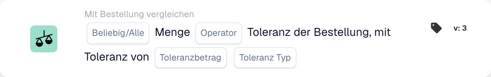
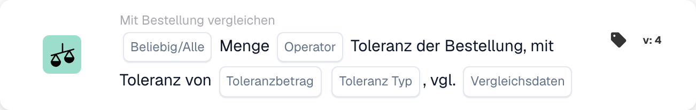

# Beliebige / Alle Menge

<figure><figcaption>
Kartenfelder in der angezeigten Version. Die Platzhalter sind noch nicht ausgefüllt.
</figcaption></figure>

<figure><figcaption>
Kartenfelder in der angezeigten Version. Die Platzhalter sind noch nicht ausgefüllt.
</figcaption></figure>

## **Zweck:**

Diese Workflow-Karte dient dazu, die Menge in einem Dokument mit der in der Bestellung definierten Toleranz zu vergleichen. Damit können Benutzer bewerten, ob die Menge bestimmte Bedingungen erfüllt, z. B. Gleichheit oder Überschreitung der angegebenen Toleranz. In Version 4 erweitert die Karte die Funktionalität um die Möglichkeit, mehrere Entitäten zu vergleichen, einschließlich der Bestellung, der eingegangenen Mengen und der Dokumentmengen, was eine größere Flexibilität bei der Handhabung verschiedener Szenarien bietet.

## **Bestandteile der Karte:**

1. **Alle / Alle:**
   * **Beschreibung**: Gibt an, wie der Vergleich auf mehrere Elemente oder Bedingungen angewendet werden soll.
   * **Optionen**:
     * **Any**: Mindestens eine der Bedingungen muss wahr sein, damit die Aktion ausgelöst wird.
     * **Alle**: Alle Bedingungen müssen wahr sein, damit die Aktion fortgesetzt werden kann.
2. **Operator:**
   * **Beschreibung**: Definiert die Bedingung, die angewendet wird, um die Dokumentmenge mit der angegebenen Toleranz zu vergleichen.
   * **Optionen**:
     * **Gleich (=)**: Prüft, ob die Menge mit dem angegebenen Toleranzwert übereinstimmt.
     * **Ungleich (≠)**: Stellt sicher, dass die Menge vom angegebenen Toleranzwert abweicht.
     * **Größer als (>)**: Überprüft, ob die Menge größer als die angegebene Toleranz ist.
     * **Größer oder gleich (≥)**: Prüft, ob die Menge größer oder gleich der angegebenen Toleranz ist.
     * **Kleiner als (<)**: Überprüft, ob die Menge kleiner als die angegebene Toleranz ist.
     * **Kleiner oder gleich (≤)**: Prüft, ob die Menge kleiner oder gleich der angegebenen Toleranz ist.
3. **Toleranzbetrag:**
   * **Beschreibung**: Gibt den Toleranzwert an, mit dem die Dokumentmenge verglichen wird.
   * **Detailliert**: Dieser Wert ist numerisch und stellt den Schwellenwert der zulässigen Abweichung in der Menge dar
4. **Toleranztyp:**
   * **Beschreibung**: Definiert die Art der Toleranz, die angewendet wird.
   * **Optionen**:
     * **Prozentsatz**: Die Toleranz wird als Prozentsatz der Bestellmenge berechnet.
     * **Wert**: Die Toleranz wird als fester numerischer Wert angegeben.

## **Zusätzliche Komponenten in Version 4:**

* **Vergleichstyp**: Wählt die zu vergleichenden Entitäten aus und bietet so mehr Flexibilität bei der Auswertung der Mengen in Version 4.
  * **Bestellung zum Dokument**: Vergleicht die Menge in der Bestellung mit der Menge im zugehörigen Dokument.
  * **Als Dokument erhalten**: Vergleicht die empfangene Menge mit der Menge im Dokument.
  * **Bestellung zu erhalten**: Vergleicht die Bestellmenge mit der erhaltenen Menge.

## **Funktionalität:**

* **Bedingungsauswertung:** Das System vergleicht die Menge im Dokument mit der Toleranz in der Bestellung basierend auf dem ausgewählten Bediener und der Toleranzmenge/-art. In Version 4 ermöglicht der **Vergleichstyp** den Vergleich verschiedener Mengen, z. B. Bestellung mit Eingang oder Bestellung mit Dokument, was einen dynamischeren Vergleich ermöglicht.
* **Aktionsausführung:**
  * **True-Bedingung**: Wenn der Vergleich „True“ ergibt (z. B. die Dokumentmenge liegt innerhalb des akzeptablen Toleranzbereichs), wird der Workflow fortgesetzt.
  * **Falsche Bedingung**: Wenn der Vergleich ein falsches Ergebnis ergibt (z. B. die Menge entspricht nicht der Toleranz), wird der Workflow nicht fortgesetzt.

## **Einrichtung und Konfiguration:**

**Version 3:**

* Benutzer konfigurieren die Karte, indem sie die Dokumentmenge auswählen, den Toleranzbetrag und den Toleranztyp definieren und den entsprechenden Operator auswählen, um die Menge mit der Toleranz zu vergleichen. Die Karte prüft, ob die Menge innerhalb der Toleranzschwelle liegt und führt je nach Ergebnis die Aktion „Wahr“ oder „Falsch“ aus.

**Version 4:**

* Zusätzlich zur Konfiguration in Version 3 können Benutzer den **Vergleichstyp** auswählen, der Vergleiche zwischen verschiedenen Entitäten ermöglicht, wie zum Beispiel:
  * **Bestellung zum Dokument**
  * **Als Dokument erhalten**
  * **Bestellung bis Eingang**

## **Beispielszenario:**

Aus einer Rechnung geht hervor, dass 100 Einheiten geliefert wurden, in der Bestellung wurden jedoch nur 90 Einheiten genehmigt. Der Toleranzbetrag ist auf 10 Einheiten festgelegt und der Toleranztyp ist absolut.

* **Version 3**: Die Karte vergleicht die 100 Einheiten im Dokument mit der Toleranz der Bestellung von 90 Einheiten. Wenn die Menge die Toleranz überschreitet, markiert die Karte die Abweichung zur weiteren Überprüfung.
* **Version 4**: Die Karte könnte die **Bestellmenge** (90 Einheiten) mit der **erhaltenen Menge** (100 Einheiten) oder der **Dokumentenmenge** (100 Einheiten) vergleichen. Abhängig vom ausgewählten **Vergleichstyp** prüft es, ob die Differenz zwischen den beiden Einheiten die Toleranz überschreitet und löst die entsprechende Aktion aus.

## **Fazit:**

* **Version 3**: Diese Workflow-Karte vergleicht die Dokumentmenge mit der Bestelltoleranz und trägt so dazu bei, dass Mengenabweichungen gekennzeichnet und angemessen behandelt werden.
* **Version 4**: Erweitert diese Funktionalität, indem es Benutzern ermöglicht, verschiedene Entitäten zu vergleichen, z. B. Bestellung mit Eingang oder Bestellung mit Dokument, was eine größere Flexibilität bei der Handhabung komplexerer Szenarien bietet. Version 4 sorgt für eine strengere Kontrolle der Beschaffungs- und Empfangsabläufe und bietet dynamischere Vergleiche und Aktionen basierend auf dem gewählten Vergleichstyp.

Siehe [Vergleichsrichtung, Toleranzbasis und gespeicherte Kartenversionen](../../cards-overview/po-comparison-versions-guide.md), bevor Sie die Vergleichsseiten ändern.
