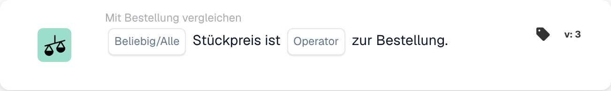
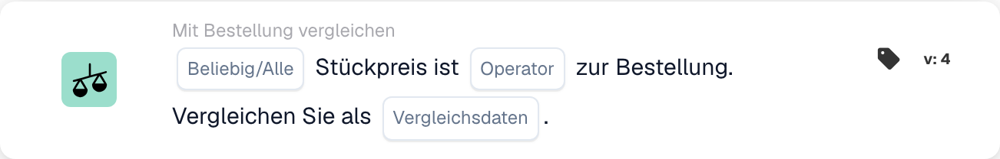

# Beliebige oder alle Stückpreise vergleichen

<figure><figcaption>
Kartenfelder in der angezeigten Version. Die Platzhalter sind noch nicht ausgefüllt.
</figcaption></figure>

<figure><figcaption>
Kartenfelder in der angezeigten Version. Die Platzhalter sind noch nicht ausgefüllt.
</figcaption></figure>

## **Zweck:**

Diese Workflow-Karte wird verwendet, um den Stückpreis in einem Dokument mit dem Stückpreis in einer Bestellung zu vergleichen und sicherzustellen, dass die Preise innerhalb definierter Toleranzgrenzen liegen. Der Vergleich kann Maßnahmen auslösen, wenn der Stückpreis nicht den Erwartungen entspricht. **Version 4** bietet mehr Flexibilität, indem es Benutzern ermöglicht, verschiedene Einheiten zum Vergleich auszuwählen, was eine tiefere Kontrolle über Preis- und Beschaffungsprozesse bietet.

## **Bestandteile der Karte:**

1. **Alle / Alle:**
   * **Beschreibung**: Definiert, ob die Bedingung für einige oder alle Fälle gilt, in denen der Stückpreis verglichen wird.
   * **Optionen**:
     * **Any**: Die Bedingung ist erfüllt, wenn ein Stückpreis die angegebene Vergleichsbedingung erfüllt.
     * **Alle**: Die Bedingung ist nur erfüllt, wenn alle Einzelpreise die angegebene Vergleichsbedingung erfüllen.
2. **Operator:**
   * **Beschreibung**: Definiert die Bedingung für den Vergleich des Stückpreises mit dem angegebenen Wert.
   * **Optionen**:
     * **Gleich (=)**: Überprüft, ob der Stückpreis mit dem angegebenen Wert übereinstimmt.
     * **Ungleich (≠)**: Stellt sicher, dass der Stückpreis vom angegebenen Wert abweicht.
     * **Größer als (>)**: Überprüft, ob der Stückpreis größer als der angegebene Wert ist.
     * **Größer oder gleich (≥)**: Überprüft, ob der Stückpreis größer oder gleich dem angegebenen Wert ist.
     * **Kleiner als (<)**: Überprüft, ob der Stückpreis unter dem angegebenen Wert liegt.
     * **Kleiner oder gleich (≤)**: Überprüft, ob der Stückpreis kleiner oder gleich dem angegebenen Wert ist.

## **Zusätzliche Komponenten in Version 4:**

**Vergleichstyp:**

* **Beschreibung**: Ermöglicht Benutzern die Auswahl der zu vergleichenden Einheiten zusätzlich zum Stückpreis.
* **Optionen**:
  * **Bestellung zum Dokument**: Vergleicht den Stückpreis in der Bestellung mit dem Stückpreis im Dokument.
  * **Als Dokument erhalten**: Vergleicht den aus der abgeglichenen Bestellung abgeleiteten eingangsseitigen Betrag mit dem dokumentseitigen Betrag.
  * **Bestellung auf Empfangen umstellen**: Vergleicht die Bestellseite mit dem abgeleiteten Betrag auf der Empfangsseite.

## **Funktionalität:**

* **Bedingungsauswertung:** Das System vergleicht den Stückpreis im Dokument mit dem Stückpreis in der Bestellung (oder einer anderen ausgewählten Entität in Version 4) basierend auf dem ausgewählten Operator. Wenn der Vergleich wahr ist, fährt der Workflow mit den nächsten Schritten fort und löst entweder die Genehmigung aus oder stoppt den Prozess.
* **Aktionsausführung:**
  * **Wahre Bedingung**: Wenn die Bedingung als wahr ausgewertet wird (z. B. der Stückpreis im Dokument ist größer als der angegebene Wert), fährt der Workflow mit der wahren Aktion fort (z. B. Genehmigung, Dokumentverarbeitung).
  * **Falsche Bedingung**: Wenn die Bedingung als falsch ausgewertet wird (z. B. der Stückpreis im Dokument entspricht nicht dem Vergleich), wird der Workflow nicht fortgesetzt.

## **Einrichtung und Konfiguration:**

* **Version 3-Setup:** Benutzer konfigurieren die Karte, indem sie den Einheitspreis im Dokument auswählen, den entsprechenden Operator auswählen, um zu definieren, wie der Einheitspreis mit dem angegebenen Wert verglichen wird, und den Vergleichswert festlegen. Darüber hinaus wählen Benutzer aus, ob die Bedingung für einige oder alle Instanzen des Einzelpreisvergleichs gilt.
* **Version 4-Setup:** In Version 4 haben Benutzer die zusätzliche Option, den Vergleichstyp auszuwählen. Auf diese Weise können sie die zu vergleichenden Entitäten definieren, z. B. Bestellung mit Dokument, Eingang mit Dokument oder Bestellung mit Eingang. Dies erhöht die Flexibilität der Karte beim Vergleich von Stückpreisen in komplexeren Szenarien.

## **Beispielszenario:**

*   **Version 3 Beispiel:**

    Eine Rechnung weist einen Stückpreis von 50 $ aus. Die zugehörige Bestellung hat einen Stückpreis von 45 $. Die Karte vergleicht die beiden Einheitspreise mithilfe des Operators „Größer als“. Da der Stückpreis im Dokument (50 $) höher ist als der Stückpreis in der Bestellung (45 $), löst der Workflow die wahre Bedingung aus (z. B. das Dokument zur Überprüfung senden).
* **Version 4 Beispiel:**\
  Eine Rechnung weist einen Stückpreis von 50 $ aus und die zugehörige Bestellung genehmigt einen Stückpreis von 45 $. Darüber hinaus beträgt die erhaltene Menge 60 Einheiten. Die Karte vergleicht die erhaltene Menge mit dem Stückpreis des Dokuments mithilfe des Operators „Größer als“. Da die erhaltene Menge (60) größer ist als der Stückpreis (50 $), löst der Workflow die wahre Bedingung aus und das Dokument wird zur weiteren Prüfung markiert.

## **Fazit:**

Version 3 der Workflow-Karte „Einzelpreisvergleich“ soll sicherstellen, dass die Einzelpreise in Dokumenten mit denen in Bestellungen übereinstimmen und Aktionen basierend auf definierten Bedingungen ausgelöst werden. Version 4 erweitert diese Funktionalität durch die Einführung komplexerer Vergleichsoptionen, wie z. B. den Vergleich von Bestellungen mit Dokumenten, eingegangenen Mengen mit Dokumenten und Bestellungen mit eingegangenen Mengen. Diese zusätzliche Flexibilität ermöglicht es Unternehmen, anspruchsvollere Preis- und Beschaffungsszenarien zu bewältigen und so die Kontrolle und Genauigkeit ihrer Arbeitsabläufe zu verbessern.

## Version 5 und Vergleichsrichtung

Version 5 umfasst „Alle/Alle“, „Operator“, „Toleranzbetrag“, „Toleranztyp“ und „Vergleichsseitenauswahl“. Neuere Versionen bieten beide Richtungen des Dokumentenvergleichs, Bestell- und Empfangsdatenvergleiche. Die Referenzseite bestimmt die Basis einer prozentualen Toleranz. Siehe [PO-Vergleichsversionen](../../cards-overview/po-comparison-versions-guide.md) für alle sechs Optionen, Migration gespeicherter Karten und Testbeispiele.
