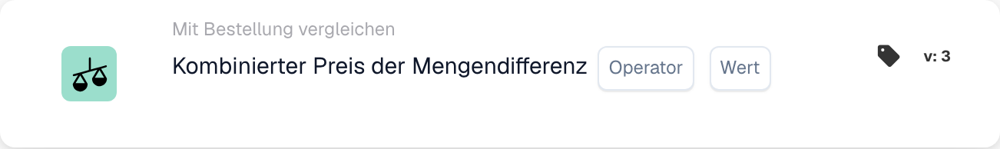
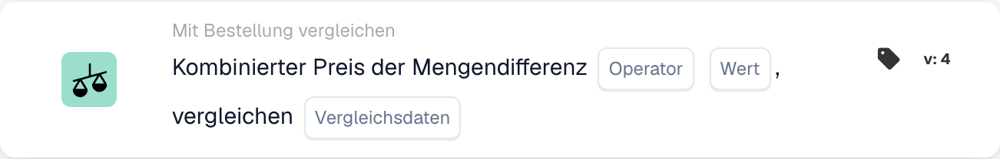

# Kombinierter Preis der Mengendifferenz

<figure><figcaption>
Kartenfelder in der angezeigten Version. Die Platzhalter sind noch nicht ausgefüllt.
</figcaption></figure>

<figure><figcaption>
Kartenfelder in der angezeigten Version. Die Platzhalter sind noch nicht ausgefüllt.
</figcaption></figure>

## **Zweck**:

Diese Workflow-Karte wertet den Gesamtpreis einer Mengendifferenz aus und vergleicht ihn mit einem angegebenen Wert. Es hilft, Aktionen auf der Grundlage von Preis- und Mengenabweichungen in zugehörigen Dokumenten zu automatisieren und so die Beschaffungs- und Empfangsabläufe zu verbessern. **Version 4** erweitert diese Funktionalität, indem es Vergleiche zwischen verschiedenen Einheiten wie der Bestellung, eingegangenen Mengen und dem Dokument selbst ermöglicht, was dem Arbeitsablauf mehr Flexibilität und Kontrolle verleiht.

## **Bestandteile der Karte**:

1. **Operator**:
   * **Beschreibung:** Die Bedingung für den Vergleich des kombinierten Preises mit einem angegebenen Wert.
   * **Optionen:**
     * **Gleich (=)**: Prüft, ob der kombinierte Preis mit dem angegebenen Wert übereinstimmt.
     * **Ungleich (≠)**: Stellt sicher, dass der kombinierte Preis vom angegebenen Wert abweicht.
     * **Größer als (>)**: Überprüft, ob der kombinierte Preis größer als der angegebene Wert ist.
     * **Größer oder gleich (≥)**: Prüft, ob der kombinierte Preis größer oder gleich dem angegebenen Wert ist.
     * **Kleiner als (<)**: Überprüft, ob der Gesamtpreis unter dem angegebenen Wert liegt.
     * **Kleiner oder gleich (≤)**: Prüft, ob der kombinierte Preis kleiner oder gleich dem angegebenen Wert ist
2. **Wert**:
   * **Beschreibung:** Gibt den Wert an, mit dem der kombinierte Preis- und Mengenwert verglichen wird.
   * **Detail:** Der Wert muss ein numerischer Wert sein.

## **Zusätzliche Komponenten in Version 4**:

* **Vergleichstyp**: Wählt die zu vergleichenden Entitäten aus. Zu den Optionen gehören:
  * **Bestellung mit Dokument**: Vergleicht die Mengen und Preise zwischen der Bestellung und dem zugehörigen Dokument.
  * **Als Dokument erhalten**: Vergleicht die empfangenen Mengen mit den Mengen im Dokument.
  * **Bestellung zu erhalten**: Vergleicht die Bestellmengen mit den erhaltenen Mengen.

## **Funktionalität**:

* **Bedingungsbewertung**: Berechnet den kombinierten Preis durch Multiplikation der Mengendifferenz mit dem Preis pro Einheit und vergleicht ihn mit dem angegebenen Wert unter Verwendung des ausgewählten Operators.\
  **Version 4** fügt die Option hinzu, zusätzliche Entitäten basierend auf der Konfiguration des Benutzers zu vergleichen, z. B. Bestellung mit Eingang oder Bestellung mit Dokument.
* **Aktionsausführung**: Basierend darauf, ob der kombinierte Preis die angegebene Bedingung erfüllt, wird der Workflow mit wahren oder falschen Bedingungen fortgesetzt, um Aktionen auszulösen oder den Workflow anzuhalten. **Version 4** ermöglicht auch eine dynamischere Aktionsausführung, bei der der Bedingungstyp (z. B. Bestellung bis Eingang) Einfluss auf den nächsten Schritt hat.

## **Einrichtung und Konfiguration**:

* **Version 3**: Benutzer konfigurieren die Karte, indem sie die Dokumentfelder für die Mengendifferenz und den Preis pro Einheit auswählen. Anschließend wird der Operator ausgewählt, um zu definieren, wie der kombinierte Preis mit dem angegebenen Wert verglichen wird. Schließlich legen Benutzer die Fortsetzungsbedingung (wahr oder falsch) fest, die den nächsten Schritt im Workflow vorgibt.
* **Version 4**: Zusätzlich zur Konfiguration in **Version 3** haben Benutzer eine zusätzliche Möglichkeit, den **Vergleichstyp** zu konfigurieren. Dies definiert, welche Entitäten verglichen werden, z. B. **Bestellung zum Dokument**, **Als Dokument erhalten** oder **Bestellung auf Empfangen umstellen**.

## **Beispielszenario**:

* Auf einer Rechnung sind 50 Einheiten eines Produkts zu je 100 US-Dollar ausgewiesen, also insgesamt 5.000 US-Dollar. Die zugehörige Bestellung genehmigte einen Kauf von 4500 US-Dollar für 45 Einheiten. Der Mengenunterschied beträgt 5 Einheiten und der Gesamtpreis der Differenz beträgt 500 $. Die Karte vergleicht die Bestellmenge (45 Einheiten) mit der erhaltenen Menge (50 Einheiten) und prüft, ob der Gesamtpreis mehr als 400 $ (der angegebene Wert) beträgt. Mithilfe des Operators **Größer als (>)** identifiziert die Karte die Diskrepanz und markiert sie zur Überprüfung durch das Finanzteam.

## **Fazit**:

**Version 3** der Workflow-Karte „Kombinierter Preis der Mengendifferenz“ bietet einen einfachen Ansatz zum Vergleichen von Mengenabweichungen und zum Auslösen von Aktionen basierend auf Preisschwellen.\
**Version 4** erweitert diese Funktionalität, indem es Vergleiche zwischen verschiedenen Entitäten (Bestellung, Eingang, Dokument) ermöglicht und so mehr Flexibilität und Kontrolle über den Arbeitsablauf bietet. Unternehmen können jetzt komplexere Szenarien automatisieren und eine strengere Kontrolle über ihre Beschaffungs- und Empfangsprozesse erzwingen.

Siehe [Vergleichsrichtung, Toleranzbasis und gespeicherte Kartenversionen](../../cards-overview/po-comparison-versions-guide.md), bevor Sie die Vergleichsseiten ändern.
