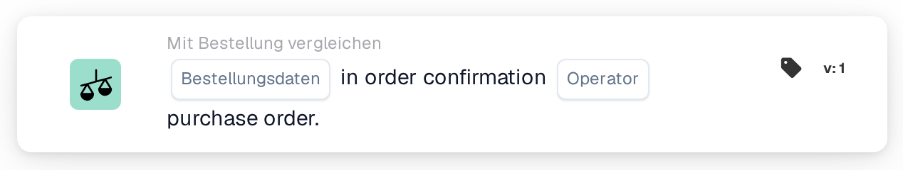
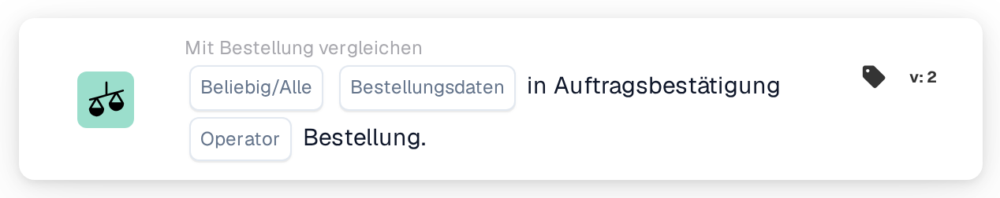
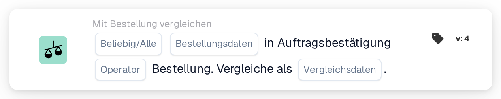

# Vergleichen Sie die Auftragsbestätigung mit der Bestellung

<figure><figcaption>
Version 1
</figcaption></figure>

<figure><figcaption>
Version 2
</figcaption></figure>

<figure><figcaption>
Version 3
</figcaption></figure>

<figure><figcaption>
Version 4
</figcaption></figure>

## Zweck:

Diese DocBits-Karte dient dazu, ein bestimmtes Bestelldatenfeld – wie Menge, Rabatt oder Stückpreis – zwischen einer Bestellbestätigung und einer Bestellung zu vergleichen. Indem es einen gezielten Vergleich jeweils eines Feldes ermöglicht, gewährleistet es eine präzise Validierung wichtiger Datenpunkte und sorgt für die Beibehaltung der Auftragsgenauigkeit. **Version 4** erweitert diese Funktionalität, indem es Vergleiche zwischen verschiedenen Einheiten wie der Bestellung, eingegangenen Mengen und dem Dokument selbst ermöglicht, was dem Arbeitsablauf mehr Flexibilität und Kontrolle verleiht.

## Bestandteile der Karte:

1. **Alle/Alle**
   * **Beschreibung:** Legt fest, ob die Bedingung für eine oder alle Zeilen in der Auftragsbestätigung gilt.\
     **Optionen:**
     * **Any**: Der Vergleich wird ausgelöst, wenn der ausgewählte Feldwert in einer Zeile der Bestellbestätigung mit dem entsprechenden Wert in der Bestellung übereinstimmt.
     * **Alle**: Der Vergleich wird nur ausgelöst, wenn der ausgewählte Feldwert in allen Zeilen der Bestellbestätigung mit dem entsprechenden Wert in der Bestellung übereinstimmt.
2. **Bestelldatenfeld**
   * **Beschreibung**: Gibt das Datenfeld an, das zwischen der Auftragsbestätigung und der Bestellung verglichen werden soll.
   * **Detailliert**: Benutzer können eines der folgenden Felder zum Vergleich auswählen:
     * **Menge**: Vergleicht die bestellte Menge mit der bestätigten Menge.
     * **Rabatt**: Überprüft, ob der Rabatt in der Bestätigung mit der Bestellung übereinstimmt.
     * **Stückpreis**: Stellt sicher, dass der Stückpreis in der Bestätigung mit der Bestellung übereinstimmt.
3. **Operator**
   * **Beschreibung**: Definiert die Bedingung, die auf den Vergleich des ausgewählten Datenfelds angewendet wird.
   * **Optionen**:
     * **Gleich (=)**: Bestätigt, dass der Wert mit der Bestellung übereinstimmt.
     * **Ungleich (≠)**: Stellt sicher, dass sich der Wert von der Bestellung unterscheidet.
     * **Größer als (>)**: Überprüft, ob der Wert den Wert der Bestellung übersteigt.
     * **Größer oder gleich (≥)**: Bestätigt, dass der Wert dem Wert der Bestellung entspricht oder diesen überschreitet.
     * **Kleiner als (<)**: Prüft, ob der Wert unter dem Bestellwert liegt.
     * **Kleiner oder gleich (≤)**: Bestätigt, dass der Wert unter dem Wert der Bestellung liegt oder diesem entspricht.

## **Zusätzliche Komponenten in Version 4**:

* **Vergleichstyp**: Wählt die zu vergleichenden Entitäten aus. Zu den Optionen gehören:
  * **Bestellung zum Dokument**: Vergleicht die Bestelldaten mit dem zugehörigen Dokument.
  * **Als Dokument erhalten**: Vergleicht die empfangenen Daten (z. B. eingegangene Mengen) mit dem Dokument.
  * **Bestellung auf Empfangen umstellen**: Vergleicht die Bestelldaten mit den eingegangenen Mengen.

## Funktionalität:

* **Feldvergleich**: Das System vergleicht das ausgewählte Bestelldatenfeld (Stückpreis, Rabatt oder Menge) aus der Bestellbestätigung mit dem entsprechenden Wert in der Bestellung.
* **Aktionsausführung**: Basierend auf dem Vergleichsergebnis und der Bedienerbedingung kann die Karte Folgeaktionen wie Benachrichtigungen oder Alarme auslösen.

## Beispielszenario:

* In einer Auftragsbestätigung ist ein **Stückpreis** von 50 $ angegeben, während in der Bestellung 45 $ angegeben sind. Mithilfe des „Größer als“-Operators markiert die Karte die Diskrepanz, sodass das Beschaffungsteam sie vor der Verarbeitung beheben kann.

## Fazit:

Diese Karte vereinfacht die Validierung einzelner Bestelldatenfelder und stellt so die Einhaltung der Bestellbedingungen sicher. Durch die Isolierung einzelner Felder zum Vergleich werden gezielte Überprüfungen und Fehlervermeidung bei der Auftragsabwicklung unterstützt.

Siehe [Vergleichsrichtung, Toleranzbasis und gespeicherte Kartenversionen](../../cards-overview/po-comparison-versions-guide.md), bevor Sie die Vergleichsseiten ändern.
