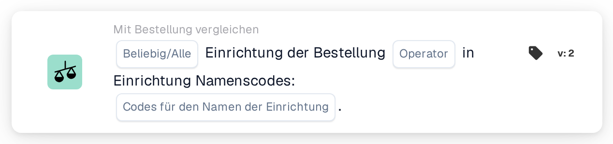

# Einrichtung der Bestellung

<figure><figcaption>
Version 2
</figcaption></figure>

## Zweck:

Diese Workflow-Karte prüft die Einrichtung der einem Dokument zugeordneten Bestellungen gegen eine Liste von Einrichtungscodes. Sie kann verwendet werden, um Dokumente je nach der Einrichtung (dem Standort), für die bestellt wurde, unterschiedlich zu behandeln, zum Beispiel um sie an das für diese Einrichtung zuständige Team weiterzuleiten.

Der Bestellabgleich sollte vor dieser Karte laufen. Ohne zugeordnete Bestellung meldet die Karte fehlende Daten.

## Bestandteile der Karte:

1. **Beliebig/Alle**
   * **Beschreibung:** Wie die Einrichtungscodes der zugeordneten Bestellungen gegen die Liste ausgewertet werden.
   * **Optionen:**
     * **Irgendeine:** Mindestens eine zugeordnete Bestellung erfüllt den Operator.
     * **Alle:** Jede zugeordnete Bestellung mit einer Einrichtung erfüllt den Operator. Ist kein Wert festgelegt, verwendet die Karte **Alle**.
2. **Operator**
   * **Beschreibung:** Ob die Einrichtung in der Liste stehen soll oder nicht.
   * **Optionen:**
     * **Ist**
     * **Ist nicht**
3. **Codes für den Namen der Einrichtung**
   * **Beschreibung:** Die Einrichtungscodes, mit denen die Einrichtung der Bestellung verglichen wird.
   * **Detail:** Es können mehrere Codes eingegeben werden, durch Kommas getrennt.

## Funktionalität:

* **Bedingungsauswertung:** Die Karte liest die dem Dokument zugeordneten Bestellnummern, lädt diese Bestellungen und sammelt die Einrichtung (den Standort) jeder einzelnen. Bestellungen ohne Einrichtung werden übersprungen. Die gesammelten Einrichtungscodes werden dann mit den **Codes für den Namen der Einrichtung** auf der Karte verglichen.
  * Ein Einrichtungscode gilt als aufgeführt, wenn er als Ganzes einem der eingegebenen Codes entspricht. Groß- und Kleinschreibung sowie Leerzeichen um die Einträge werden nicht beachtet, daher entspricht `wh01` dem Code `WH01`, `WH` aber nicht `WH01`.
  * Mit **Ist** erfüllt eine Bestellung die Bedingung, wenn ihr Einrichtungscode aufgeführt ist. Mit **Ist nicht** erfüllt sie die Bedingung, wenn ihr Einrichtungscode nicht aufgeführt ist.
  * Mit **Irgendeine** ist die Bedingung erfüllt, wenn mindestens eine Bestellung sie erfüllt, mit **Alle**, wenn jede Bestellung mit einer Einrichtung sie erfüllt.
  * Hat keine der zugeordneten Bestellungen eine Einrichtung, ist **Alle** erfüllt und **Irgendeine** nicht.
* **Ausführung der Aktion:**
  * **True-Bedingung:**\
    Ist die Bedingung erfüllt, wird der Workflow fortgesetzt, zum Beispiel mit einem Schritt, der speziell für die aufgeführten Einrichtungen gilt.
  * **False-Bedingung:**\
    Ist die Bedingung nicht erfüllt, stoppt der Workflow mit einer nicht erfüllten Bedingung.
* **Fehlende Daten:** Sind auf der Karte keine Einrichtungscodes eingegeben oder hat das Dokument keine zugeordnete Bestellung, wertet die Karte die Bedingung nicht aus und meldet die fehlenden Daten im Workflow-Protokoll.

## Einrichtung und Konfiguration:

* Die Karte kann als And-Bedingung nach dem Bestellabgleich aus der Kategorie **Mit Bestellung vergleichen** hinzugefügt werden. Danach können **Irgendeine** oder **Alle**, der Operator und die durch Kommas getrennten Einrichtungscodes festgelegt werden. Groß- und Kleinschreibung spielt keine Rolle, aber jeder Code sollte vollständig eingegeben werden, da Teile eines Codes nicht übereinstimmen.
* Mit **Testkarte** im Kartenmenü des Workflow Builders kann die Konfiguration an einem vorhandenen Dokument ausprobiert werden. Das Kartenprotokoll listet die zugeordneten Bestellungen, die darauf gefundenen Einrichtungscodes und die nicht zugeordneten Codes auf.

## Fazit:

Die Workflow-Karte „Facility of Purchase Order“ stellt die Einrichtung der bestellten Waren als Workflow-Bedingung zur Verfügung. So kann ein Workflow Dokumente für verschiedene Einrichtungen unterschiedlich behandeln, auf Basis der Bestelldaten statt dessen, was auf dem Dokument gedruckt ist.
