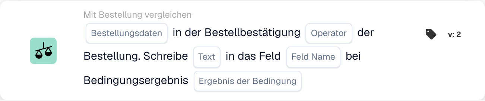

# Auftragsbestätigung und Bestellung vergleichen

Verwenden Sie **Mit Bestellung vergleichen** im Workflow-Builder, wenn eine Auftragsbestätigung gegen ihre Bestellung geprüft werden soll. Fügen Sie die Karte unter **Und...** hinzu und wählen Sie die Bestelldaten, einen Operator und das Verhalten bei einem Treffer. Die folgenden Abbildungen zeigen zwei verfügbare Kartenversionen in der deutschen Oberfläche. Ihre Felder sind noch Platzhalter; legen Sie sie für Ihren eigenen Workflow fest, bevor Sie speichern.

## Das Ergebnis in ein Feld schreiben

<figure><figcaption>
Kartenfelder in der angezeigten Version. Die Platzhalter sind noch nicht ausgefüllt.
</figcaption></figure>

Wählen Sie **Bestellungsdaten** aus der Auftragsbestätigung und einen **Operator** für den Vergleich mit der Bestellung. Geben Sie den **Text** ein, der geschrieben werden soll, wählen Sie das **Feld Name** und das **Ergebnis der Bedingung**, das das Schreiben auslösen soll.

## Die Daten vergleichen

<figure><figcaption>
Kartenfelder in der angezeigten Version. Die Platzhalter sind noch nicht ausgefüllt.
</figcaption></figure>

Wählen Sie **Beliebig/Alle**, um festzulegen, ob eine oder alle ausgewählten Bedingungen übereinstimmen müssen. Wählen Sie anschließend die **Bestellungsdaten**, den **Operator** und die **Vergleichsdaten** für den Bestellvergleich.

Die umgebenden Schritte finden Sie unter [Workflow](../..) und [Mit Bestellung vergleichen](.).

<!-- workflow-card-practical-example-20261021 -->

## Praxisbeispiel

**Verwendungszweck:** Vergleichen Sie eine Bestellbestätigung mit der verknüpften Bestellung.

**Konfiguration:** Verwenden Sie eine Demo-Bestellung und Bestätigung mit demselben Lieferanten, derselben Artikelreferenz und denselben Vergleichswerten. Wählen Sie die gewünschte Vergleichsrichtung und die Felder aus, die diese Version bietet.

**Erwartetes Ergebnis und Gegenbeispiel:** Der passende Vergleich ist erfolgreich. Ändern Sie einen verglichenen Elementwert in einem separaten Testfall und überprüfen Sie, ob er erkannt wird. Eine fehlende verknüpfte Bestellung ist ein separates Datenproblem.

Dies ist eine beispielhafte Konfiguration und ein erwartetes Ergebnis. Verwenden Sie in Ihrer Testorganisation konfigurierte Felder, Benutzer und Gruppen. Es wird nicht behauptet, dass dieses Beispiel ausgeführt wurde.
